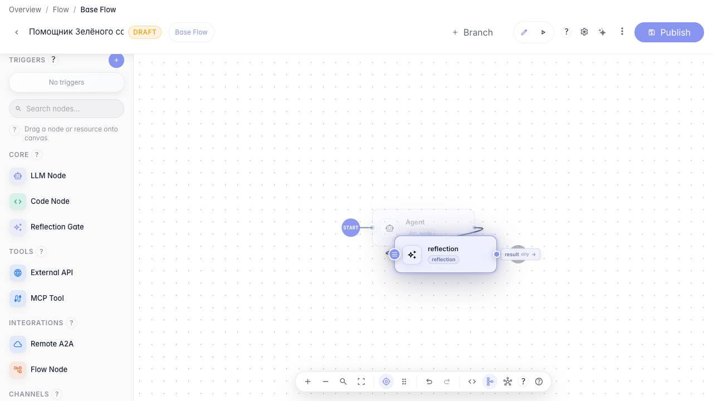
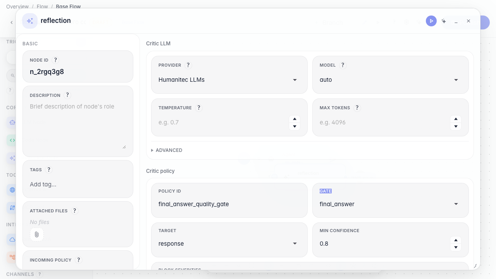
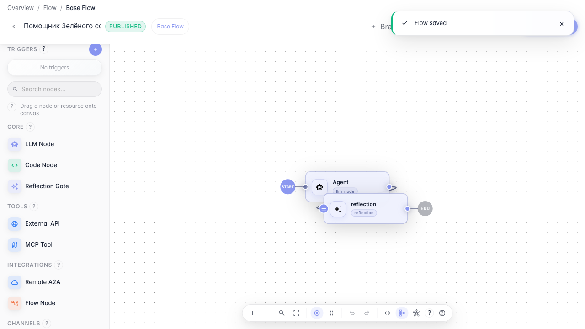

# Add an answer self-review

**What for:** this guide blocks giving the customer an answer that failed quality checks.

**Problems it solves:** the agent sometimes replies too vaguely — you need a self-review step before sending text.

**Result:** a reflection review node is wired after the main agent.

## Step 1. Add an answer review node

Drag a Review (reflection) node and open it. Here you set quality criteria and a confidence threshold before sending the reply.

## Step 2. Configure review criteria

Review the critic policy block: set minimum confidence and criteria that block the reply when quality is too low.

## Step 3. Publish the graph with review

**Result demonstration.** The self-review node is saved in the graph — weak answers can be rejected before reaching the customer.

**Summary.** You can add a reflection node and configure answer quality control.

