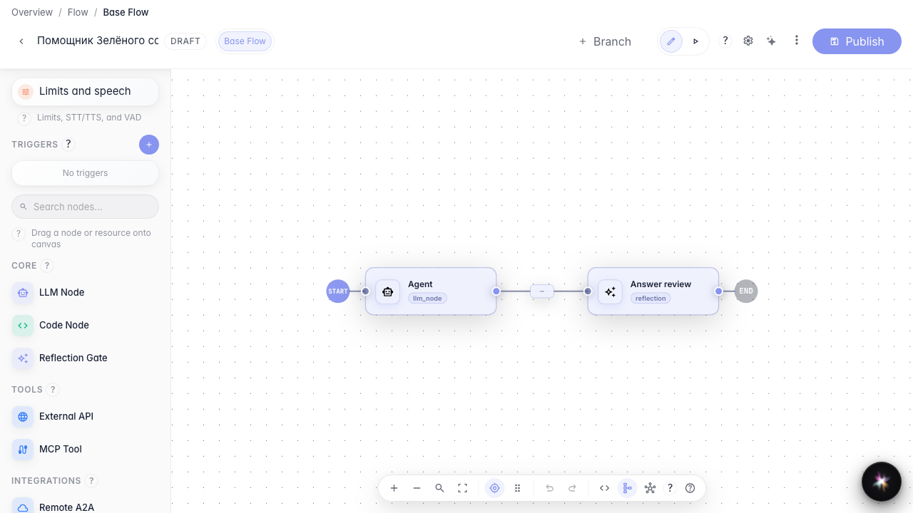
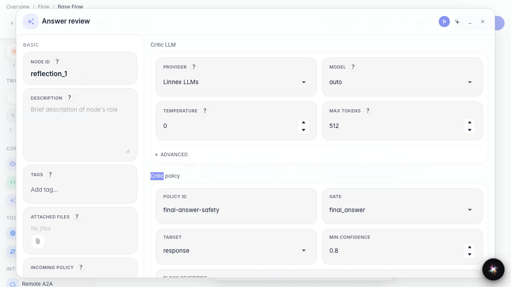
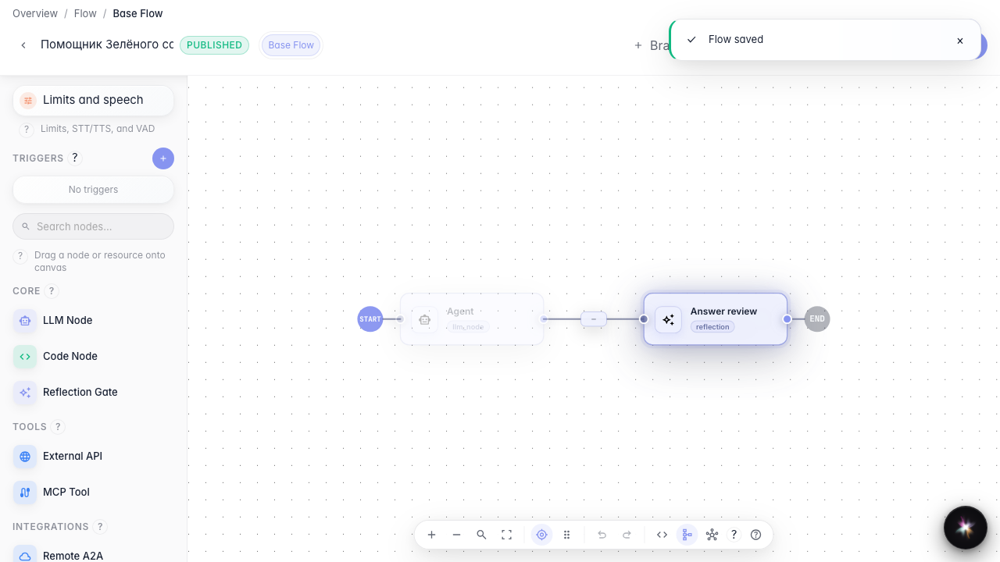

# Добавляем самопроверку ответа

**Для чего:** эта инструкция не даст отдать покупателю ответ, не прошедший проверку.

**Какие проблемы решает:** агент иногда отвечает слишком общо — нужен блок самопроверки перед выдачей текста.

**Результат:** нода проверки (reflection) подключена после основного агента.

## Шаг 1. Откройте граф с нодой проверки ответа

На канве после агента стоит нода «Проверка» (reflection), соединённая стрелкой. Ответ сначала проходит проверку, и только потом уходит покупателю.

## Шаг 2. Настройте критерии проверки

Откройте свойства ноды проверки: блок политики критика задаёт минимальную уверенность и критерии, при нарушении которых ответ не уйдёт покупателю.

## Шаг 3. Опубликуйте граф с проверкой

**Демонстрация результата.** Нода самопроверки сохранена в графе — слабый ответ можно отклонить до отправки покупателю.

**Итог.** Теперь вы умеете подключать reflection-ноду и настраивать контроль качества ответа.

