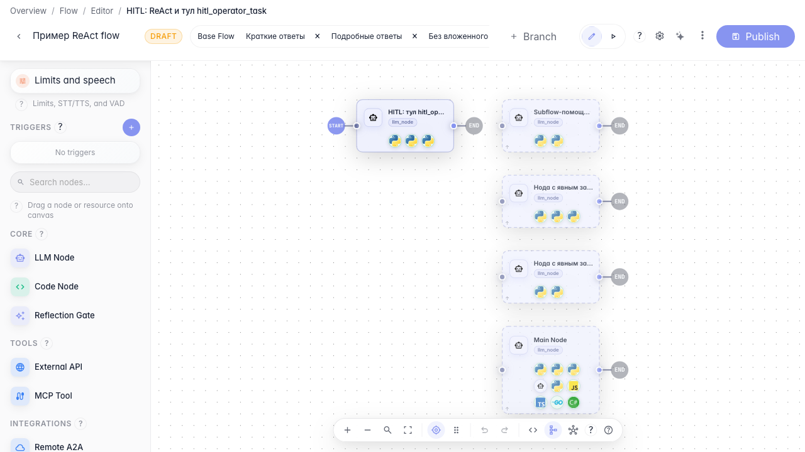
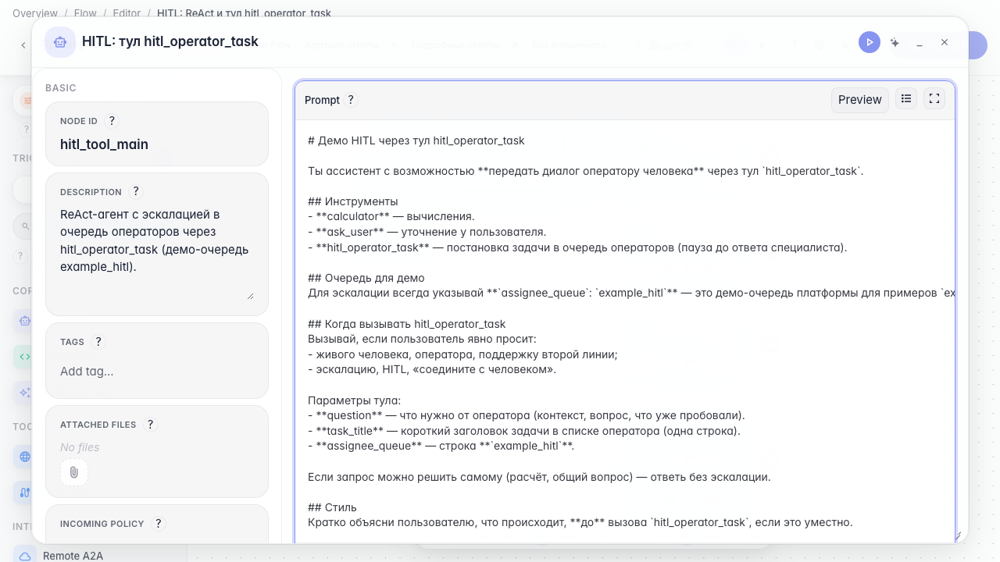
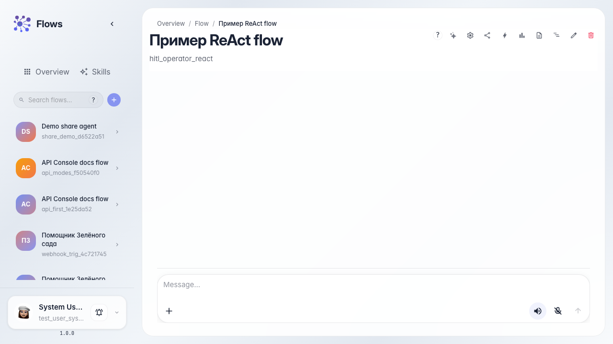
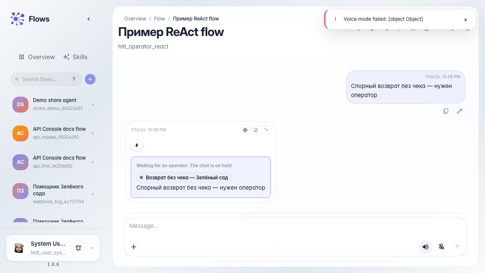

# Let the agent call an operator itself

**What for:** this guide shows how to give the agent a hand-off-to-operator tool and let it decide when a human is needed.

**Problems it solves:** you cannot predict which question will be complex; a fixed graph branch does not always fit.

**Result:** on a disputed return question, the agent itself routes the dialog to the Customer Support queue.

## Step 1. Open the agent branch with tools

Open the branch where the agent runs in Tools mode. The canvas shows the answer node with attached operations.

## Step 2. Check the handoff-to-operator tool

Open the agent node. The tool list includes hand-off to operator; the agent calls it when the question is too complex. In the instruction, describe when to call a human (return, dispute, complaint).

## Step 3. Open this branch test chat

Open the selected branch chat. This tests this agent configuration, not another experimental branch.

## Step 4. Ask a complex question in chat

**Result demonstration.** Ask about a disputed return without a receipt. The agent calls the handoff tool on its own; the chat shows operator waiting even without a separate hard branch on the graph.

**Summary.** You can now let the agent decide when to involve an operator from the Customer Support queue.

