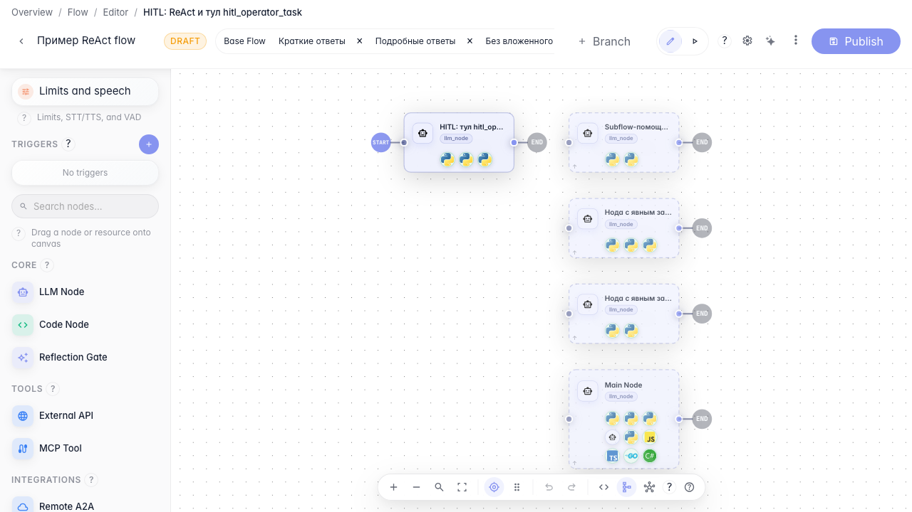
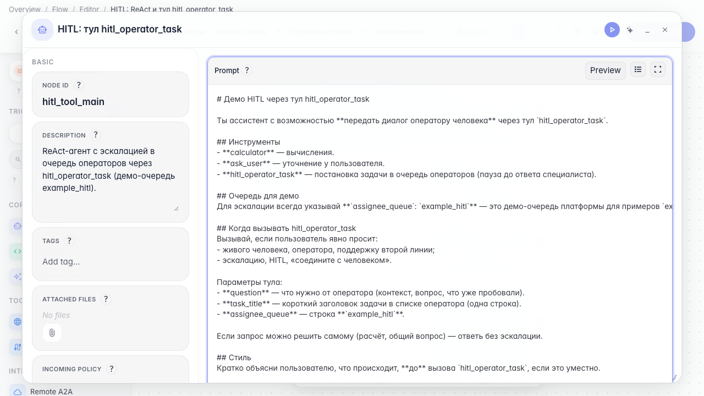
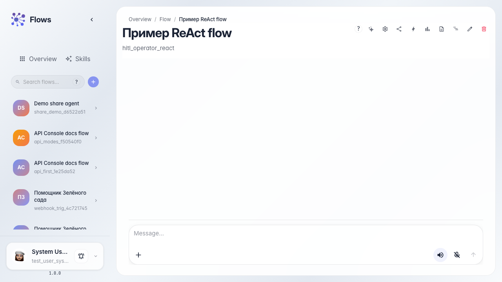
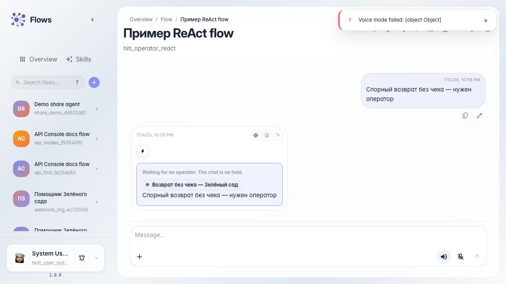

# Агент сам зовёт оператора

**Для чего:** эта инструкция покажет, как дать агенту инструмент «передать оператору» и позволить ему самому решать, когда нужен человек.

**Какие проблемы решает:** заранее неизвестно, какой вопрос окажется сложным — жёсткая развилка на графе срабатывает не всегда к месту.

**Результат:** при спорном вопросе о возврате агент сам передаёт диалог в очередь «Поддержка клиентов».

## Шаг 1. Откройте ветку агента с инструментами

Откройте ветку, где агент работает в режиме «Инструменты». На канве видна нода ответа с подключёнными операциями.

## Шаг 2. Проверьте инструмент передачи оператору

Откройте ноду агента. В списке инструментов есть «передать оператору» — агент вызывает его сам, когда вопрос слишком сложный. В инструкции опишите, при каких случаях звать человека (возврат, спор, жалоба).

## Шаг 3. Откройте тестовый чат этой ветки

Откройте чат выбранной ветки. Так вы проверяете поведение именно этой конфигурации агента, а не другой экспериментальной ветки.

## Шаг 4. Задайте сложный вопрос в чате

**Демонстрация результата.** Напишите про спорный возврат без чека. Агент сам вызывает инструмент передачи — в чате появляется ожидание оператора, хотя на графе нет отдельной жёсткой развилки.

**Итог.** Теперь вы умеете доверять агенту решение, когда подключать оператора из очереди «Поддержка клиентов».

