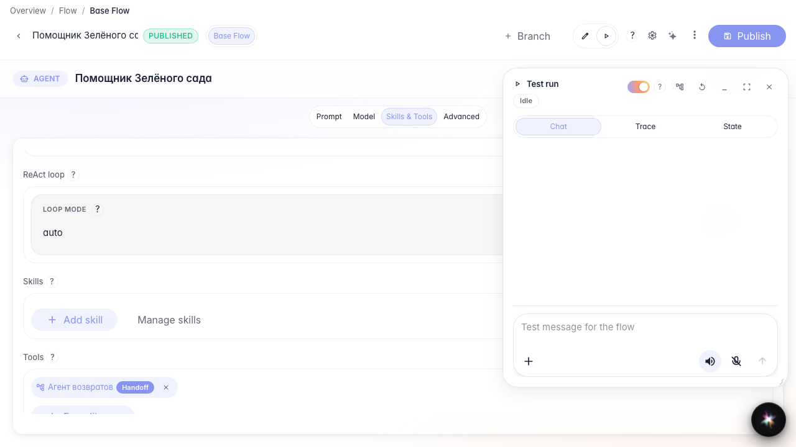
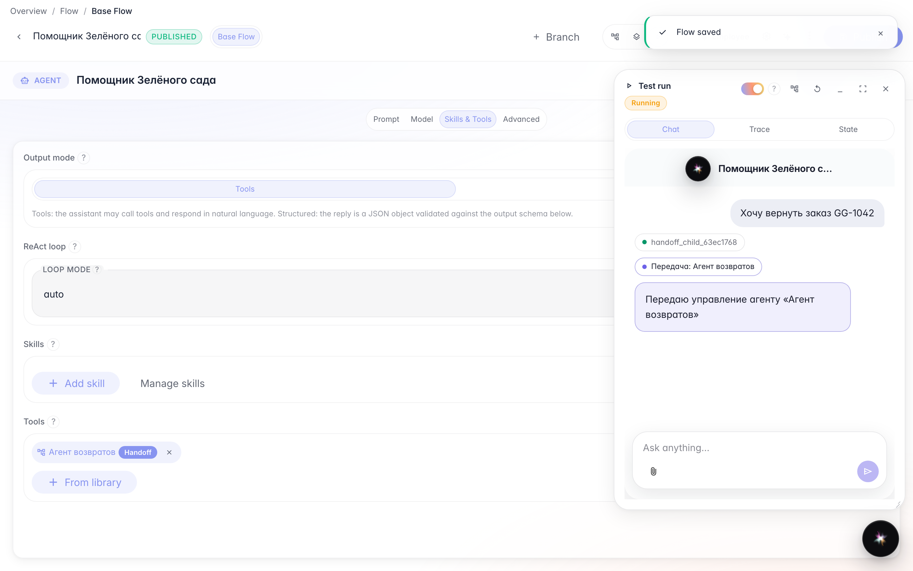
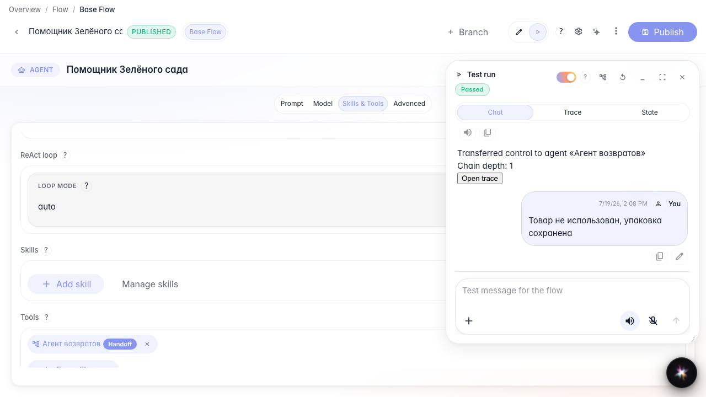
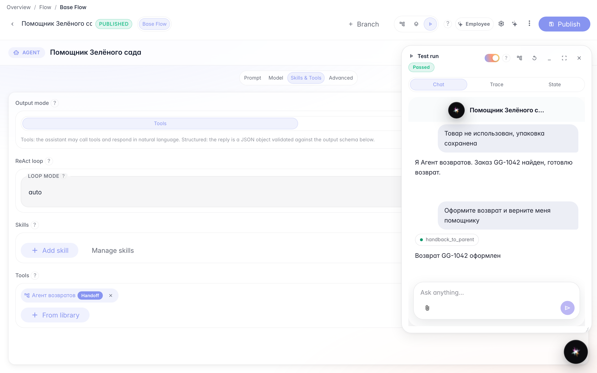
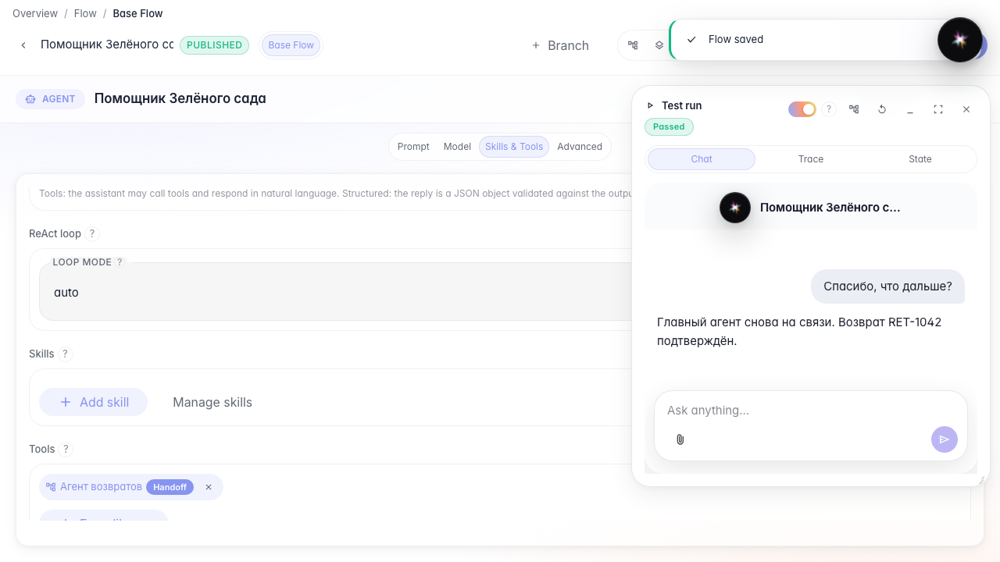

# Hand off the dialog between agents

**What for:** this guide demonstrates the complete agent collaboration cycle: handoff to a specialist and control returned to the parent.

**Problems it solves:** the main assistant should not handle every topic, and the user must always see who is replying.

**Result:** the real chat shows the transfer, a Returns Agent reply, handback, and the next reply from the main agent.

## Step 1. Add the returns agent as a tool

Open the main agent and add the returns sub-agent from the library. On this chip, **Call** invokes the sub-agent once and returns its result to the current agent; the main agent remains active.

## Step 2. Enable handoff mode

Click **Call** on the chip to switch it to **Handoff**, then describe when to transfer control. Following user turns are routed to the sub-agent. The current text and explicit variables are passed automatically; message history must be mapped separately when it is needed.

## Step 3. Publish and open Run mode

Publish the graph and switch to **Run**. The shared chat used on the agent page and in the embedded widget opens on the right.

## Step 4. Hand off the dialog to the specialist

## Step 5. Verify that the sub-agent is replying

The return sub-agent reply is visible in the feed. One Flow UI conversation keeps the full parent and child dialog.

## Step 6. Return control to the main agent

When the task is complete, the child calls **handback_to_parent**. The handback result appears in the feed. Only the result text and explicitly selected variables are returned — return_id in this example.

## Step 7. Verify the return to the main agent

**Result demonstration.** The next reply is again from the main agent. One feed shows the complete cycle: user → agent → handoff → sub-agent → handback → agent.

**Summary.** Use Call for a one-off invocation, Handoff to route following turns, and handback_to_parent to explicitly return control.

