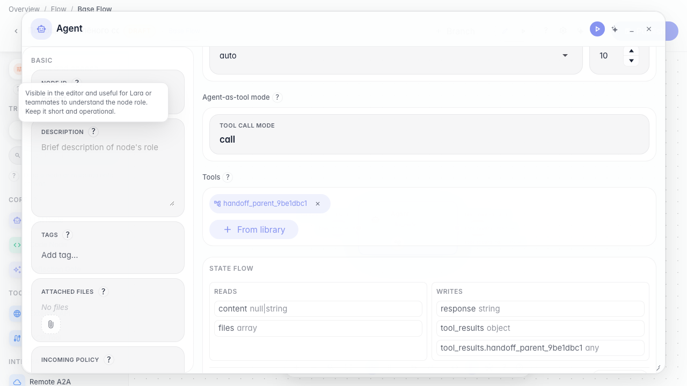
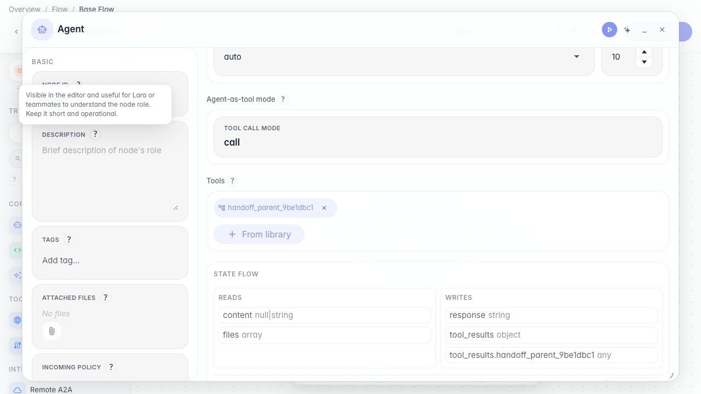
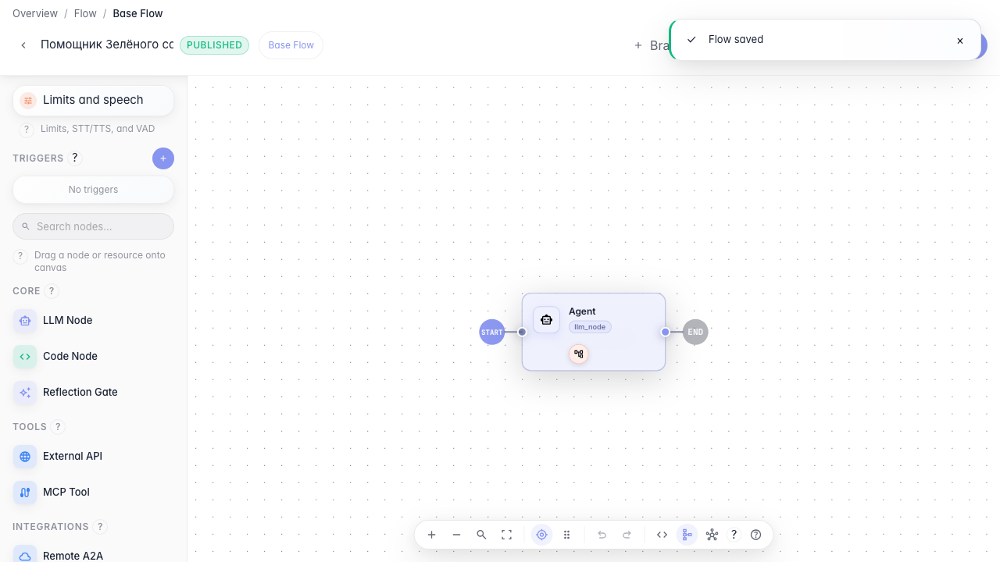

# Hand off the dialog between agents

**What for:** this guide hands the customer to a specialist agent, for example the Returns Agent.

**Problems it solves:** the main assistant should not handle every topic — complex cases go to a dedicated agent.

**Result:** the sub-agent tool uses handoff mode.

## Step 1. Add the returns agent as a tool

Open the main agent and add the returns sub-agent from the library. The orchestrator can then hand off the full dialog to it.

## Step 2. Enable handoff mode

In the call type block choose Handoff (ownership transfer). In this mode the sub-agent receives the full dialog, not a single request.

## Step 3. Publish the handoff setup

**Result demonstration.** The sub-agent tool is saved with handoff mode — the main agent can transfer the customer to the Returns Agent.

**Summary.** You can configure dialog handoff between agents without involving a human operator.

