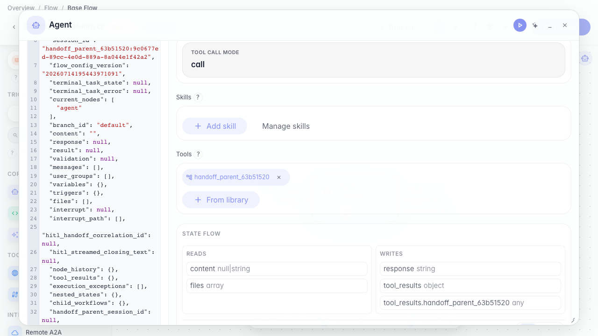
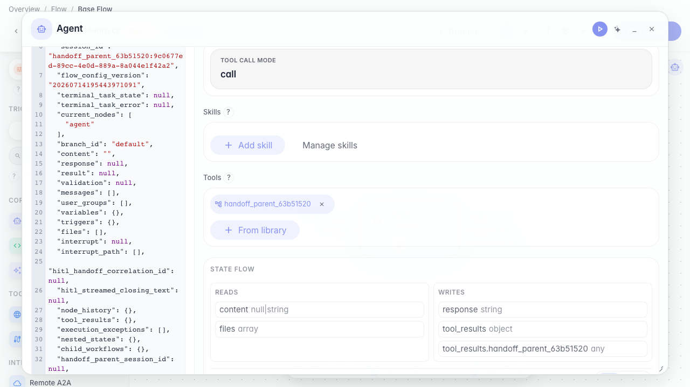
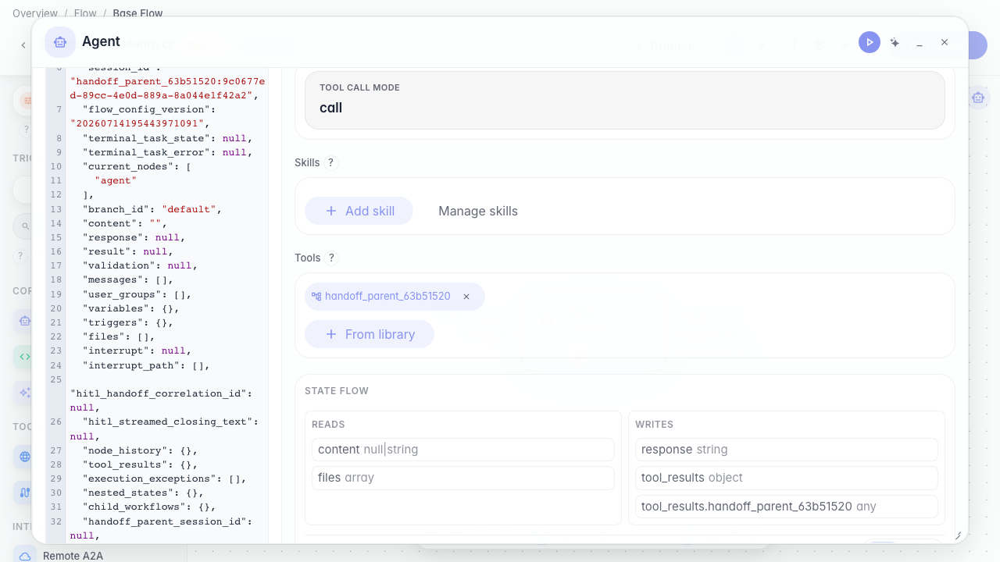
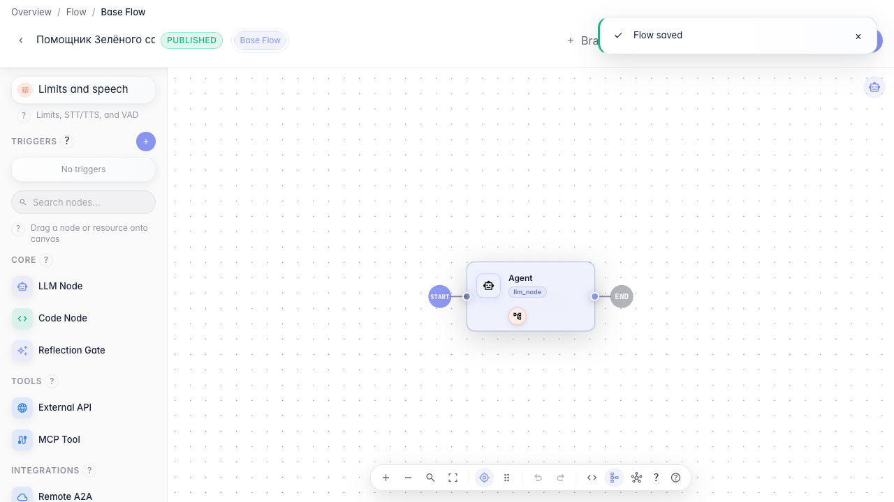

# Передаём диалог между агентами

**Для чего:** эта инструкция передаст покупателя профильному агенту, например «Агенту возвратов».

**Какие проблемы решает:** основной помощник не должен вести весь диалог сам — сложные темы лучше передать специалисту.

**Результат:** у инструмента под-агента включён режим handoff.

## Шаг 1. Добавьте агента возвратов как инструмент

Откройте главного агента и добавьте из библиотеки под-агента возвратов. Так оркестратор сможет передать ему диалог целиком.

## Шаг 2. Включите режим передачи управления

В блоке типа вызова выберите Handoff (передача управления). В этом режиме под-агент получает весь диалог, а не только один запрос.

## Шаг 3. Добавьте правило передачи в инструкцию

В инструкции агента опишите, когда передавать диалог агенту возвратов — например, при любом вопросе о возврате товара.

## Шаг 4. Опубликуйте настройку handoff

**Демонстрация результата.** Инструмент под-агента сохранён с режимом handoff — главный агент может передать покупателя «Агенту возвратов».

**Итог.** Теперь вы умеете настраивать передачу диалога между агентами без подключения оператора.

