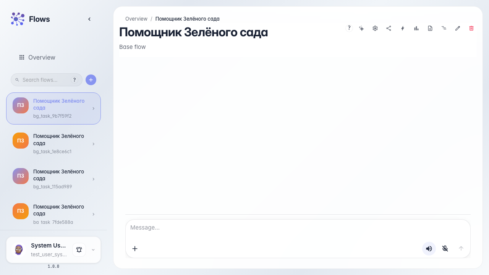
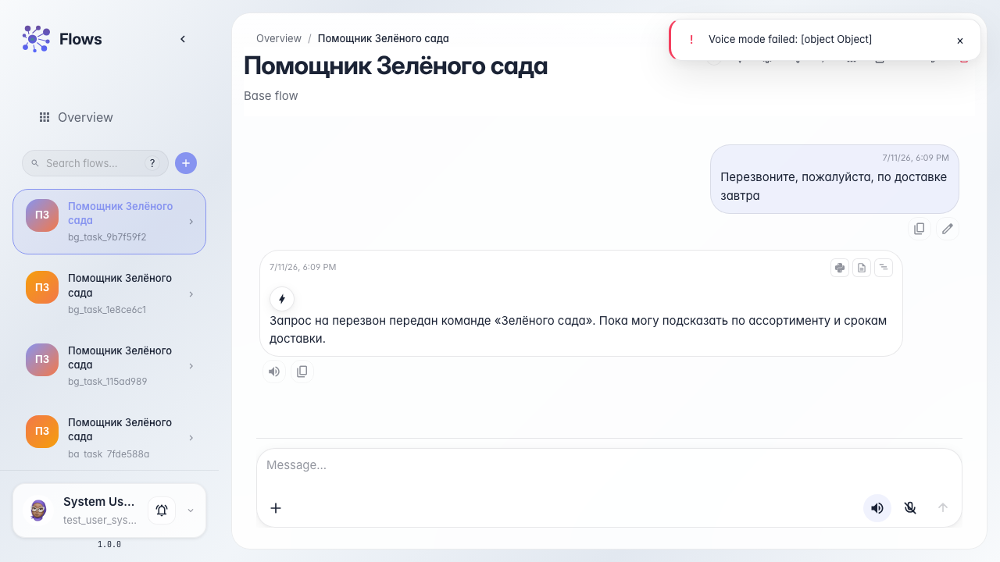
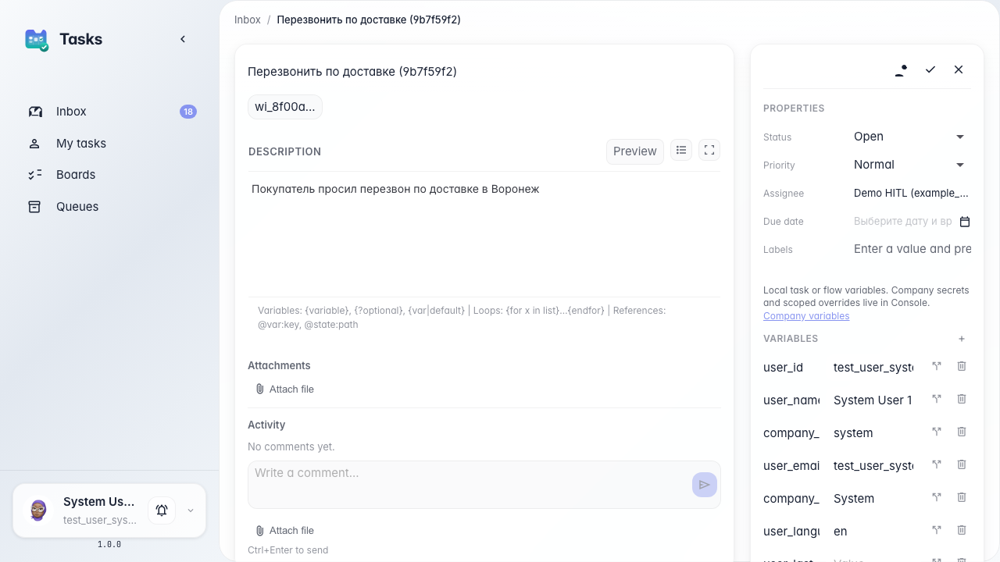

# Agent files a background task for the team

**What for:** this guide helps you teach the agent to create a task for people without stopping the customer dialog.

**Problems it solves:** a callback or stock check needs the team, but the customer should not wait on the line.

**Result:** the agent replies immediately while a background task appears in the Customer Support queue.

## Step 1. Open the agent chat with background tasks

Open the agent chat that has a non-blocking task creation tool. This lets the agent assign a callback or stock check to the team and keep talking to the customer right away.

## Step 2. Request a callback and get an instant reply

Ask for a callback. The agent replies immediately, without a waiting banner, and says the request was passed to the team. The customer dialog is not interrupted.

## Step 3. Find the background task in tasks

**Result demonstration.** Open inbox in tasks; the new callback task for the Customer Support queue is there even though the agent chat already continued with the customer.

**Summary.** You can now tell a background task from an HITL pause: the customer does not wait, and the team gets the assignment in the queue.

