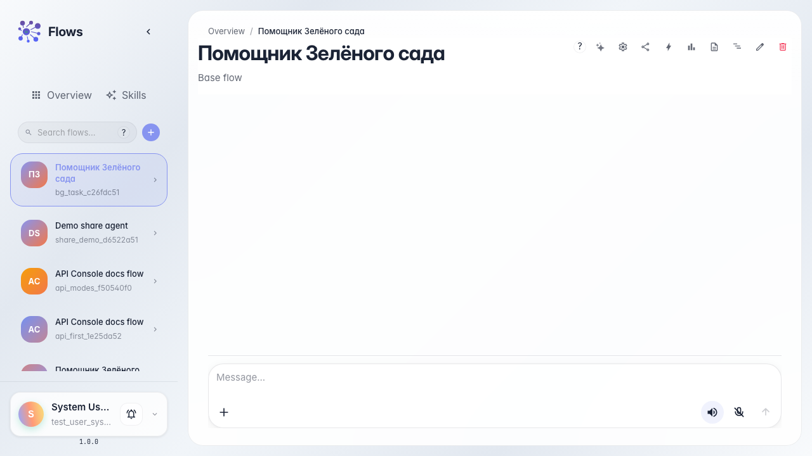
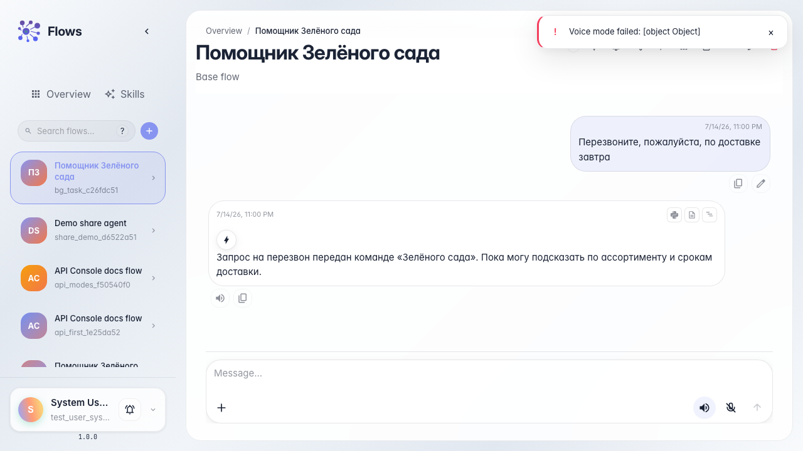
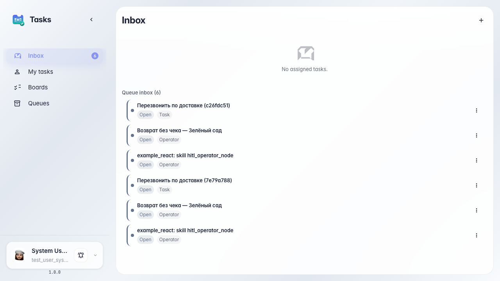
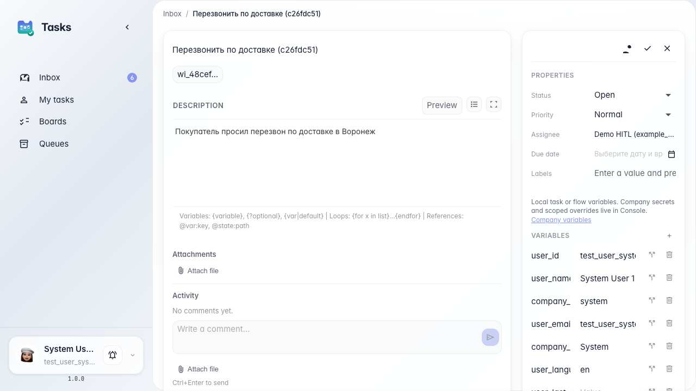

# Агент ставит фоновую задачу команде

**Для чего:** эта инструкция поможет научить агента создавать поручение людям без остановки диалога с покупателем.

**Какие проблемы решает:** перезвон или проверка остатка нужны команде, но покупателя нельзя заставлять ждать на линии.

**Результат:** агент сразу отвечает покупателю, а фоновая задача появляется в очереди «Поддержка клиентов».

## Шаг 1. Откройте чат агента с фоновой задачей

Откройте чат агента, у которого есть инструмент создания задачи без ожидания. Так агент может поручить перезвон или проверку остатка команде и сразу продолжить разговор с покупателем.

## Шаг 2. Попросите перезвон и получите мгновенный ответ

Попросите перезвон. Агент отвечает сразу — без плашки ожидания — и сообщает, что поручение передано команде. Диалог с покупателем не прерывается.

## Шаг 3. Откройте входящие задач команды

Перейдите во входящие раздела задач. В списке должно появиться новое поручение «Перезвонить по доставке» — агент создал его, не прерывая чат с покупателем.

## Шаг 4. Откройте карточку фоновой задачи

**Демонстрация результата.** Карточка задачи открыта — видны заголовок, очередь «Поддержка клиентов» и описание перезвона, хотя чат агента уже продолжил отвечать покупателю.

**Итог.** Теперь вы отличаете фоновую задачу от паузы HITL: покупатель не ждёт, а команда получает поручение в очередь.

