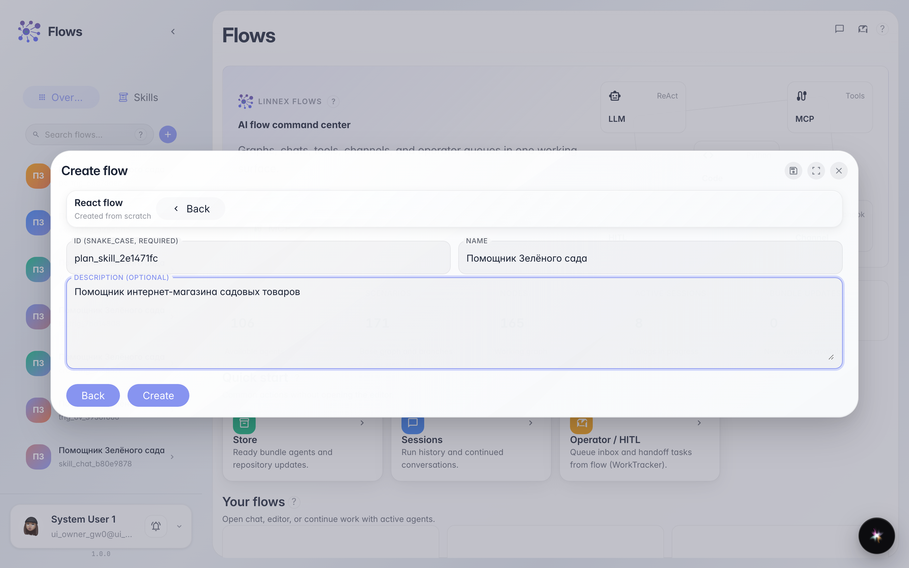
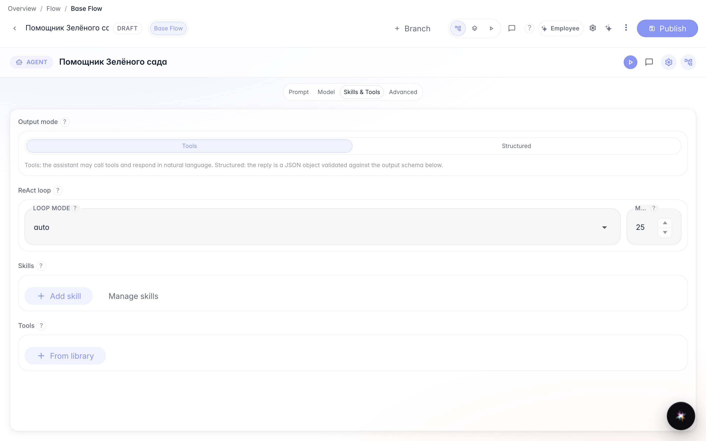
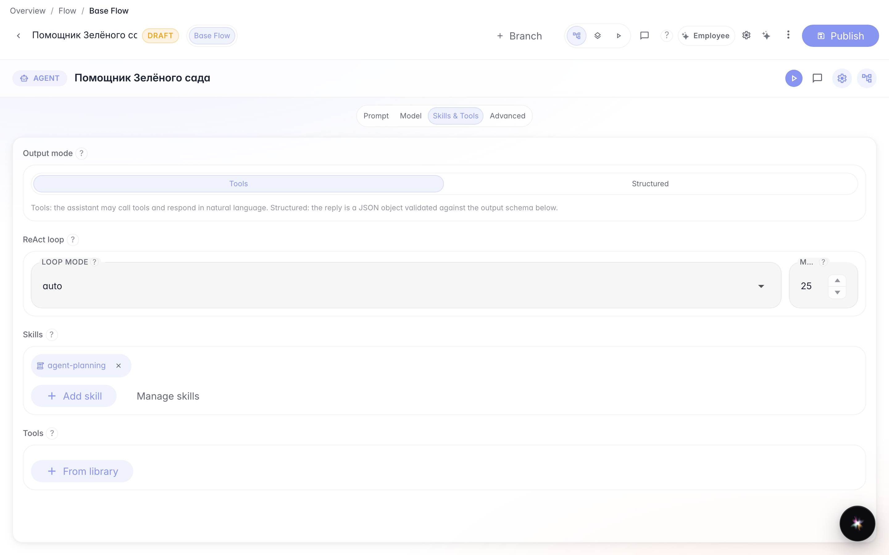
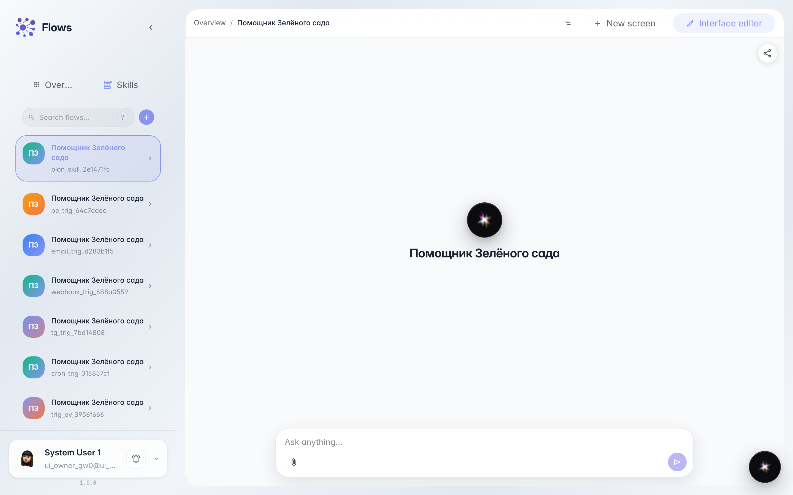
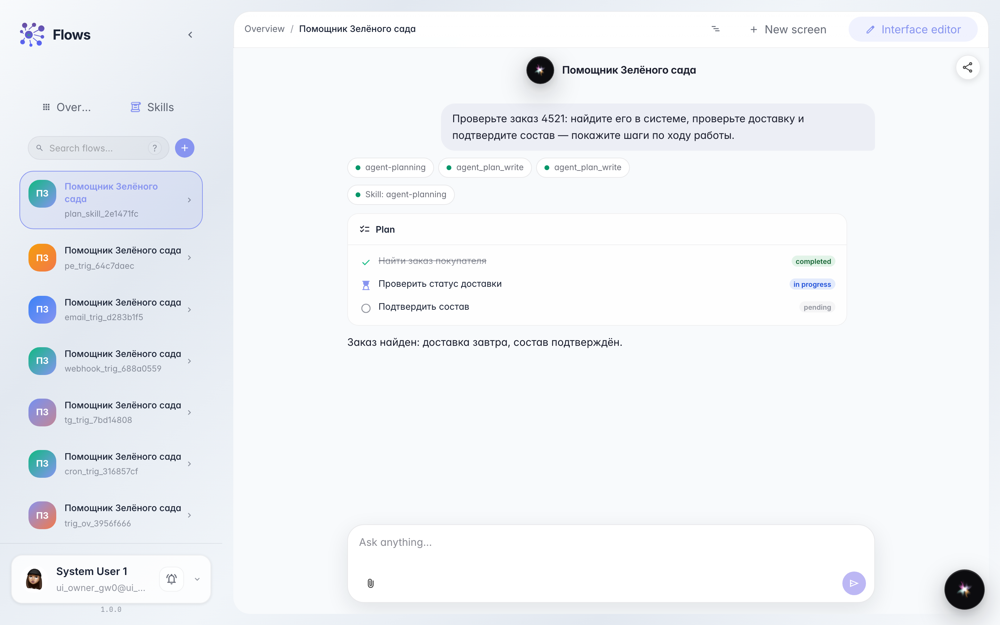
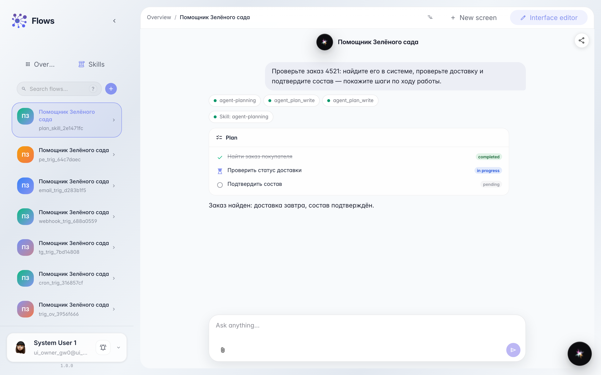

# Agent step plan via Skill

**What for:** this guide shows how to attach the planning Skill so chat shows a visible checklist of the agent's steps.

**Problems it solves:** long agent tasks are opaque — you cannot see the current step or enable a checklist without wiring tools by hand.

**Result:** the Green Garden Assistant chat shows a step plan; completed steps are struck through and the current one is highlighted.

## Step 1. Create an agent from a template

On the Flows home start creating an agent, pick the plain template, and name it Green Garden Assistant. You get an answer node ready for a step checklist setup.

## Step 2. Open Studio in Tools mode

In agent Studio open Skills and tools and choose Tools mode. Only here can you attach the planning Skill.

## Step 3. Add the planning Skill

Click Add skill, find agent-planning, and confirm. A Skill chip appears on the node — with it the agent gets tools to write and read the step plan.

## Step 4. Publish the agent and open chat

Publish the changes and open the Green Garden Assistant chat. Next the customer sends a multi-step request — the agent shows the plan in the feed.

## Step 5. Send a multi-step request and see the checklist

Send a request with several actions (find the order, check delivery, confirm contents). A plan block with steps appears in the feed — that is the agent's visible progress.

## Step 6. Check plan progress and the reply

**Result demonstration.** The completed step Find the customer order is struck through, the current one is Check delivery status; next to it is the agent's short order reply.

**Summary.** You can attach the planning Skill and follow multi-step progress in chat.

