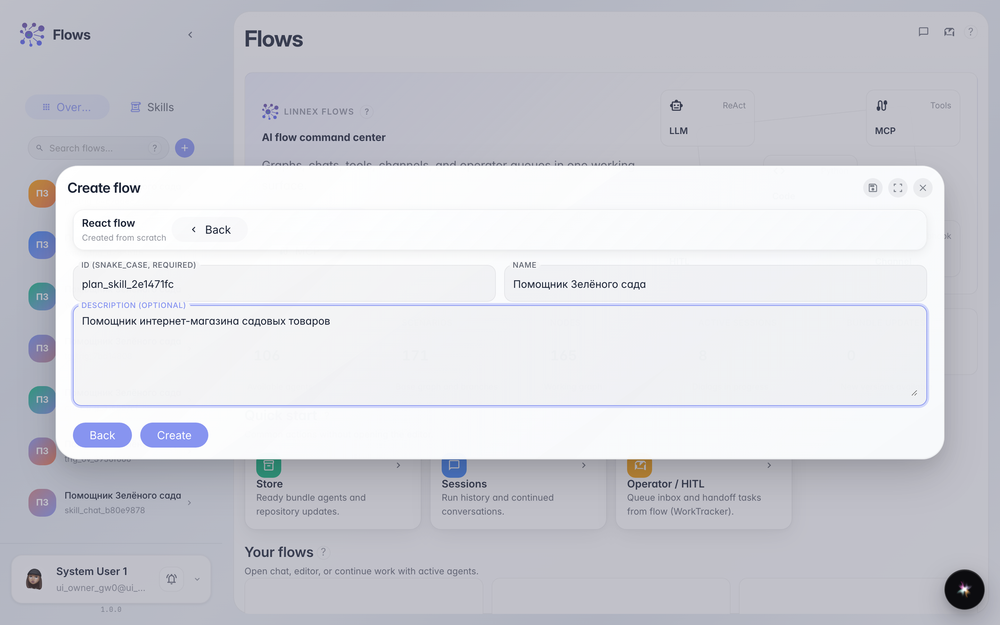
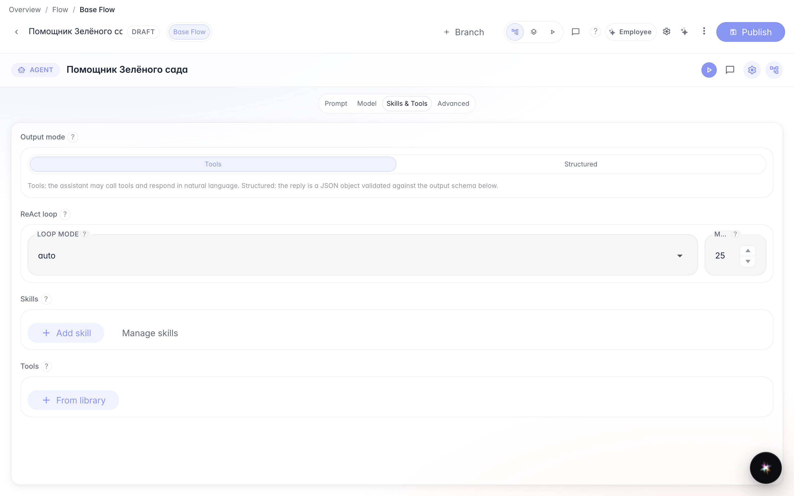
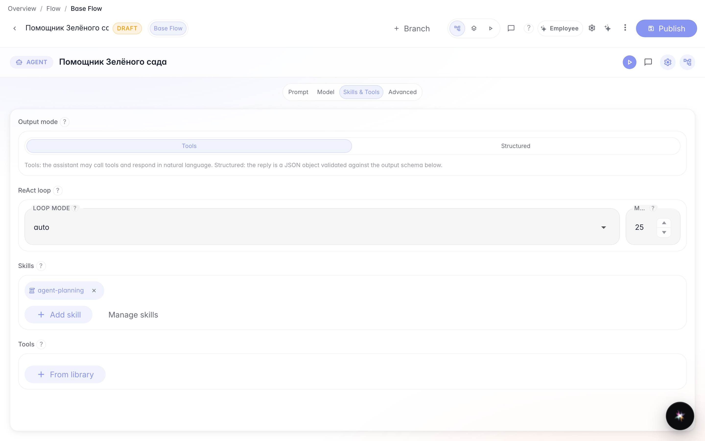
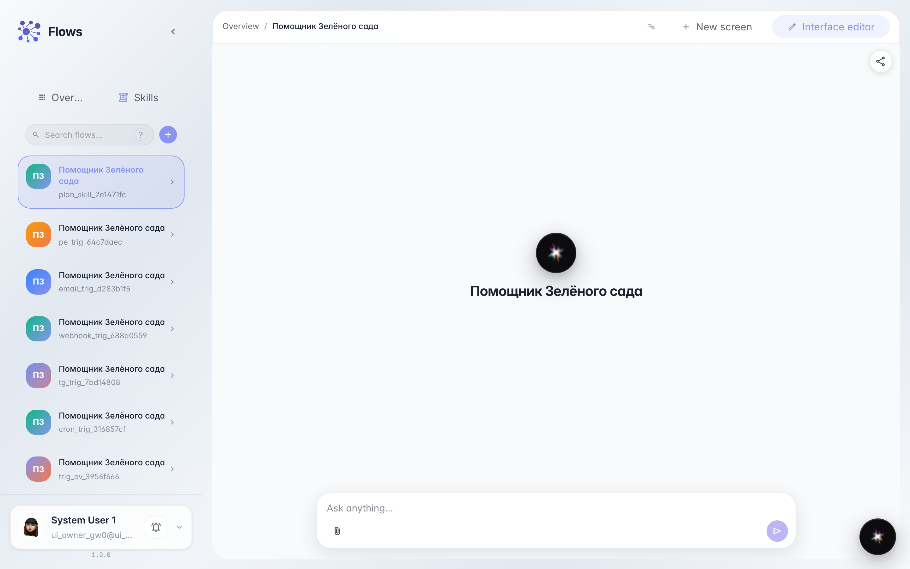
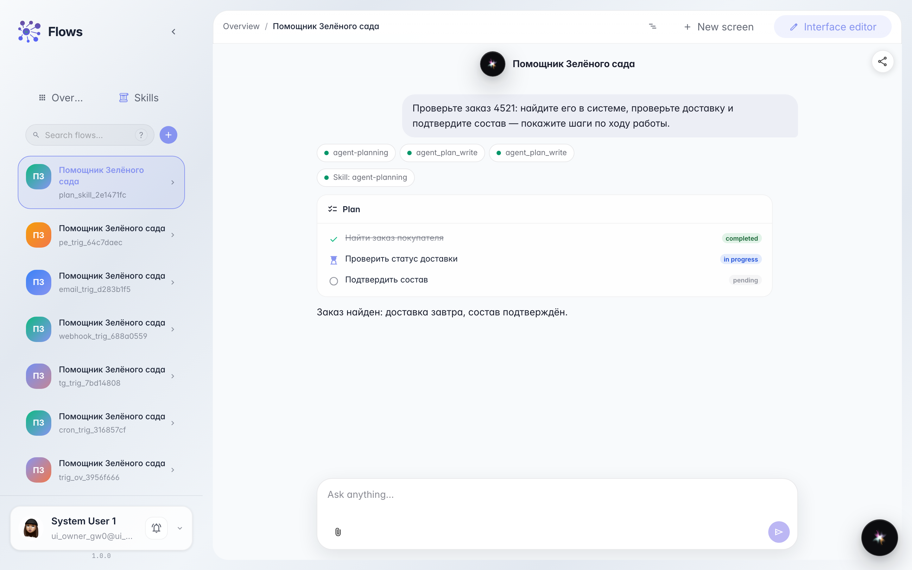
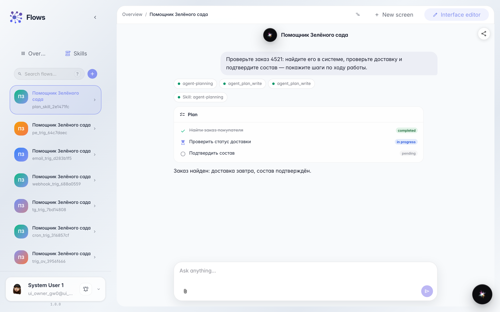

# План шагов агента через Skill

**Для чего:** эта инструкция научит подключить Skill планирования, чтобы в чате был видимый checklist шагов работы агента.

**Какие проблемы решает:** длинные задачи агента непрозрачны — непонятно, на каком шаге он сейчас и как включить checklist без ручной настройки инструментов.

**Результат:** у «Помощника Зелёного сада» в чате появляется план шагов; готовые шаги зачёркнуты, текущий выделен.

## Шаг 1. Создайте агента из шаблона

На главной Flows нажмите создание агента, выберите обычный шаблон и укажите название «Помощник Зелёного сада». Так у вас появится помощник с нодой ответа, готовый к настройке плана шагов.

## Шаг 2. Откройте студию в режиме «Инструменты»

В студии агента откройте секцию Skills и tools и выберите режим «Инструменты». Только здесь можно подключить Skill планирования.

## Шаг 3. Добавьте Skill планирования

Нажмите «Добавить skill», найдите «agent-planning» (Планирование) и подтвердите. На ноде появится чип Skill — вместе с ним агент получит инструменты записи и чтения плана шагов.

## Шаг 4. Опубликуйте агента и откройте чат

Опубликуйте изменения и откройте чат «Помощника Зелёного сада». Дальше покупатель пишет многошаговый запрос — агент покажет план прямо в ленте.

## Шаг 5. Отправьте многошаговый запрос и увидьте checklist

Напишите запрос с несколькими действиями (найти заказ, проверить доставку, подтвердить состав). В ленте появится блок плана с шагами — это и есть видимый прогресс работы агента.

## Шаг 6. Проверьте обновление плана и ответ

**Демонстрация результата.** Готовый шаг «Найти заказ покупателя» зачёркнут, текущий — «Проверить статус доставки»; рядом краткий ответ агента о заказе.

**Итог.** Вы умеете подключать Skill планирования и читать прогресс многошаговой задачи прямо в чате.

