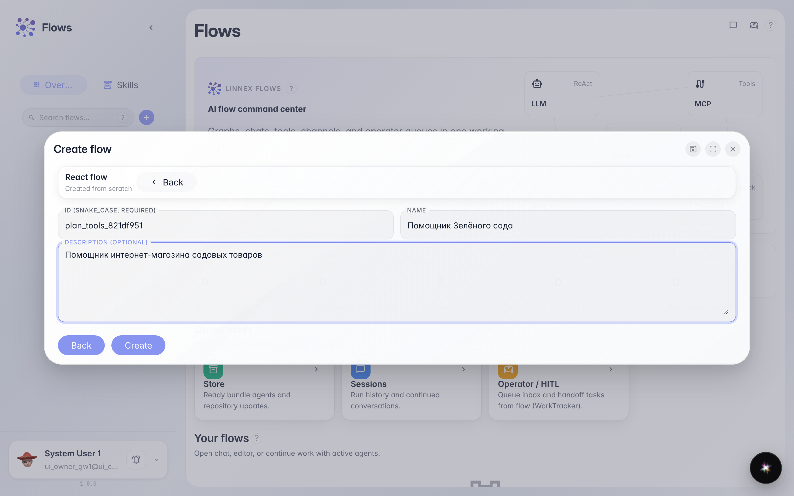
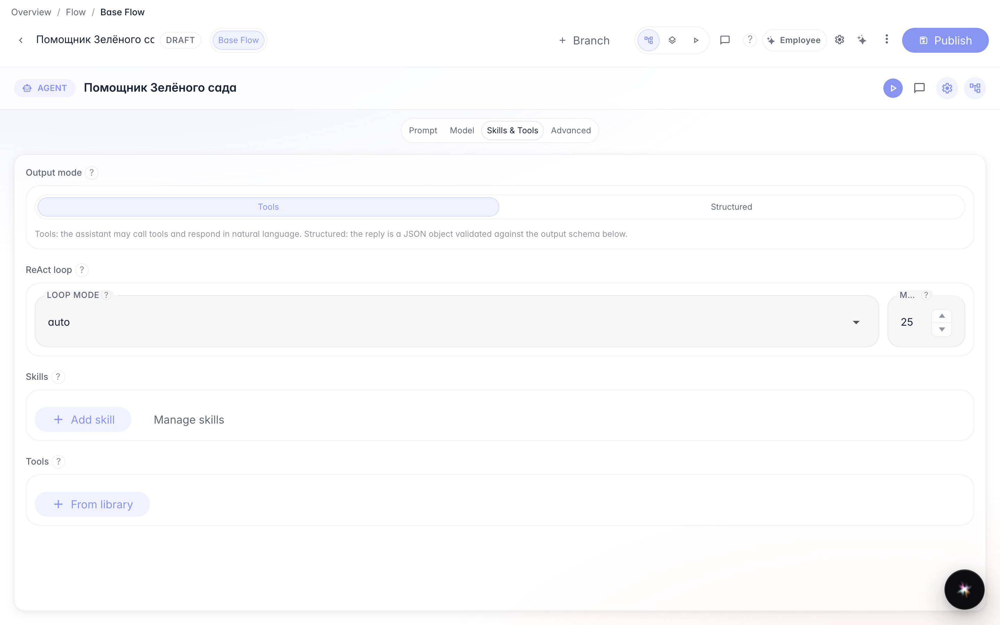
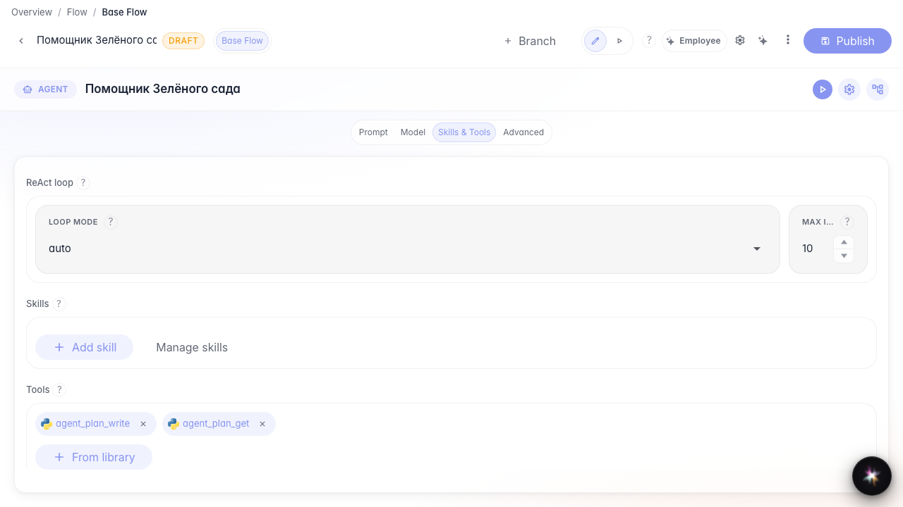

# Agent step plan via tools

**What for:** this guide shows how to attach plan tools by hand when a Skill is not needed or not available.

**Problems it solves:** you only need a chat checklist without a Skill procedure — write and read plan tools are enough.

**Result:** the Green Garden Assistant chat shows the same checklist with completed steps struck through.

## Step 1. Create an agent from a template

On the Flows home start creating an agent, pick the plain template, and name it Green Garden Assistant. You get an answer node ready for a step checklist setup.

## Step 2. Open Studio in Tools mode

In Studio open Skills and tools and choose Tools. Here you add library tools without a Skill.

## Step 3. Add plan tools from the library

Click From library and add agent_plan_write and agent_plan_get. The first writes the full step checklist; the second reads the current plan. Both appear as chips on the node.

