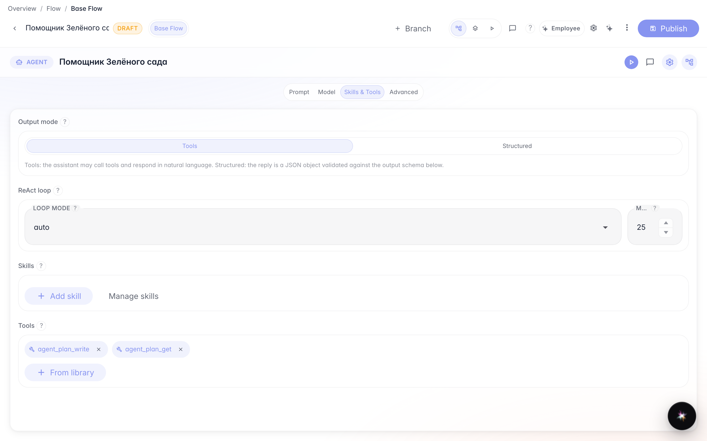
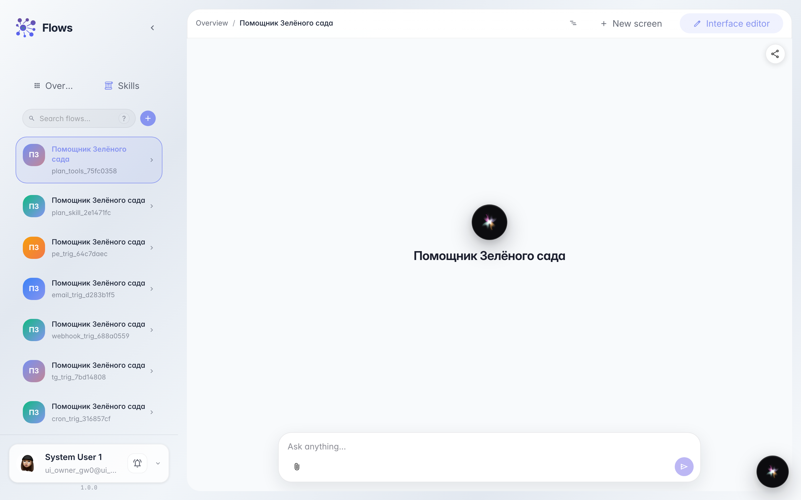
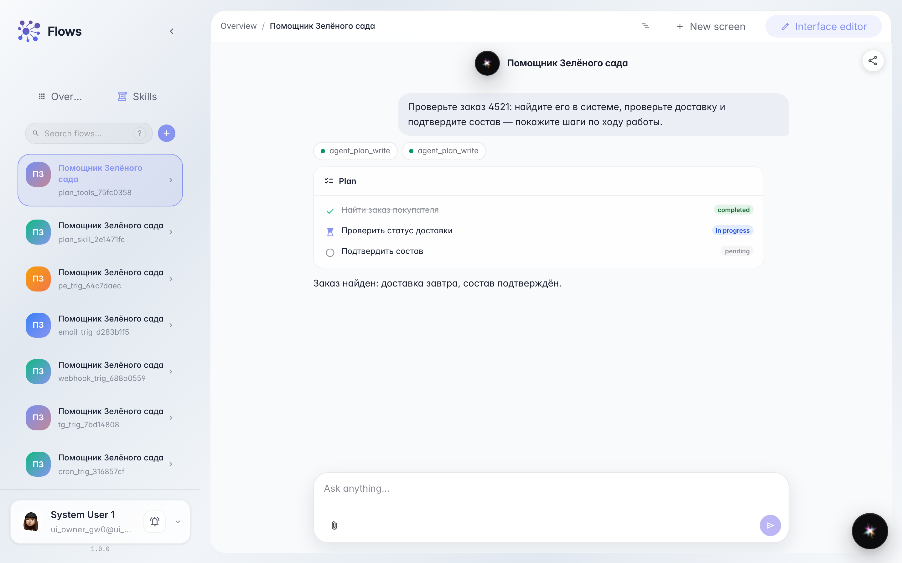

# План шагов агента через инструменты

**Для чего:** эта инструкция научит вручную подключить инструменты плана шагов, если Skill не нужен или недоступен.

**Какие проблемы решает:** нужен только checklist в чате без процедуры Skill — достаточно инструментов записи и чтения плана.

**Результат:** у «Помощника Зелёного сада» в чате тот же checklist с зачёркиванием готовых шагов.

## Шаг 1. Создайте агента из шаблона

На главной Flows нажмите создание агента, выберите обычный шаблон и укажите название «Помощник Зелёного сада». Так у вас появится помощник с нодой ответа, готовый к настройке плана шагов.

## Шаг 2. Откройте студию в режиме «Инструменты»

В студии откройте секцию Skills и tools и выберите «Инструменты». Сюда добавляют инструменты из библиотеки — без Skill.

## Шаг 3. Добавьте инструменты плана из библиотеки

Нажмите «Из библиотеки» и добавьте agent_plan_write и agent_plan_get. Первый записывает весь checklist шагов, второй читает текущий план. Оба появятся чипами на ноде.

## Шаг 4. Опубликуйте агента и откройте чат

Опубликуйте настройки и откройте чат помощника. Дальше тот же многошаговый запрос покупателя — план появится без Skill.

## Шаг 5. Отправьте многошаговый запрос и увидьте checklist

Напишите запрос с несколькими действиями. Агент вызовет инструменты плана, и в ленте появится checklist шагов.

## Шаг 6. Проверьте обновление плана и ответ

**Демонстрация результата.** Шаг «Найти заказ покупателя» зачёркнут, текущий — «Проверить статус доставки»; рядом ответ агента.

**Итог.** Вы умеете включать план шагов вручную через инструменты библиотеки и следить за прогрессом в чате.

