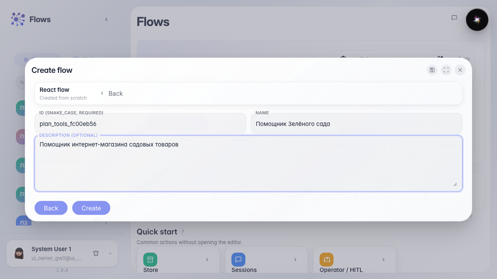
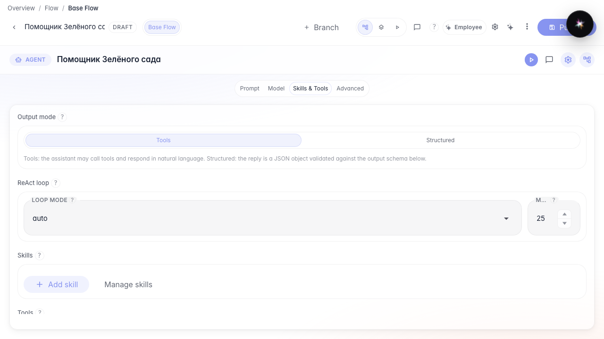

# План шагов агента через инструменты

**Для чего:** эта инструкция научит вручную подключить инструменты плана шагов, если Skill не нужен или недоступен.

**Какие проблемы решает:** нужен только checklist в чате без процедуры Skill — достаточно инструментов записи и чтения плана.

**Результат:** у «Помощника Зелёного сада» в чате тот же checklist с зачёркиванием готовых шагов.

## Шаг 1. Создайте агента из шаблона

На главной Flows нажмите создание агента, выберите обычный шаблон и укажите название «Помощник Зелёного сада». Так у вас появится помощник с нодой ответа, готовый к настройке плана шагов.

## Шаг 2. Откройте студию в режиме «Инструменты»

В студии откройте секцию Skills и tools и выберите «Инструменты». Сюда добавляют инструменты из библиотеки — без Skill.

