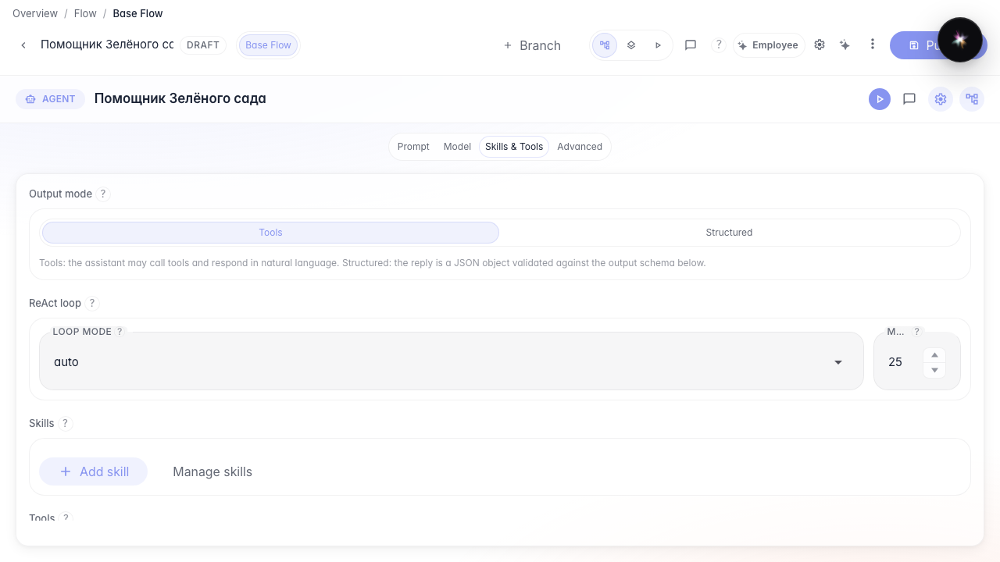
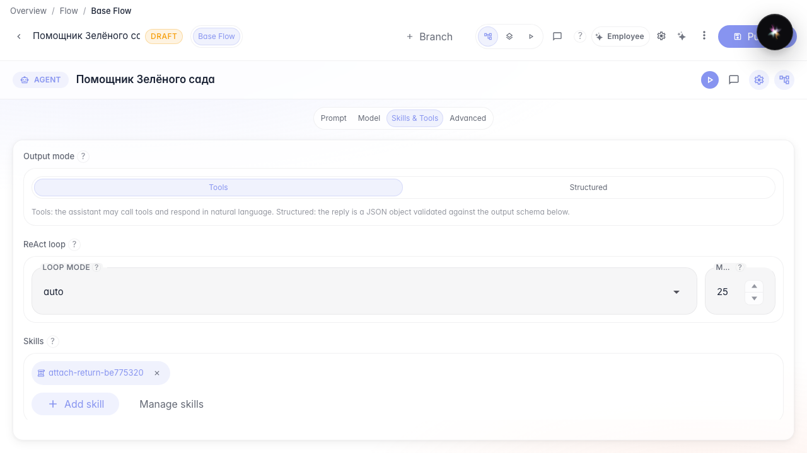
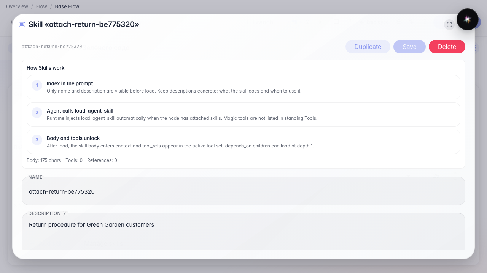

# Attach a Skill to the agent

**What for:** this guide shows how to attach a Skill to the answer node in Tools mode.

**Problems it solves:** the Skill exists in the library but the agent does not see it — you must attach it on the node.

**Result:** the Green Garden Assistant has a Skill chip in Tools mode; in Structured mode the Skills section is hidden.

## Step 1. Open the agent in Tools mode

Open agent Studio, the Skills and tools section, and choose Tools mode. The Skills section appears only here — not in Structured. Skill load meta-tools appear after attach and are not standing Tools chips.

## Step 2. Add the Skill from the library

Click Add skill, pick the return Skill, and confirm. A Skill chip appears on the node.

## Step 3. Open the Skill from the chip

Clicking the chip opens the procedure editor so you can fix steps without leaving the node.

