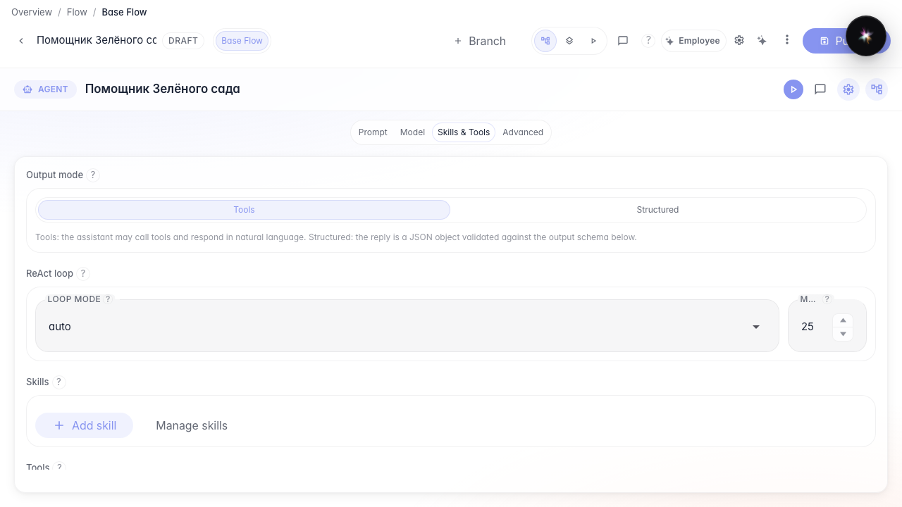
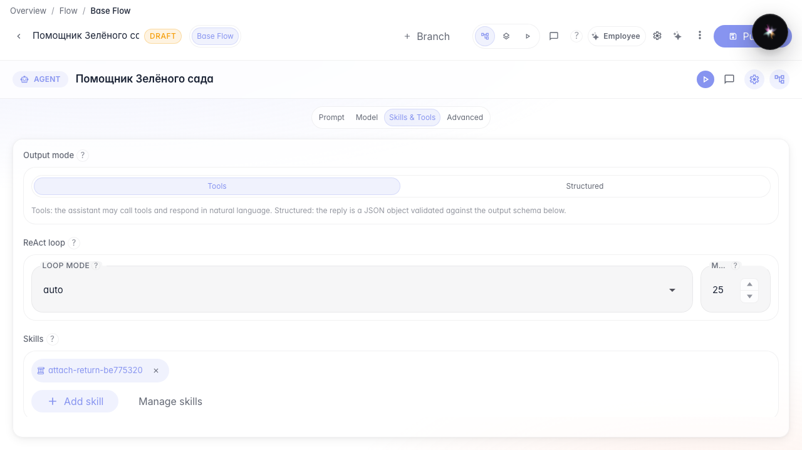
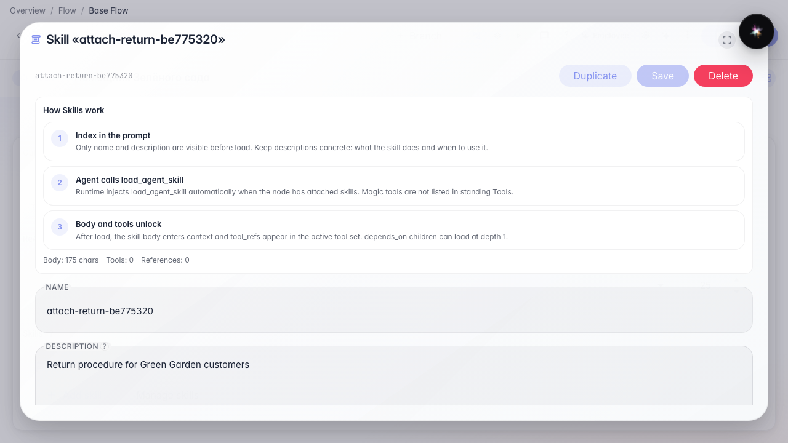

# Подключаем Skill к агенту

**Для чего:** эта инструкция покажет, как привязать Skill к ноде ответа в режиме «Инструменты».

**Какие проблемы решает:** Skill есть в библиотеке, но агент его не видит — нужно явное подключение на ноде.

**Результат:** у «Помощника Зелёного сада» чип Skill в режиме Инструменты; в Структурированном секция Skills скрыта.

## Шаг 1. Откройте агента в режиме Инструменты

Откройте студию агента, секцию Skills и tools, и выберите режим «Инструменты». Секция Skills видна только здесь: при «Структурированный» её нет. Meta-tools загрузки Skill появляются сами после attach и не показываются как обычные Tools-чипы.

## Шаг 2. Добавьте Skill из библиотеки

Нажмите «Добавить skill», выберите Skill возврата и подтвердите. На ноде появится чип Skill.

## Шаг 3. Откройте Skill с чипа

Клик по чипу открывает редактирование процедуры — можно поправить шаги, не уходя в библиотеку.

