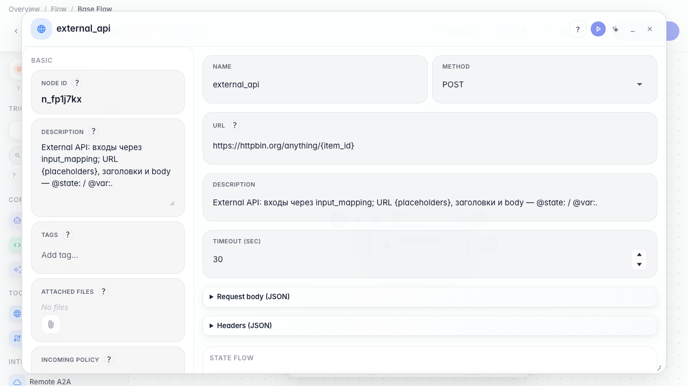
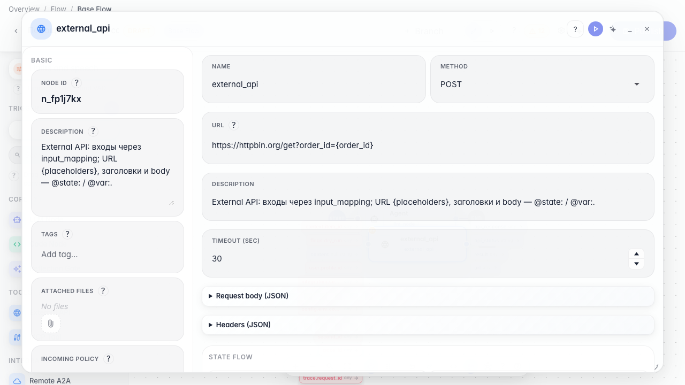
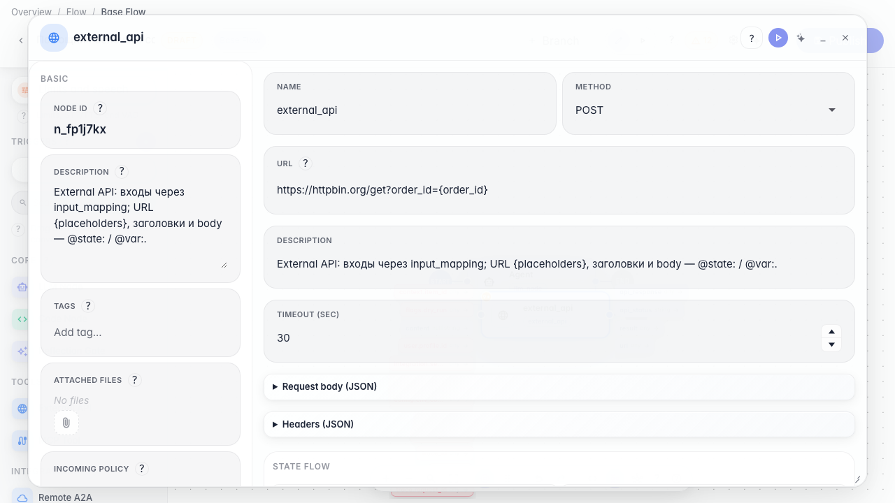
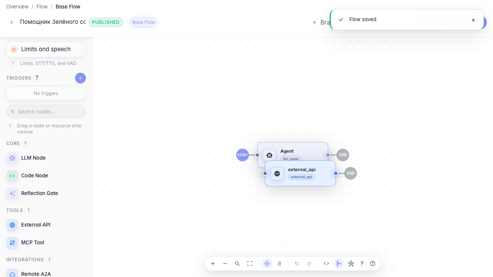

# Connect an order tracking service

**What for:** this guide helps you fetch order status from an external HTTP service.

**Problems it solves:** the customer asks where the order is and the answer must come from a delivery API.

**Result:** an external API node is configured for order status requests.

## Step 1. Add an external API node

Drag an External API node onto the canvas. Through it the agent calls HTTP services such as an order tracker.

## Step 2. Set the order service URL

Enter the tracking service URL. You can insert variables in curly braces, for example the order number from the chat.

## Step 3. Verify the URL with order variable

Confirm the address includes the {order_id} placeholder — the agent will insert the order number from the chat when calling the delivery service.

## Step 4. Publish the API connection

**Result demonstration.** The order tracker node is saved with the service URL — the agent can request order status over HTTP.

**Summary.** You can add an external API node and configure a delivery service call.

