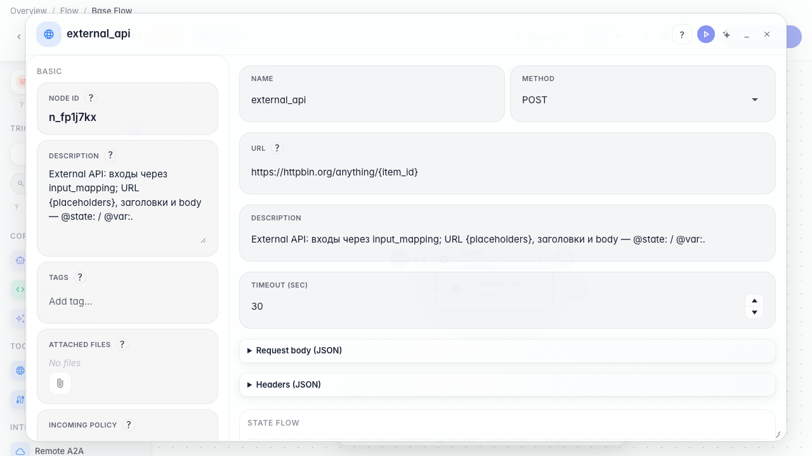
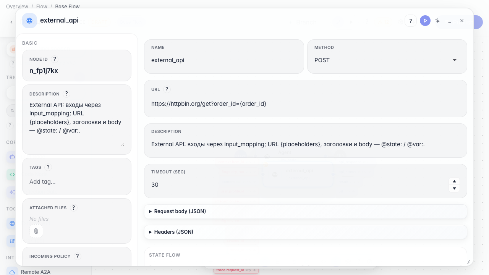
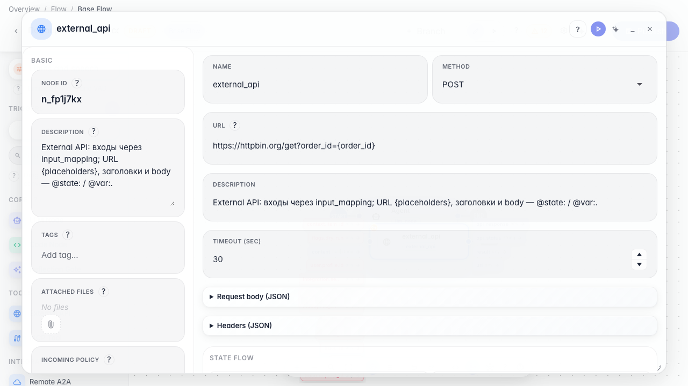
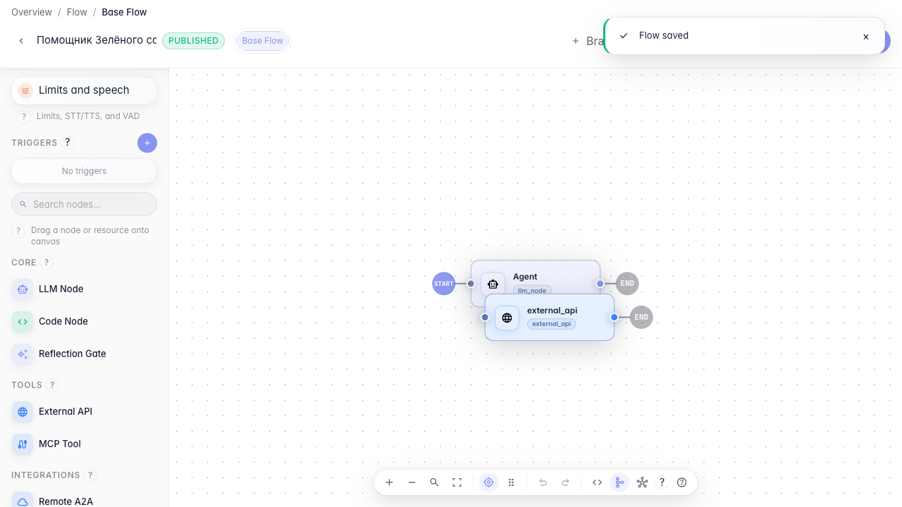

# Подключаем сервис отслеживания заказов

**Для чего:** эта инструкция поможет получать статус заказа из внешнего HTTP-сервиса.

**Какие проблемы решает:** покупатель спрашивает «где мой заказ», а ответ нужно взять из API службы доставки.

**Результат:** нода внешнего API настроена на запрос статуса заказа.

## Шаг 1. Добавьте ноду внешнего API

Перетащите ноду «Внешний API» на канву. Через неё агент обращается к HTTP-сервисам вроде трекера заказов.

## Шаг 2. Укажите адрес сервиса заказов

В поле URL впишите адрес сервиса отслеживания. Можно подставлять переменные в фигурных скобках — например номер заказа из диалога.

## Шаг 3. Проверьте URL с переменной заказа

Убедитесь, что в адресе есть placeholder {order_id} — агент подставит номер заказа из диалога при вызове сервиса доставки.

## Шаг 4. Опубликуйте подключение API

**Демонстрация результата.** Нода «Где мой заказ» сохранена с URL сервиса — агент готов запрашивать статус заказа по HTTP.

**Итог.** Теперь вы умеете добавлять external API-ноду и настраивать вызов внешнего сервиса доставки.

