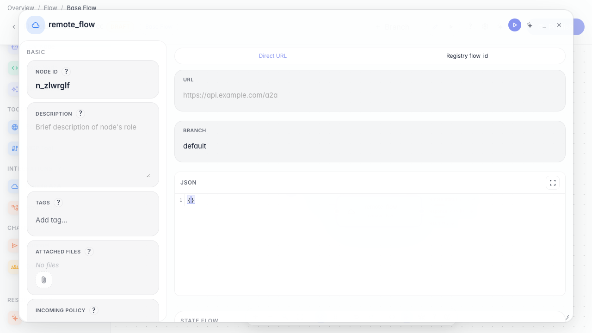
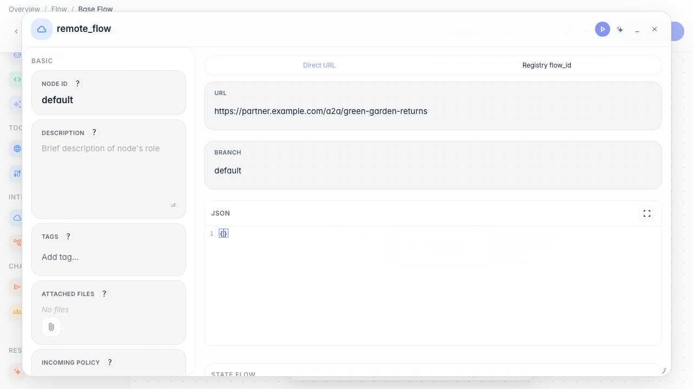
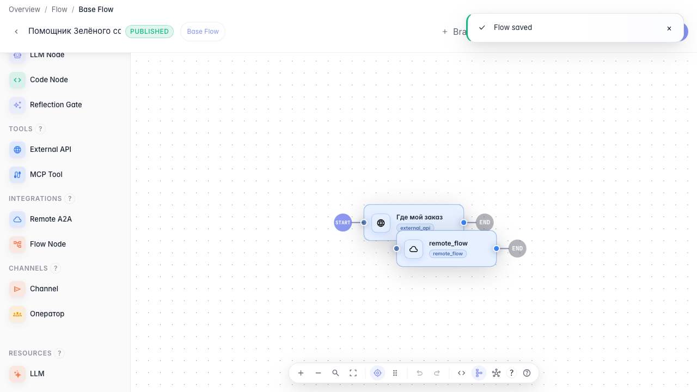

# Call a remote agent

**What for:** this guide connects a partner agent over the A2A protocol.

**Problems it solves:** some scenarios live with another provider and you need to call their remote agent from your graph.

**Result:** a remote agent node with URL and branch.

## Step 1. Add a remote agent node

Drag a Remote agent node and open its settings. It calls another company's agent by URL or identifier.

## Step 2. Set the partner agent address

In URL mode enter the partner agent address and branch if needed. Your agent then knows where to forward the customer request.

## Step 3. Publish the remote agent call

**Result demonstration.** The remote agent node is saved with the URL — the graph is ready to delegate requests to a partner.

**Summary.** You can add a remote_flow node and configure an external agent call over A2A.

