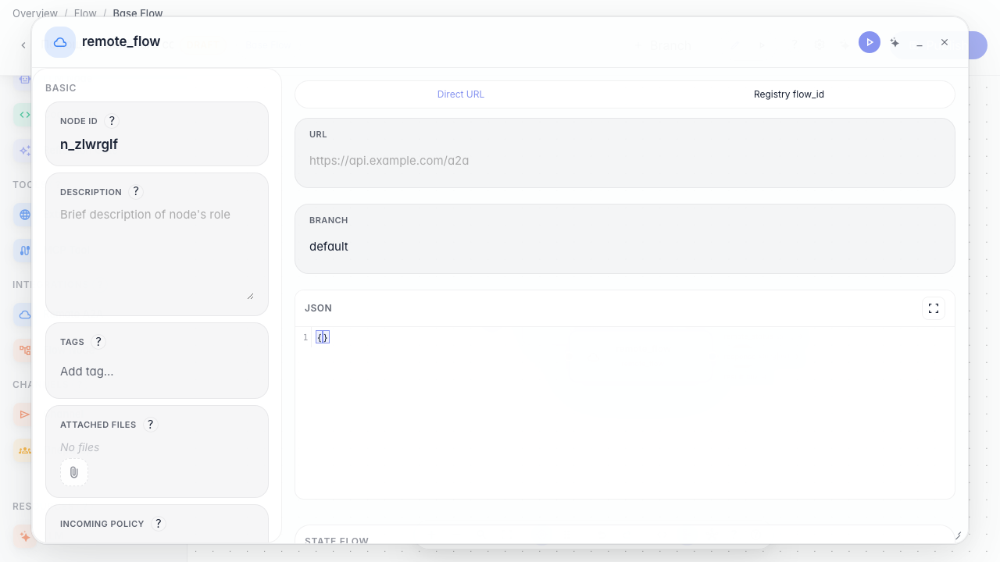
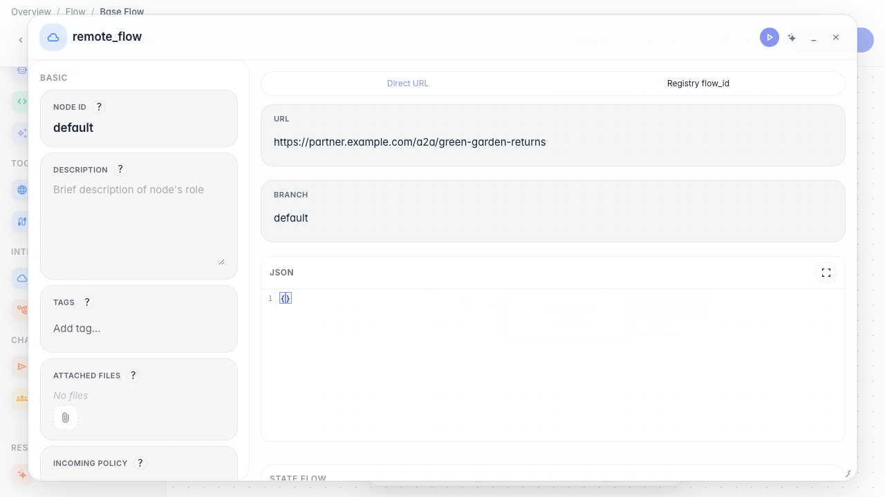
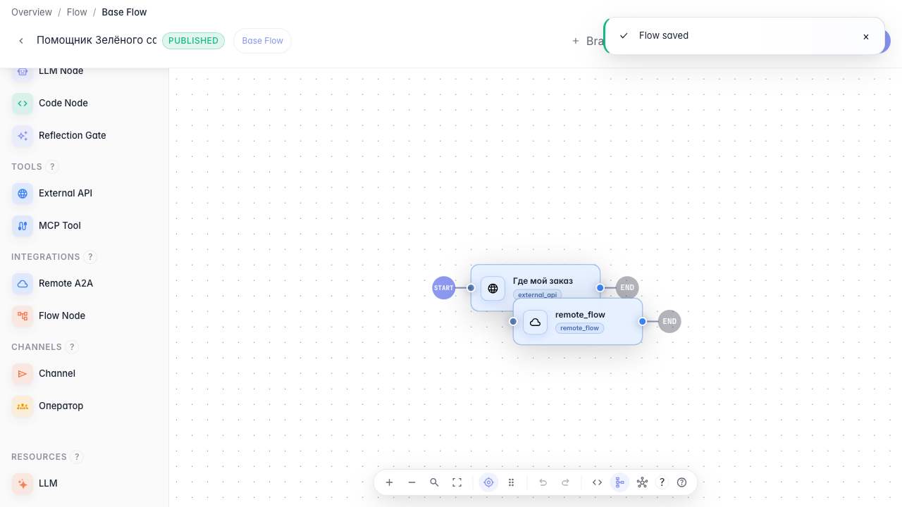

# Вызываем внешнего агента

**Для чего:** эта инструкция подключит агента-партнёра по протоколу A2A.

**Какие проблемы решает:** часть сценариев живёт у другого поставщика, и нужно вызвать его удалённого агента из своего графа.

**Результат:** нода внешнего агента с адресом и веткой.

## Шаг 1. Добавьте ноду внешнего агента

Перетащите ноду «Внешний агент» и откройте её настройки. Она вызывает агента другой компании по URL или идентификатору.

## Шаг 2. Укажите адрес партнёрского агента

В режиме URL впишите адрес агента-партнёра и при необходимости ветку. Так ваш агент знает, куда отправить запрос покупателя.

## Шаг 3. Опубликуйте вызов внешнего агента

**Демонстрация результата.** Нода внешнего агента сохранена с указанным URL — граф готов делегировать запрос партнёру.

**Итог.** Теперь вы умеете добавлять remote_flow-ноду и настраивать вызов внешнего агента по A2A.

