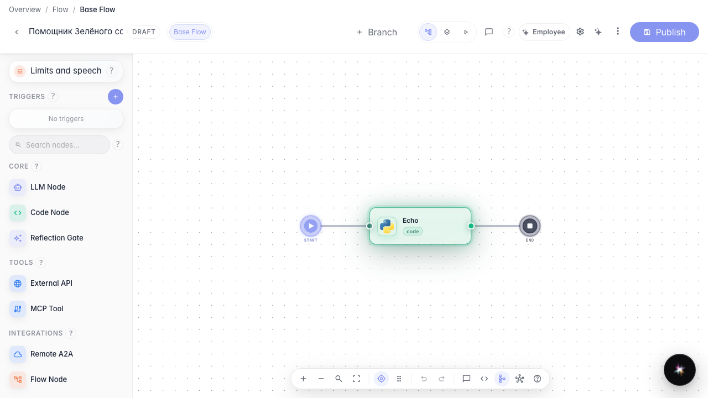
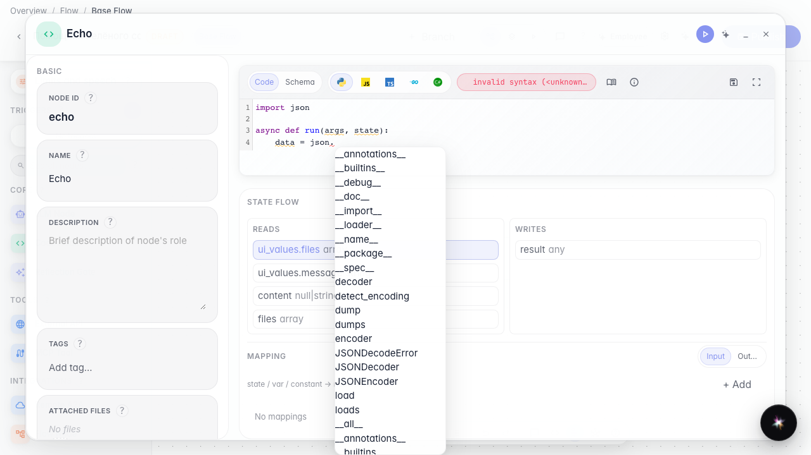
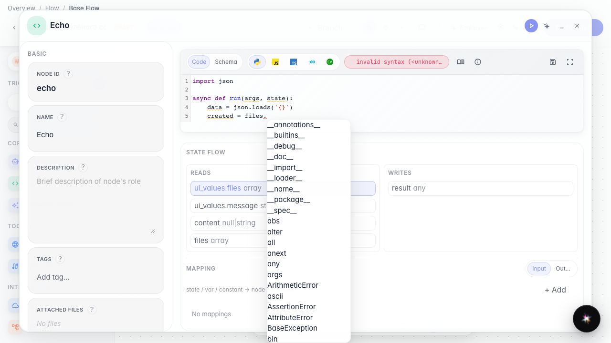
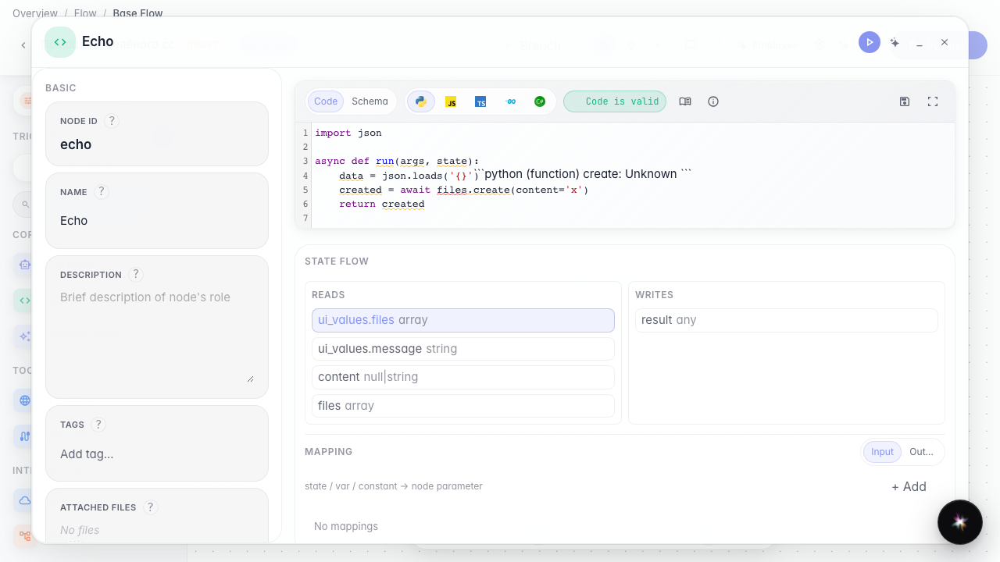

# How the code editor suggests methods like an IDE

**What for:** this guide shows how to write node code with standard-library and platform method suggestions, like in a regular IDE.

**Problems it solves:** you do not need to memorize `json.loads` or `files.create` — the editor lists matching names and a short hint.

**Result:** the agent code editor shows completions and a hover tooltip.

## Step 1. Open the code node

On the canvas select the Code node and open its editor. This is where you write the function that transforms data between agent steps.

## Step 2. Type json. and pick a suggestion

In the function body type `json.` and trigger completion (Ctrl+Space). Standard methods such as loads and dumps appear, so you do not look them up.

## Step 3. Type files. to see platform methods

On a new line type `files.` and press Ctrl+Space again. The list includes the platform file-create method — node code calls capabilities instead of forbidden open().

## Step 4. Hover a name to see its hint

**Result demonstration.** The agent code editor behaves like an IDE: a dot lists json and files methods, and hover shows a short hint.

**Summary.** You can write data transforms faster and with fewer name typos.

