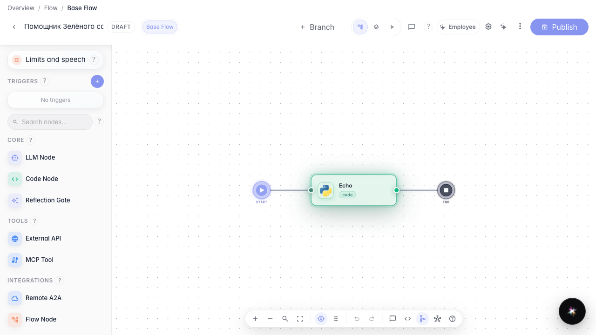
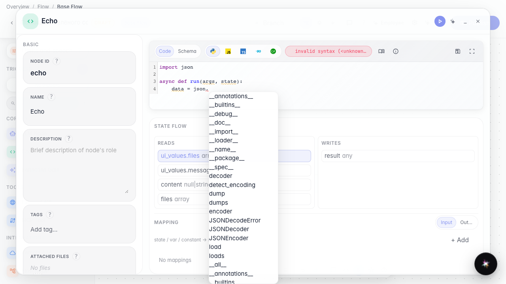
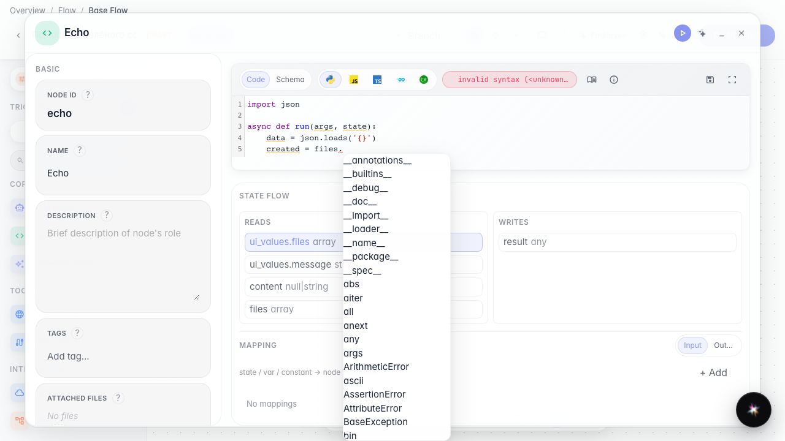
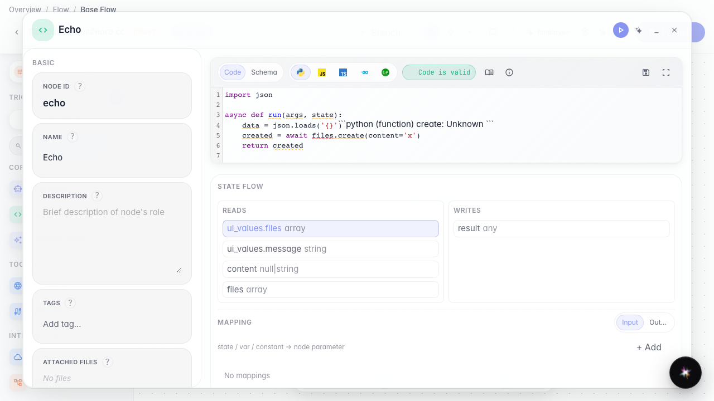

# Как редактор кода подсказывает методы как IDE

**Для чего:** эта инструкция поможет писать код ноды с подсказками стандартной библиотеки и платформенных методов, как в обычной IDE.

**Какие проблемы решает:** не нужно помнить наизусть `json.loads` или `files.create` — редактор сам показывает подходящие имена и краткую справку.

**Результат:** в редакторе кода агента видны автодополнение и подсказка по наведению.

## Шаг 1. Откройте ноду кода

На канве выберите ноду «Код» и откройте её редактор. Здесь пишется функция обработки данных между шагами агента.

## Шаг 2. Начните писать json. и выберите подсказку

В теле функции введите `json.` и вызовите автодополнение (Ctrl+Пробел). Появятся стандартные методы вроде loads и dumps — их не нужно искать в документации.

## Шаг 3. Допишите files. — редактор подскажет методы платформы

На новой строке введите `files.` и снова Ctrl+Пробел. В списке будет метод создания файла платформы — так код ноды вызывает capabilities, а не запрещённый open().

## Шаг 4. Наведите курсор на имя, чтобы увидеть справку

**Итог.** Редактор кода агента работает как IDE: после точки видны методы json и files, а наведение показывает краткую справку. Так быстрее писать обработку данных и меньше опечаток в именах.

