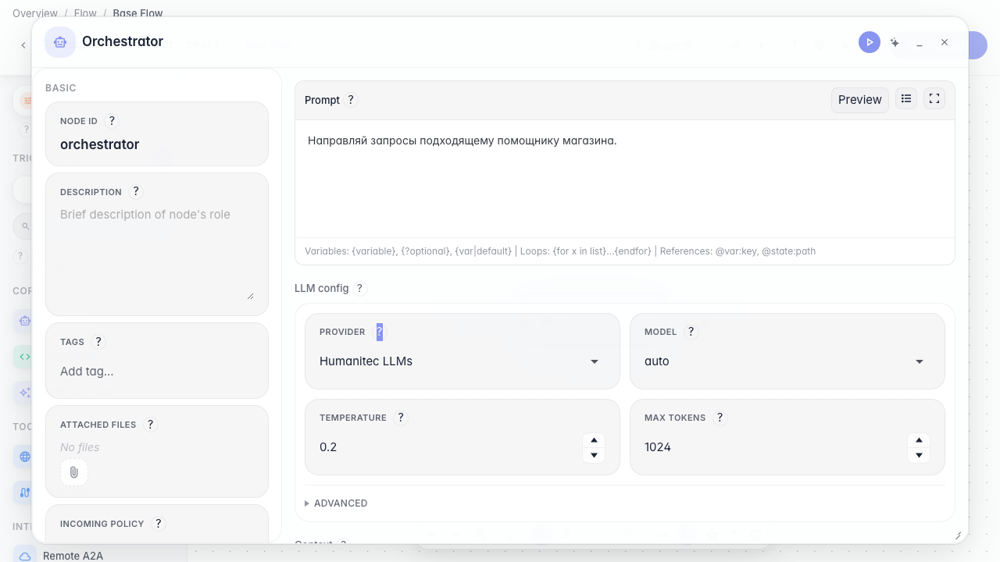
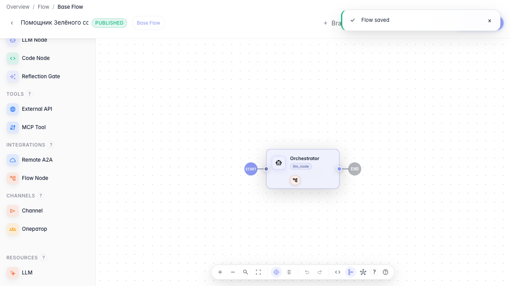

# Compose an orchestrator from sub-agents

**What for:** this guide helps split a complex task across specialized sub-agents.

**Problems it solves:** one general agent mixes topics — delivery and returns are better handled by dedicated assistants.

**Result:** an orchestrator with the returns agent attached as a tool.

## Step 1. Open the orchestrator agent

In the editor open the orchestrator's main LLM node. It decides which sub-agent should handle the customer request.

## Step 2. Attach the sub-agent as a tool

**Result demonstration.** The sub-agent is listed in the orchestrator tools and published — the main agent can delegate returns to it.

**Summary.** You can build an orchestrator from sub-agents and attach them as tools.

