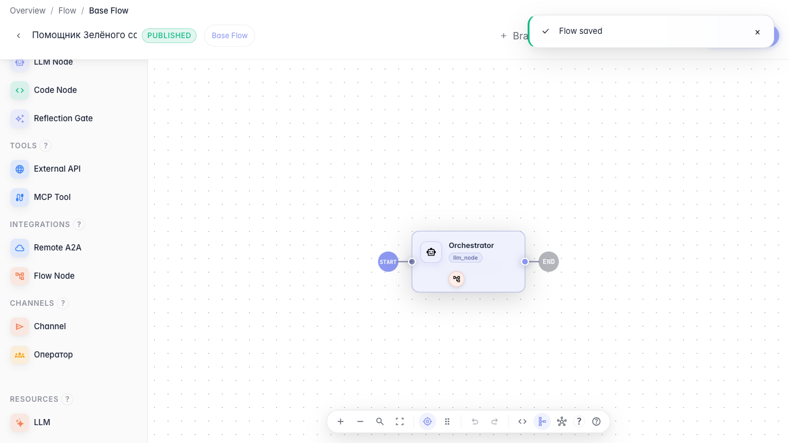

# Собираем агента из под-агентов

**Для чего:** эта инструкция поможет разделить сложную задачу между специализированными под-агентами.

**Какие проблемы решает:** один универсальный агент путается в темах — доставку и возвраты лучше поручить отдельным помощникам.

**Результат:** оркестратор с подключённым агентом возвратов как инструментом.

## Шаг 1. Откройте агента-оркестратора

В редакторе откройте главную LLM-ноду оркестратора. Она решает, какому под-агенту передать запрос покупателя.

## Шаг 2. Подключите под-агента как инструмент

**Демонстрация результата.** Под-агент добавлен в список tools оркестратора и опубликован — главный агент может делегировать ему возвраты.

**Итог.** Теперь вы умеете собирать оркестратора из под-агентов и подключать их как инструменты.

