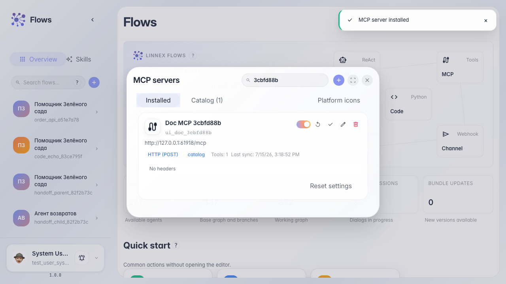
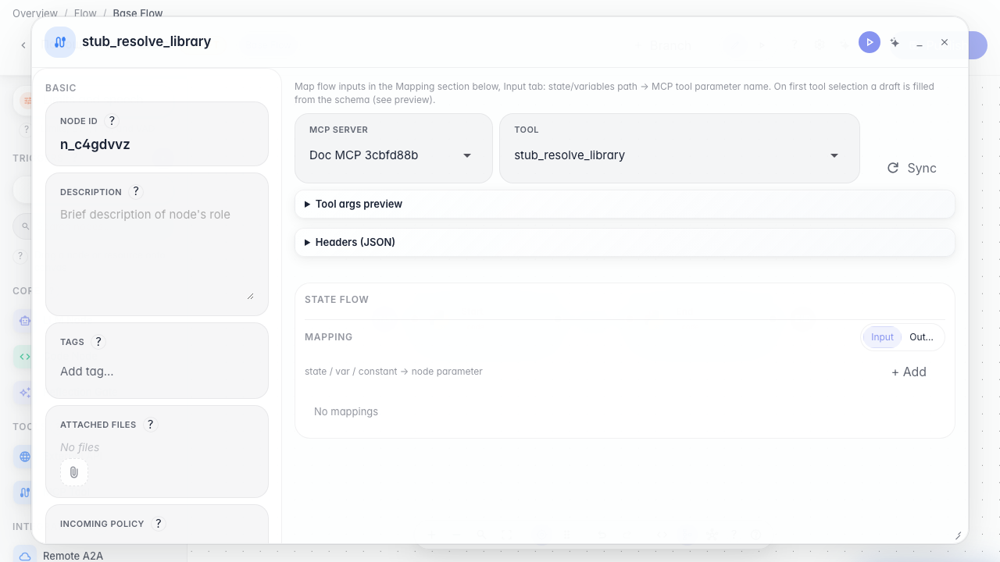
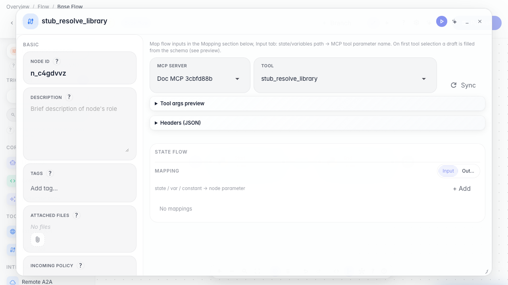
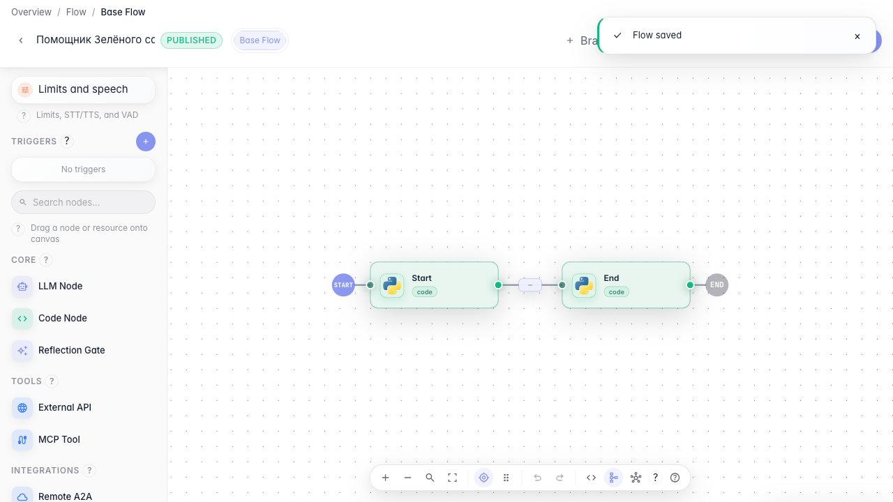

# Connect an MCP tool

**What for:** this guide extends the agent with tools from an MCP server.

**Problems it solves:** built-in tools are not enough and external MCP adds new operations without rewriting the graph.

**Result:** the MCP server is installed, the tool is added to the agent and canvas.

## Step 1. Install an MCP server from the catalog

On the Flows home open MCP, go to the catalog, find the server and click Install. Its tools then become available in the editor.

## Step 2. Add an MCP tool to the canvas

In the editor drop MCP onto the canvas and pick a tool in the library dialog. A dedicated MCP node with that tool appears on the graph.

## Step 3. Review the MCP node settings

After choosing the tool, review the properties panel that opens automatically. It shows which server tool is wired into the graph.

## Step 4. Publish the agent with MCP

**Result demonstration.** The MCP node is visible on the canvas and the saved graph includes the server tool.

**Summary.** You can install an MCP server and add its tools to the Green Garden agent.

