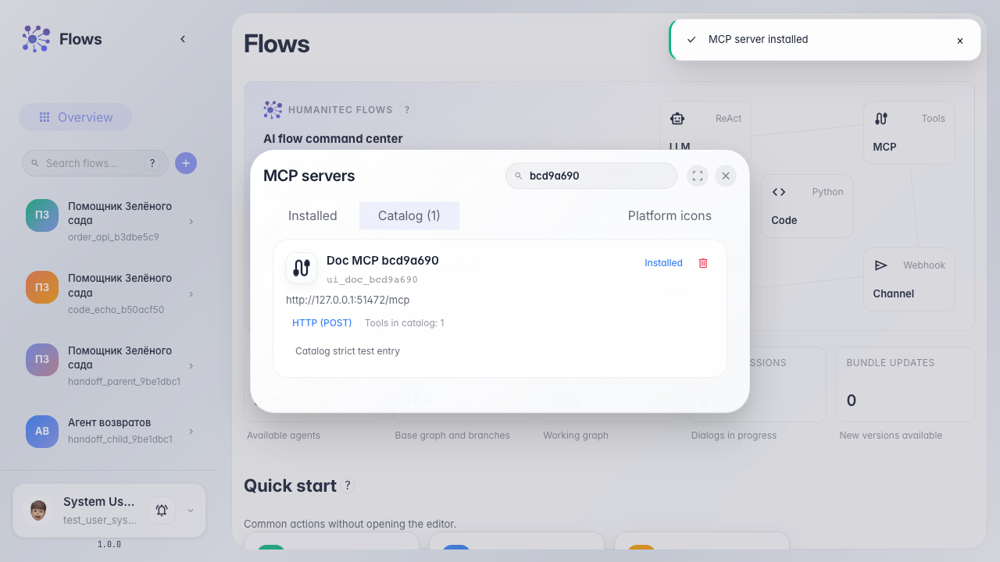
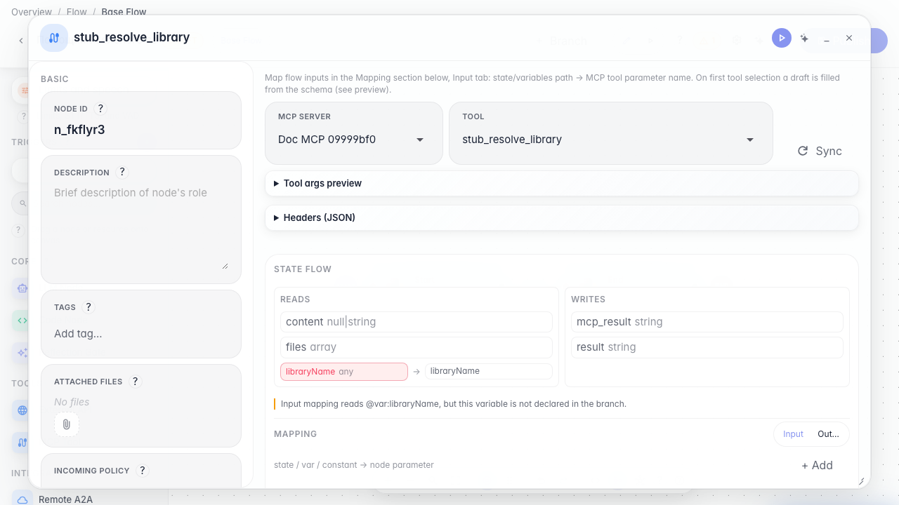
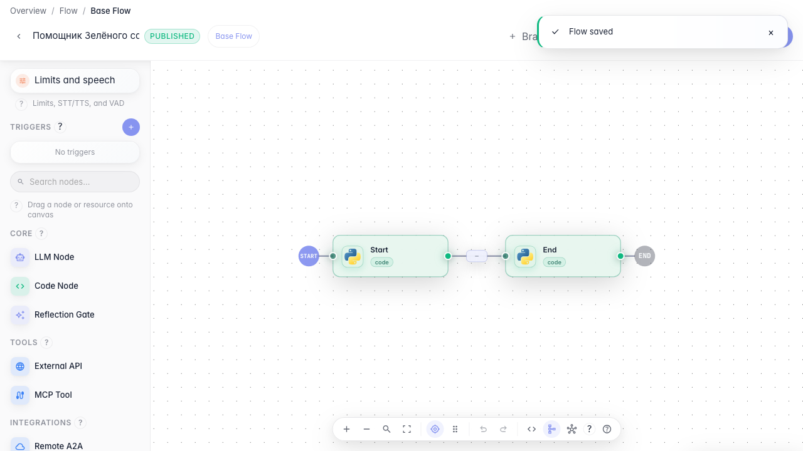

# Подключаем MCP-инструмент

**Для чего:** эта инструкция расширит агента инструментами MCP-сервера.

**Какие проблемы решает:** готовых встроенных tools не хватает, а внешний MCP даёт новые операции без переписывания графа.

**Результат:** MCP-сервер установлен, tool добавлен в агента и на канву.

## Шаг 1. Установите MCP-сервер из каталога

На главной Flows откройте MCP, перейдите в каталог, найдите сервер и нажмите «Установить». После этого инструменты сервера доступны в редакторе.

## Шаг 2. Добавьте MCP-инструмент на канву

В редакторе перетащите MCP на канву и выберите tool в окне библиотеки. На графе появится отдельная MCP-нода с выбранным инструментом.

## Шаг 3. Опубликуйте агента с MCP

**Демонстрация результата.** MCP-нода видна на канве, а в сохранённом графе есть подключённый инструмент сервера.

**Итог.** Теперь вы умеете устанавливать MCP-сервер и добавлять его tools в агента «Зелёного сада».

