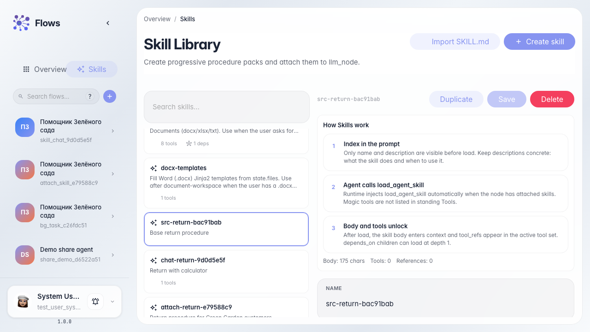
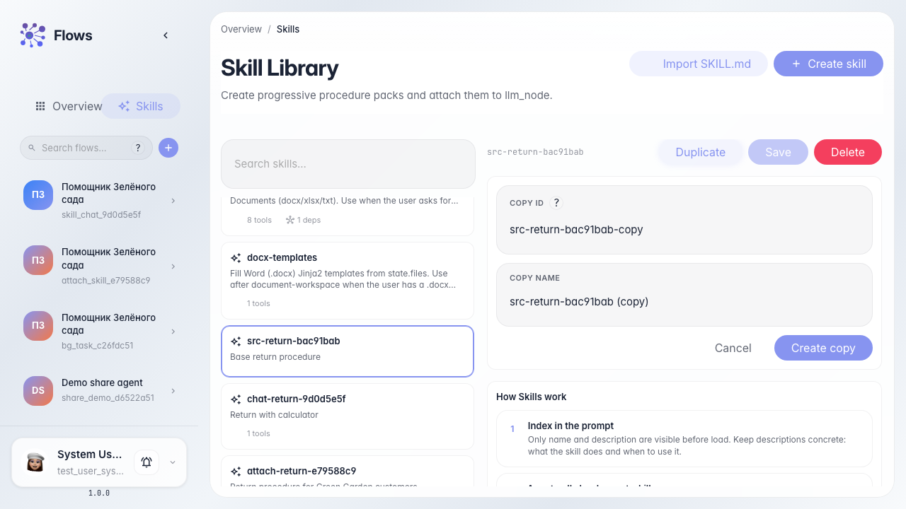
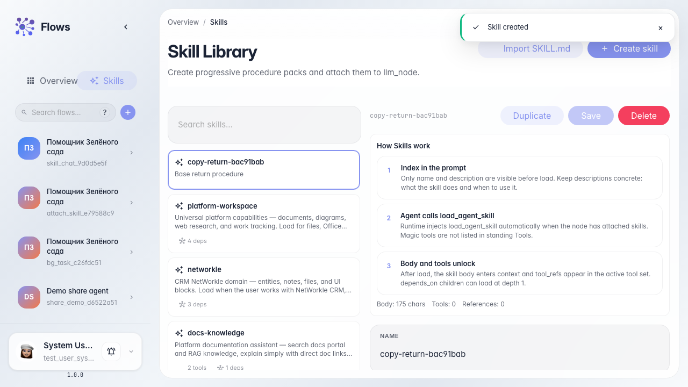
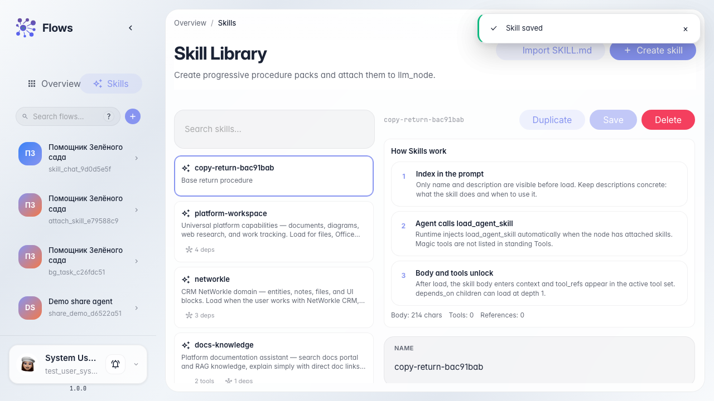

# Duplicate and edit a Skill

**What for:** this guide helps you copy a Skill and adjust the procedure for another store case.

**Problems it solves:** a similar scenario already exists, but you must not change the original — you need a copy with a new id.

**Result:** the library has a Skill copy with updated text.

## Step 1. Open the source Skill

In the library pick Order return. The editor opens on the right — from here you can duplicate without changing the original.

## Step 2. Open the duplicate form

Click Duplicate. Fields for the new id and copy name appear.

## Step 3. Set the copy id and name

Enter a new id and a name such as Order return (summer) and confirm. The editor switches to the copy.

## Step 4. Edit the copy and find it in the list

**Result demonstration.** Extend the steps for the summer case, save — the library shows a separate copy card.

**Summary.** You can duplicate a Skill and edit the copy without changing the original.

