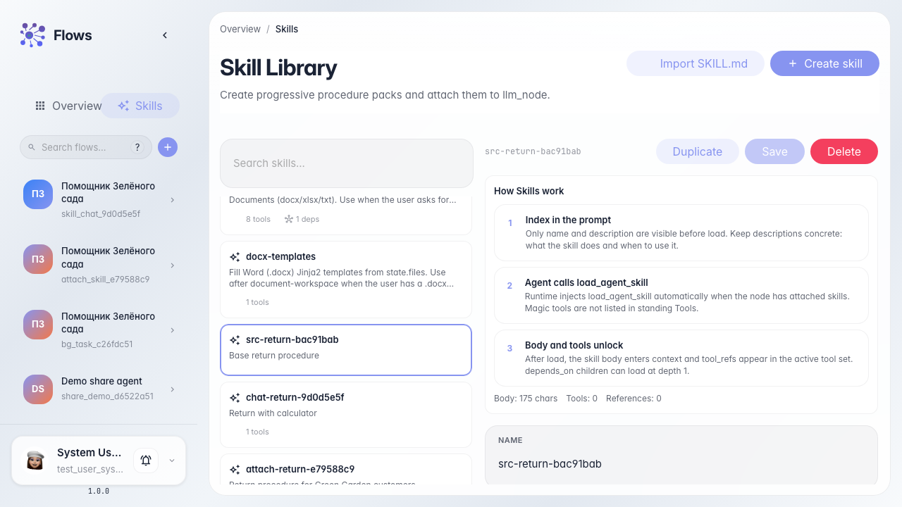
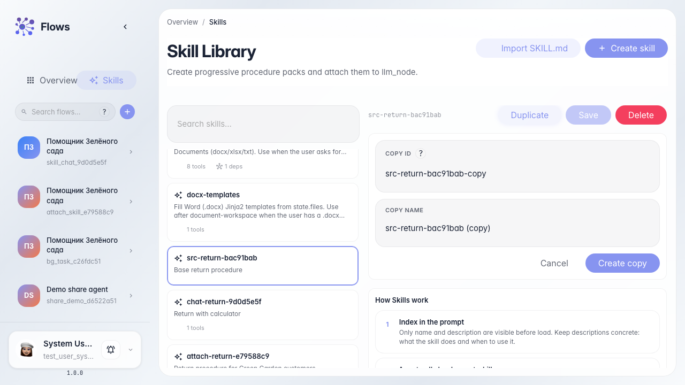
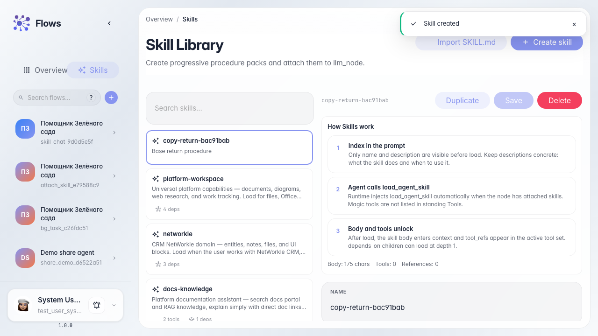
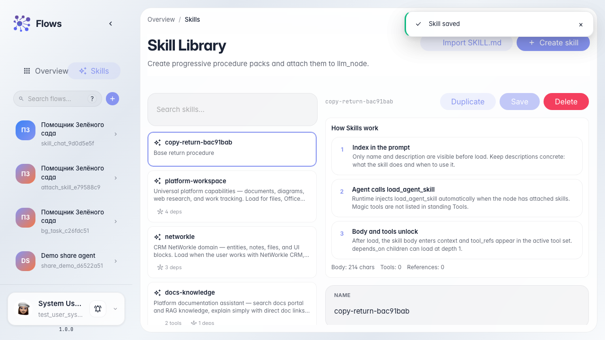

# Дублируем и правим Skill

**Для чего:** эта инструкция поможет скопировать Skill и подправить процедуру под другой кейс магазина.

**Какие проблемы решает:** похожий сценарий уже есть, но менять оригинал нельзя — нужна копия с новым идентификатором.

**Результат:** в библиотеке есть копия Skill с обновлённым текстом.

## Шаг 1. Откройте исходный Skill

В библиотеке выберите «Возврат заказа». Справа откроется редактор — отсюда можно сделать копию, не меняя оригинал.

## Шаг 2. Откройте форму дублирования

Нажмите «Дублировать». Появятся поля нового идентификатора и имени копии.

## Шаг 3. Задайте id и имя копии

Укажите новый идентификатор и имя вроде «Возврат заказа (лето)» и подтвердите. Редактор переключится на копию.

## Шаг 4. Отредактируйте копию и найдите её в списке

**Демонстрация результата.** Допишите шаги под летний кейс, сохраните — в библиотеке видна отдельная карточка копии.

**Итог.** Вы умеете дублировать Skill и править копию без изменения оригинала.

