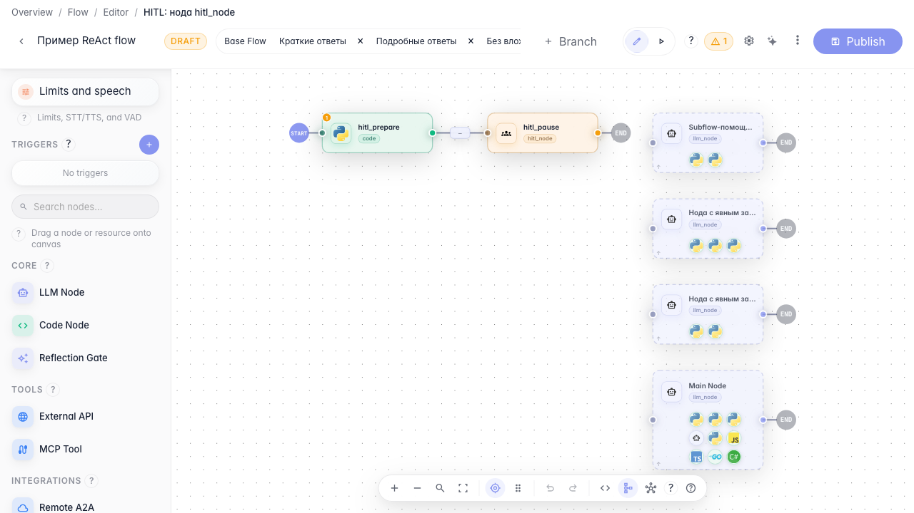
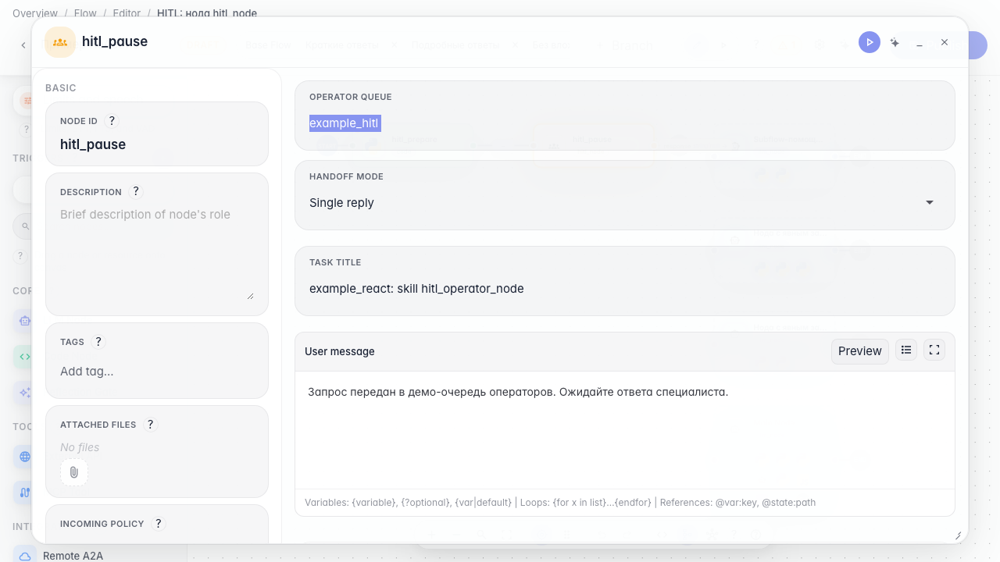
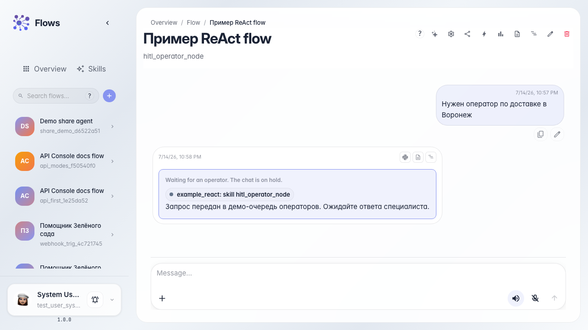

# Escalate a hard case to an operator

**What for:** this guide helps you route a complex customer request to a live operator through the Customer Support queue.

**Problems it solves:** the agent cannot always resolve a disputed issue alone; you need to know where in the graph to pause and wait for a human reply.

**Result:** the dialog goes to the support queue and the customer sees a clear message that an operator is on the way.

## Step 1. Open the operator handoff branch

In the Green Garden Assistant editor, open the demo branch with the operator handoff node. The canvas shows that context is prepared before the pause, and then the dialog stops until a human replies.

## Step 2. Check the handoff node settings

Open the operator handoff node. Set the Customer Support queue (demo queue example_hitl), single-reply mode, task title, and the waiting message for the customer. This way the agent explains that the request was passed to a live specialist.

## Step 3. Run test chat until handoff

Send a chat message that triggers operator handoff. A waiting banner appears — the dialog is paused until a reply from the Customer Support queue.

## Step 4. Check the task badge in chat

**Result demonstration.** A task badge appears next to the waiting banner — the request reached the queue and waits for an operator.

**Summary.** You can now configure the operator handoff node and see how the customer waits for a live specialist.

