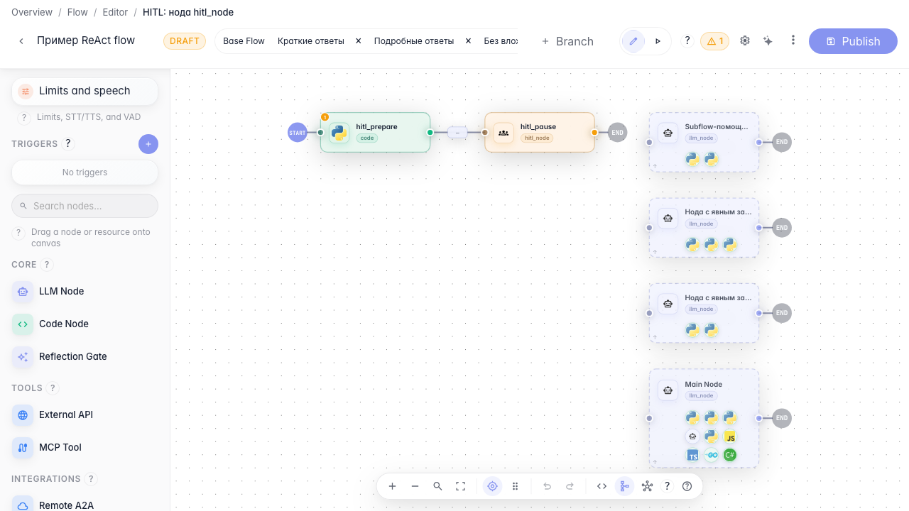
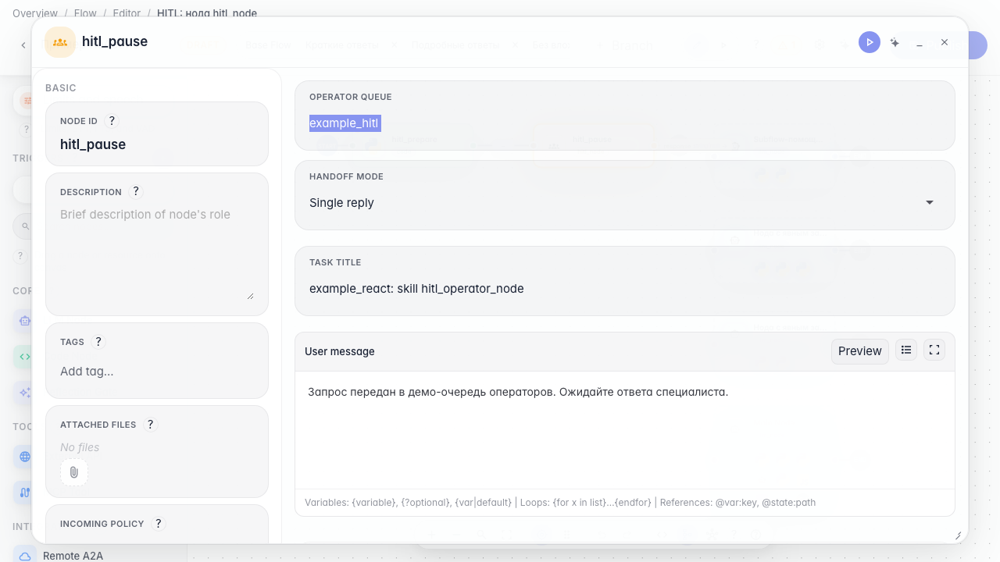
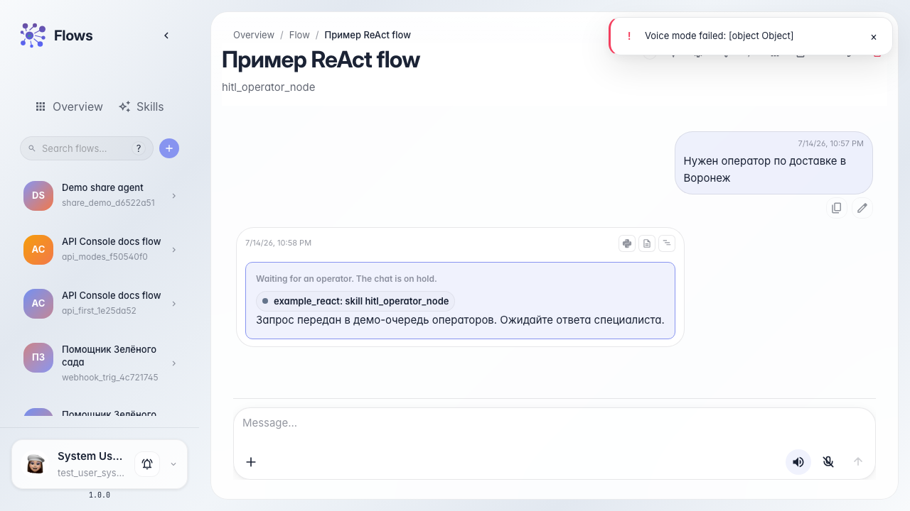

# Передаём сложный случай оператору

**Для чего:** эта инструкция поможет настроить передачу сложного обращения покупателя живому оператору через очередь «Поддержка клиентов».

**Какие проблемы решает:** агент не всегда может решить спорный вопрос сам — нужно понять, где в графе включить паузу и ожидание ответа человека.

**Результат:** диалог уходит в очередь поддержки, и покупатель видит понятное сообщение об ожидании оператора.

## Шаг 1. Откройте ветку с передачей оператору

В редакторе «Помощника Зелёного сада» откройте демо-ветку с нодой передачи оператору. На канве видно, что перед паузой подготавливается контекст обращения, а затем диалог останавливается до ответа человека.

## Шаг 2. Проверьте настройки ноды передачи

Откройте ноду передачи оператору. Укажите очередь «Поддержка клиентов» (демо-очередь example_hitl), режим «один ответ», заголовок задачи и текст для покупателя на время ожидания. Так агент объясняет, что запрос передан живому специалисту.

## Шаг 3. Запустите тестовый чат и доведите до передачи

Отправьте в чате сообщение, которое запускает передачу оператору. Появится плашка ожидания — диалог поставлен на паузу до ответа из очереди «Поддержка клиентов».

## Шаг 4. Проверьте карточку задачи в чате

**Демонстрация результата.** Рядом с плашкой ожидания видна карточка задачи — значит, обращение попало в очередь и ждёт оператора.

**Итог.** Теперь вы умеете настроить ноду передачи оператору и увидеть, как покупатель ждёт ответа живого специалиста.

