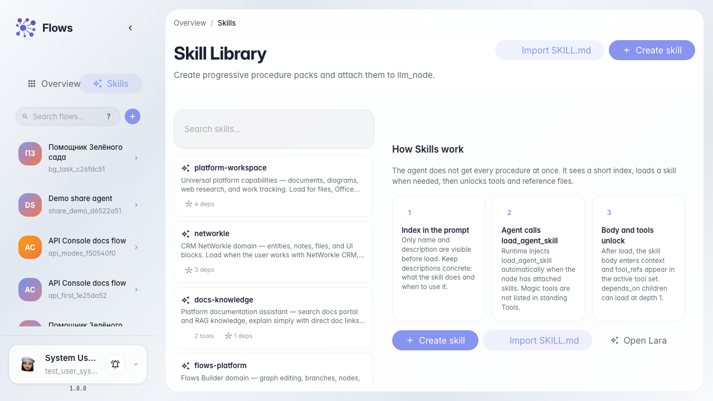
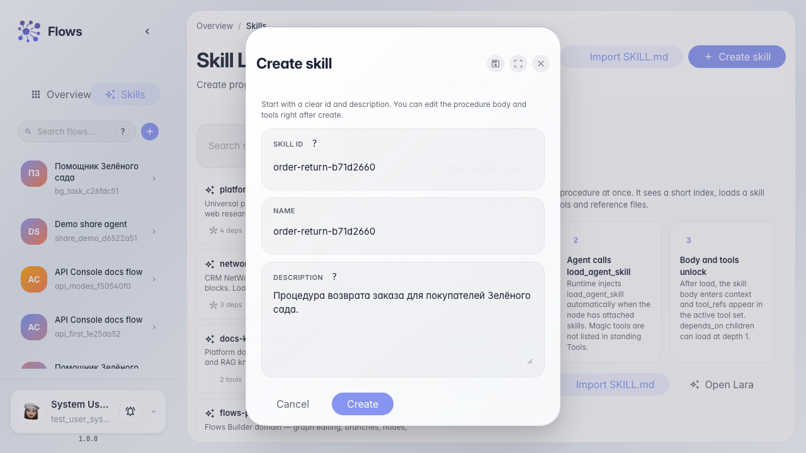
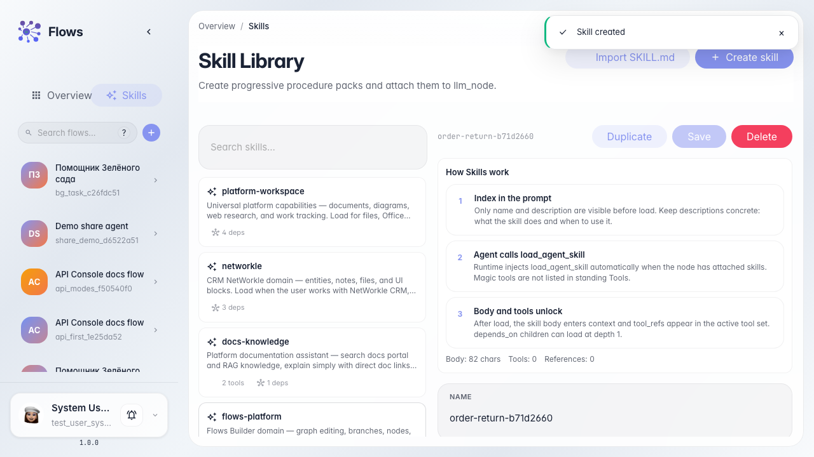
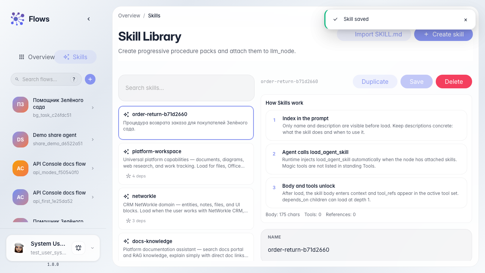
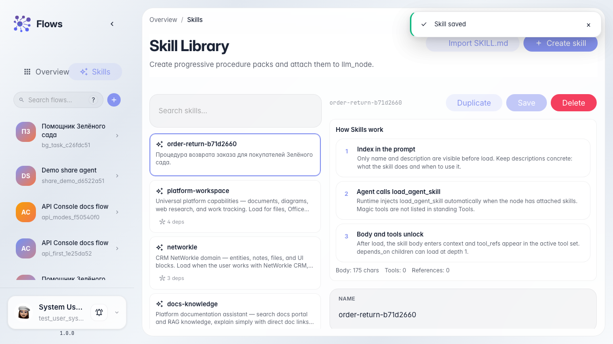

# Create the Order return Skill

**What for:** this guide helps you create a procedure (Skill) for the store assistant — a step-by-step order return scenario.

**Problems it solves:** it is unclear where the Skills library is and how a Skill differs from a tool or a graph branch.

**Result:** the Order return Skill is in the library with name, description, and procedure text.

## Step 1. Open the Skills library

In Flows open the Skills section. Procedures live here that the agent can load when needed — not a graph branch and not a standing Tools chip.

## Step 2. Fill id, name, and description

In the create form set a short latin id (for example order-return), the same value as the name, and a description about Green Garden returns so the Skill is easy to find.

## Step 3. Create the Skill and open the editor

Click Create. The procedure editor opens — write the steps the agent reads after the Skill is loaded.

## Step 4. Write the procedure and save

Describe the Green Garden return steps and save. Procedure text is guidance for the agent, not graph code.

## Step 5. Confirm the Skill is in the library list

**Result demonstration.** The Skills list shows the return procedure card — you can attach it to agents.

**Summary.** You can open the Skills library, create a procedure, and save its text.

