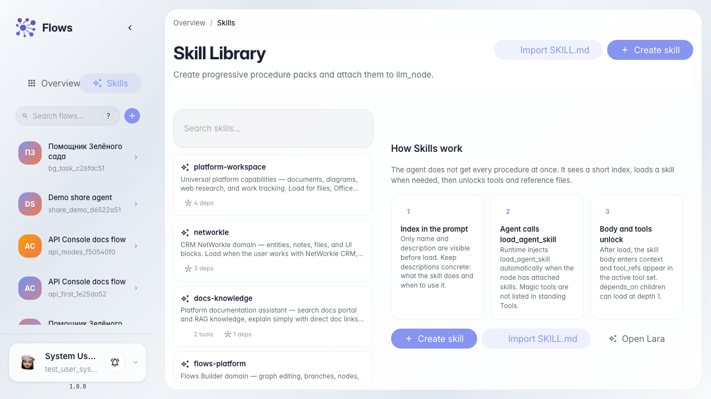
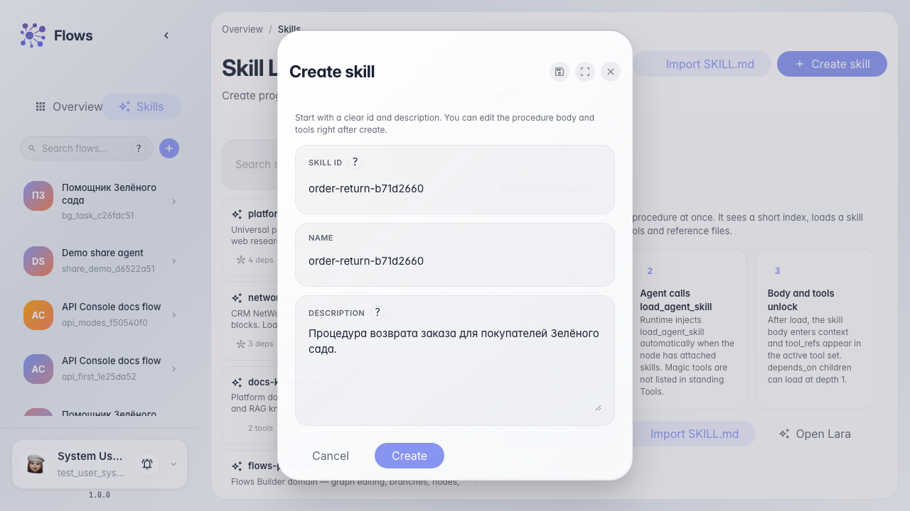
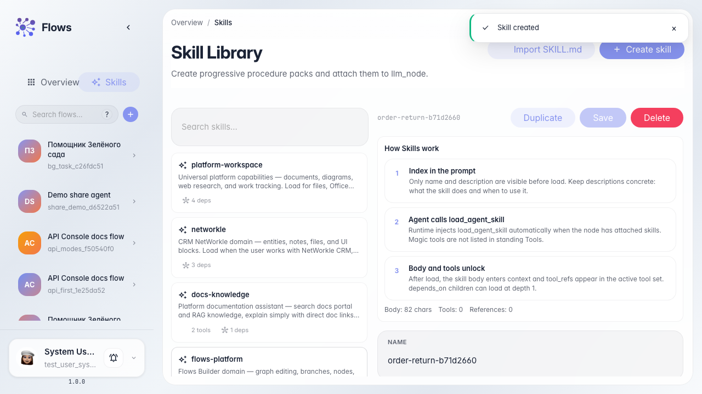
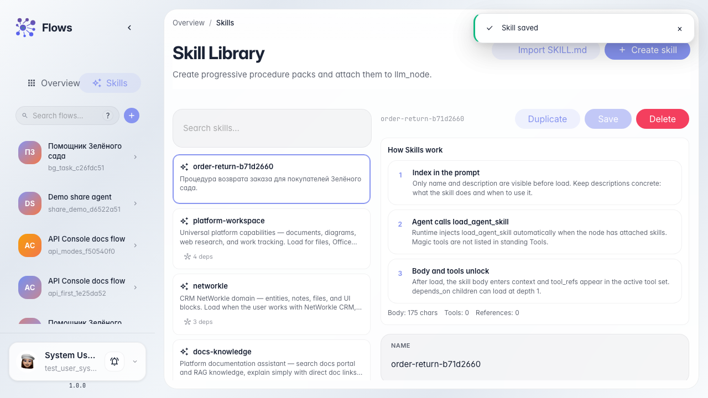
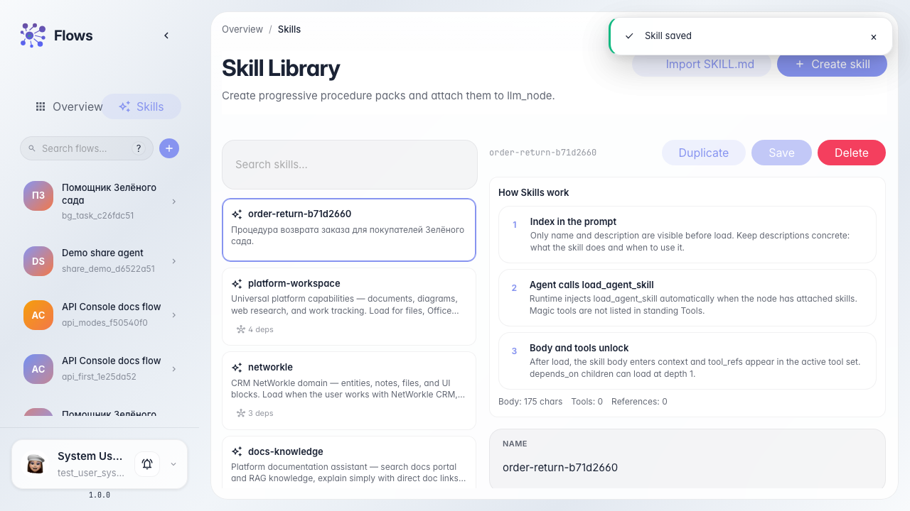

# Создаём Skill «Возврат заказа»

**Для чего:** эта инструкция поможет завести процедуру (Skill) для помощника магазина — пошаговый сценарий возврата заказа.

**Какие проблемы решает:** непонятно, где библиотека Skills и чем Skill отличается от инструмента и от ветки графа.

**Результат:** Skill «Возврат заказа» есть в библиотеке с именем, описанием и текстом процедуры.

## Шаг 1. Откройте библиотеку Skills

В Flows откройте раздел Skills. Здесь хранятся процедуры, которые агент может подключать по необходимости — это не ветка графа и не обычный инструмент из списка Tools.

## Шаг 2. Заполните идентификатор, имя и описание

В форме создания укажите короткий идентификатор латиницей (например order-return), то же значение в поле имени и описание про возврат для «Зелёного сада». Так Skill легко найти в библиотеке.

## Шаг 3. Создайте Skill и откройте редактор

Нажмите «Создать». Откроется редактор процедуры: здесь пишут шаги, которые агент прочитает после активации Skill.

## Шаг 4. Напишите процедуру и сохраните

Опишите шаги возврата для «Зелёного сада» и сохраните. Текст процедуры — инструкция для агента, а не код графа.

## Шаг 5. Убедитесь, что Skill в списке библиотеки

**Демонстрация результата.** В списке Skills видна карточка процедуры возврата — её можно подключать к агентам.

**Итог.** Вы умеете открывать библиотеку Skills, создавать процедуру и сохранять её текст.

