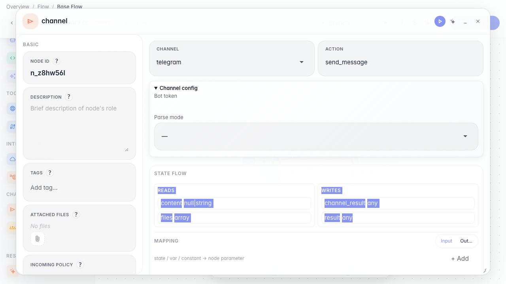
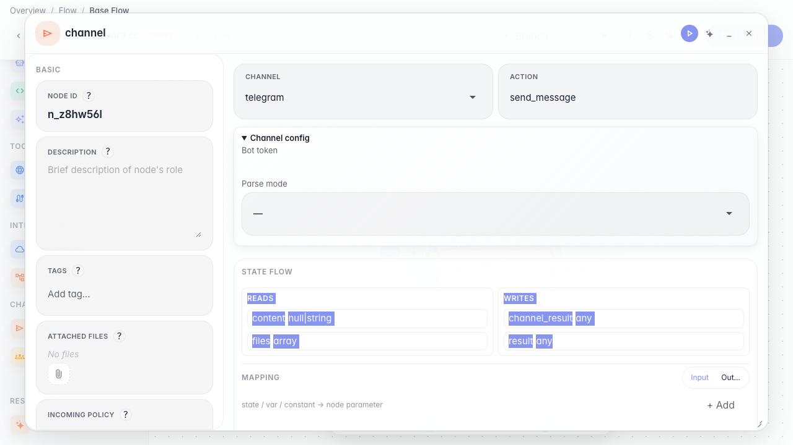
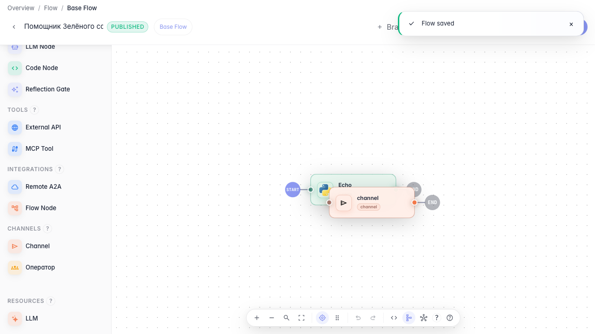

# Send the answer to Telegram

**What for:** this guide configures delivering a message to the customer in Telegram.

**Problems it solves:** the agent reply must also reach the store bot, not only the test chat.

**Result:** a Telegram channel node with demo bot settings.

## Step 1. Add a channel node

Drag a Channel node and open its settings. Here you choose how to deliver the reply — Telegram, email, or webhook.

## Step 2. Choose Telegram and set the bot

Keep Telegram as the channel and set the bot token (in this tutorial — «@zeleniy_sad_bot»). The agent then knows where to send notifications.

## Step 3. Publish the Telegram channel

**Result demonstration.** The Telegram channel node is saved in the graph — the agent can send replies to the store bot.

**Summary.** You can add a channel node and configure Telegram message delivery.

