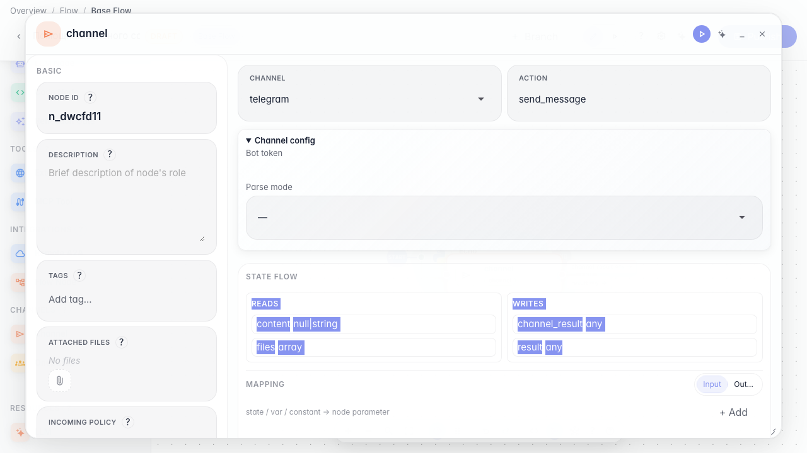
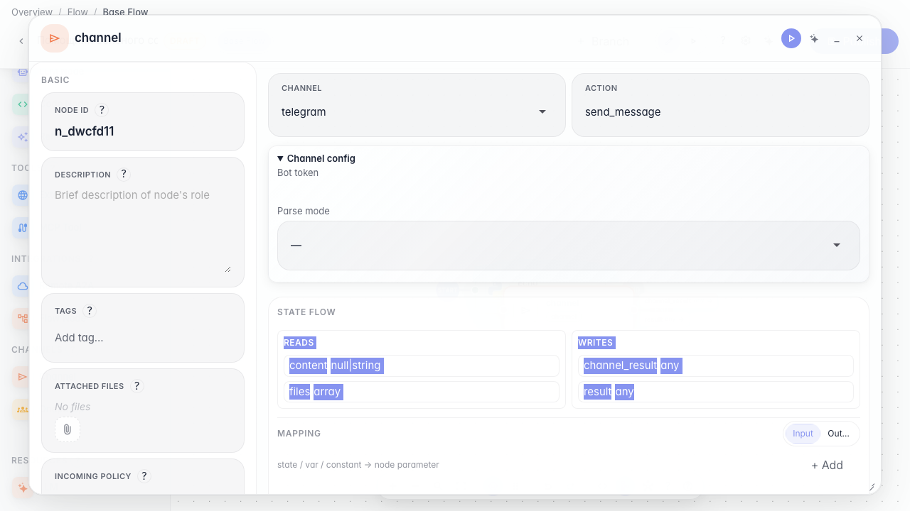
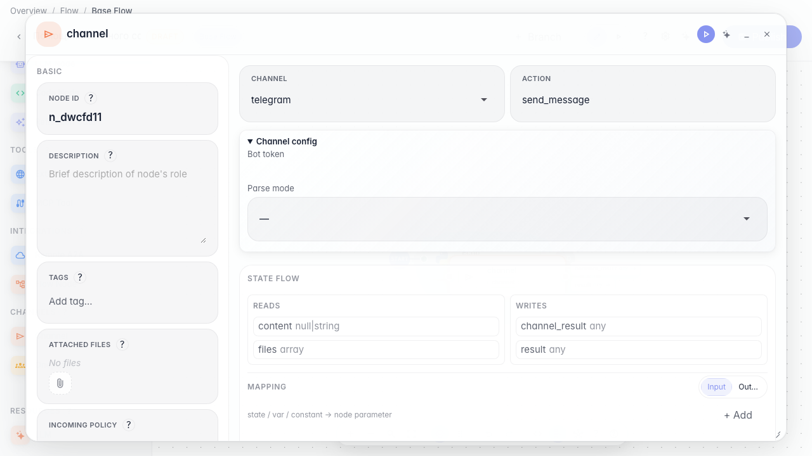
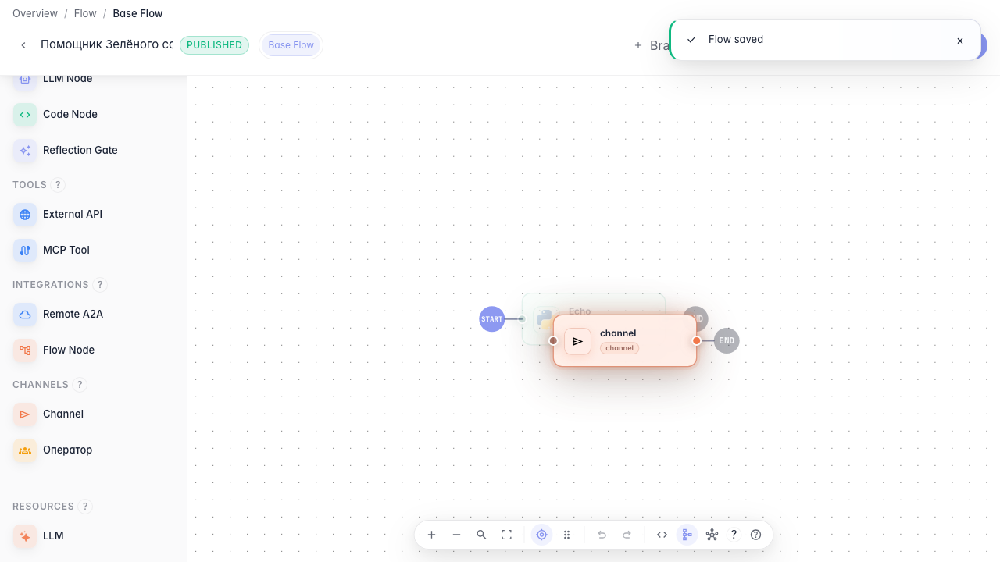

# Отправляем ответ в Telegram

**Для чего:** эта инструкция настроит доставку сообщения покупателю в Telegram.

**Какие проблемы решает:** ответ агента нужно продублировать в бот магазина, а не только показать в тестовом чате.

**Результат:** нода канала Telegram с демо-настройками бота.

## Шаг 1. Добавьте ноду канала

Перетащите ноду «Канал» и откройте её настройки. Здесь выбирается способ доставки ответа — Telegram, email или webhook.

## Шаг 2. Выберите Telegram и укажите бота

Оставьте канал Telegram и укажите токен бота (в учебном примере — «@zeleniy_sad_bot»). Так агент знает, куда отправлять уведомление.

## Шаг 3. Проверьте настройки канала перед публикацией

Снова откройте ноду канала и убедитесь, что выбран Telegram и указан токен через переменную — доставка ответов пойдёт в бот магазина.

## Шаг 4. Опубликуйте канал Telegram

**Демонстрация результата.** Нода канала Telegram сохранена в графе — агент может отправлять ответы в бот магазина.

**Итог.** Теперь вы умеете добавлять channel-ноду и настраивать доставку сообщений в Telegram.

