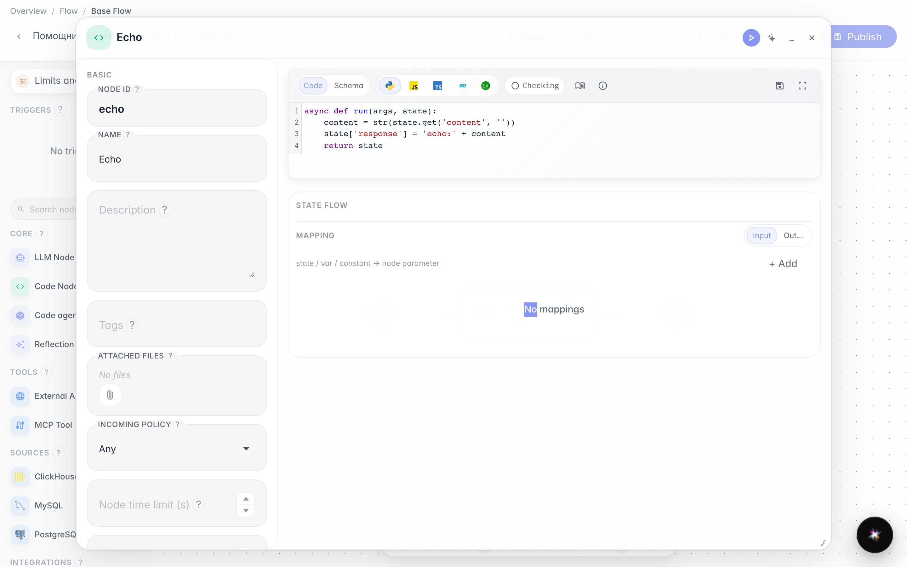
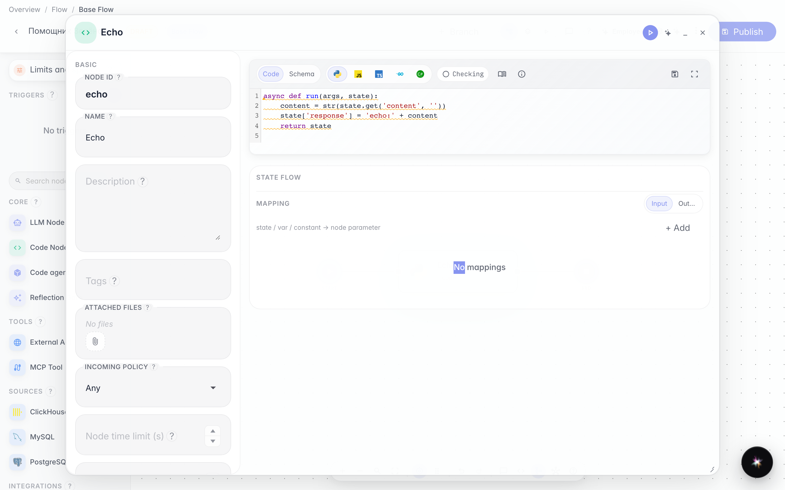
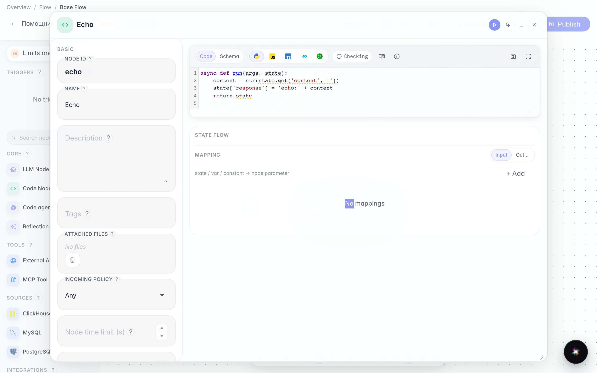

# Process data with a code node

**What for:** this guide shows how to compute or transform data inside an agent with a code node.

**Problems it solves:** not everything fits a prompt — sometimes you need exact calculations or order field transforms.

**Result:** a code echo node is ready to run in the graph.

## Step 1. Add a code node to the canvas

Drag a Code node from the left palette onto the canvas. Use it for precise calculations and data transforms between agent steps.

## Step 2. Write the processing code

On the Code tab define run: it reads input and writes the result to state['response'] so the next node gets a ready value.

## Step 3. Review the code before publishing

Reopen the code node and confirm the echo logic is still there. This verifies the draft before saving to the published version.

