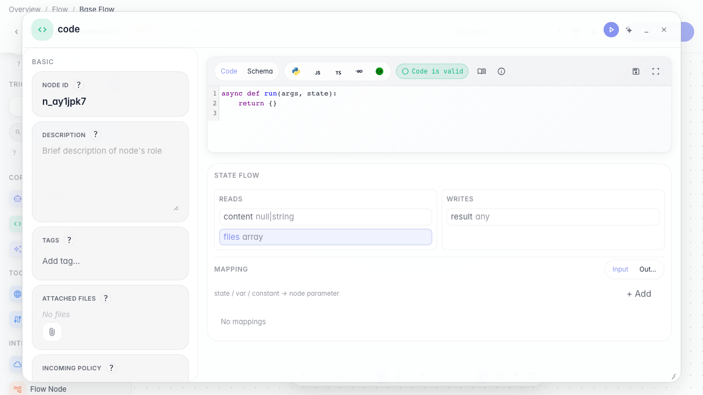
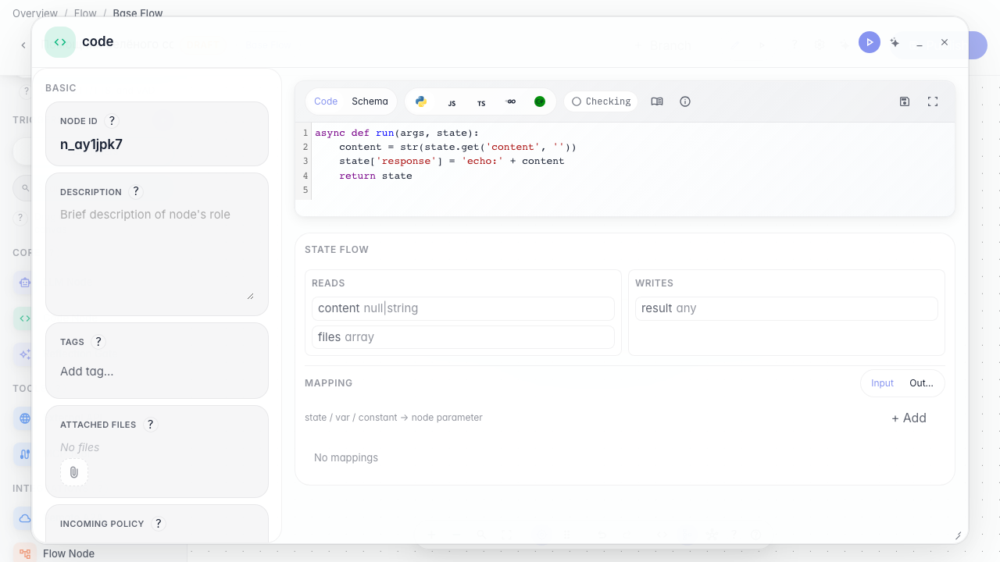
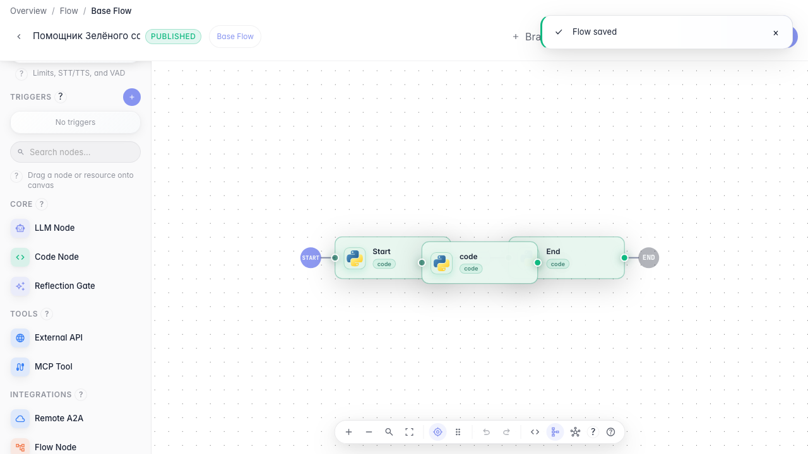

# Обрабатываем данные кодом

**Для чего:** эта инструкция покажет, как посчитать или преобразовать данные внутри агента с помощью ноды кода.

**Какие проблемы решает:** не всё можно описать промптом — иногда нужен точный расчёт или преобразование полей заказа.

**Результат:** нода кода эхо-обрабатывает вход и готова к запуску в графе.

## Шаг 1. Добавьте ноду кода на канву

Перетащите ноду «Код» из палитры слева на канву. Она нужна для точных вычислений и преобразований данных между шагами агента.

## Шаг 2. Напишите код обработки

Во вкладке «Код» опишите функцию run: она читает вход и записывает результат в state['response']. Так следующая нода получит готовое значение.

## Шаг 3. Опубликуйте граф с кодом

**Демонстрация результата.** После публикации код сохранён в ноде — при повторном открытии видна та же логика echo.

**Итог.** Теперь вы умеете добавлять ноду кода и писать обработку данных внутри агента «Зелёного сада».

