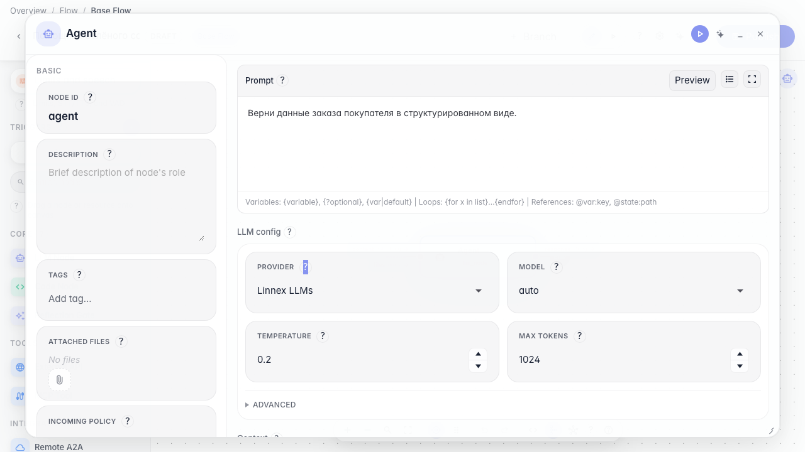
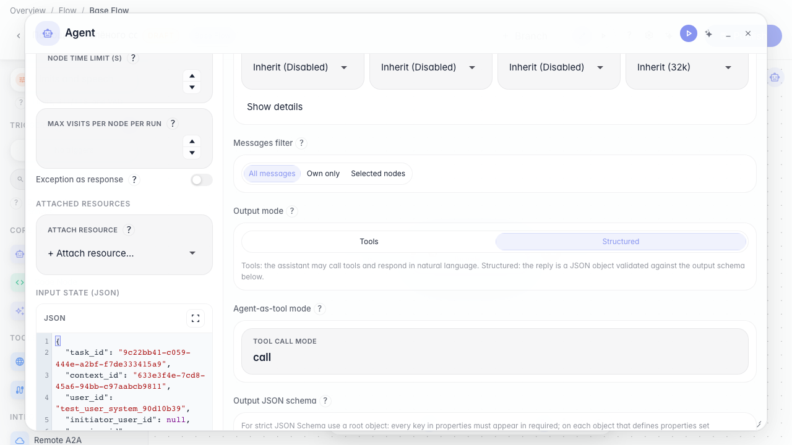
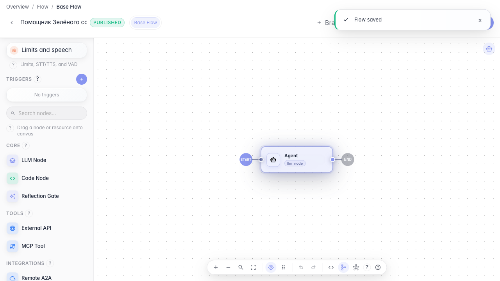

# Get a strict JSON answer

**What for:** this guide helps you get agent replies in a fixed JSON shape for downstream processing in the graph.

**Problems it solves:** free text is hard to pass to the next node — you need predictable order fields.

**Result:** the agent is configured for structured output with a JSON schema.

## Step 1. Open agent settings

In the node editor find the Output mode block. It decides whether the reply is plain text with tools or strict JSON.

## Step 2. Enable structured output

Switch the mode to Structured. A JSON schema editor appears. The Skills section is hidden in this mode — procedures and meta-tools work only in Tools mode.

## Step 3. Refine schema and instruction

Review the output schema and extend the instruction with the fields the store needs. This tells the agent what JSON the next graph step expects.

## Step 4. Publish and verify the setting

**Result demonstration.** After publishing, structured mode and the JSON schema are saved on the agent and visible when you reopen the node.

**Summary.** You can enable structured replies and define a response schema for automatic order data processing.

