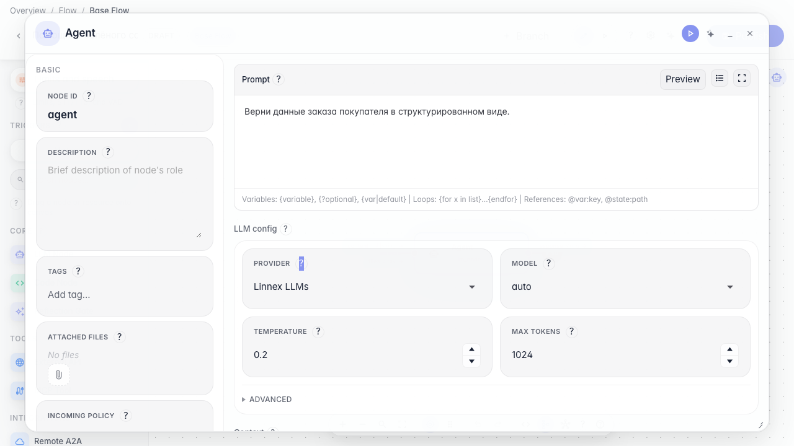
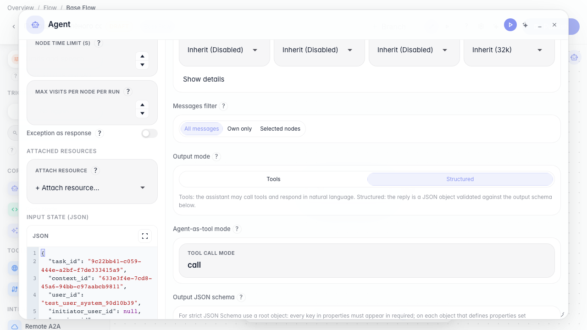
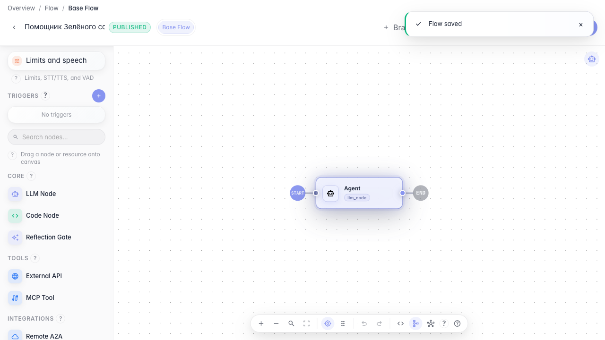

# Строгий JSON-ответ агента

**Для чего:** эта инструкция поможет получать ответ агента в заданной JSON-структуре для дальнейшей обработки в графе.

**Какие проблемы решает:** свободный текст сложно передать следующей ноде — нужен предсказуемый формат полей заказа.

**Результат:** агент настроен на структурированный вывод со схемой JSON.

## Шаг 1. Откройте настройки агента

В редакторе ноды найдите блок «Режим вывода». Он определяет, будет ли ответ обычным текстом с инструментами или строгим JSON.

## Шаг 2. Включите структурированный вывод

Переключите режим на «Структурированный». Появится редактор JSON-схемы. Секция Skills в этом режиме скрыта — процедуры и meta-tools работают только в режиме «Инструменты».

## Шаг 3. Уточните схему и инструкцию

Проверьте схему вывода и допишите в инструкции, какие поля нужны магазину. Так агент понимает, какой JSON ожидает следующий шаг графа.

## Шаг 4. Опубликуйте и проверьте настройку

**Демонстрация результата.** После публикации режим структурированного вывода и JSON-схема сохранены в агенте — их видно при повторном открытии ноды.

**Итог.** Теперь вы умеете включать структурированный вывод и задавать схему ответа для автоматической обработки данных заказа.

