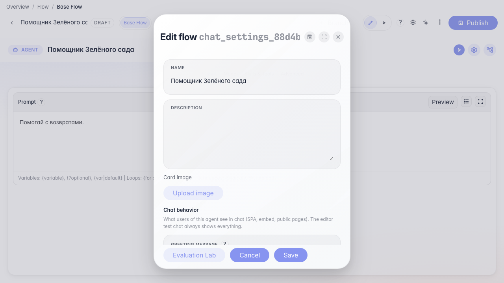
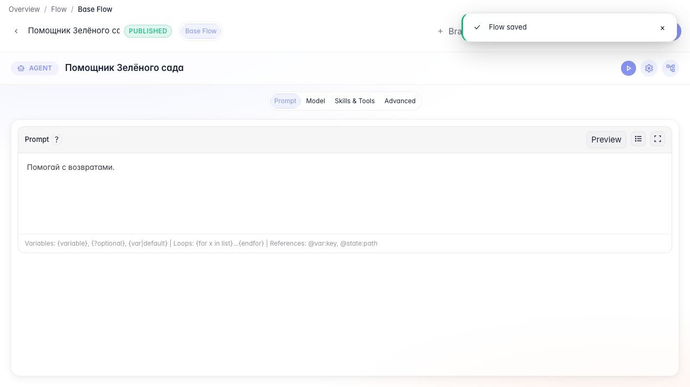
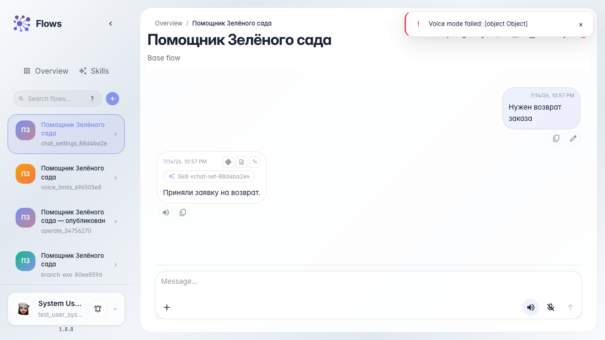

# Chat settings for customers

**What for:** this guide helps you control whether customers see Skill activations in chat.

**Problems it solves:** procedure chips distract customers or, conversely, are needed for transparency — the toggle lives in chat settings.

**Result:** the Skill activation visibility setting is toggled and verified in chat.

## Step 1. Enable Skill activation chips

In agent settings open chat options and enable Skill activation chips. Customers will see chips for loaded procedures.

## Step 2. Save and publish the agent

Save the card and publish the draft so the chat setting applies to the live version.

## Step 3. Check chat with visible chips

Ask about a return — a Skill activation chip appears in the feed so the customer sees which procedure ran.

## Step 4. Disable chips and publish again

**Result demonstration.** Turn off Skill activation chips and publish — customer chat hides procedure chips.

**Summary.** You can toggle Skill activation visibility in chat settings.

