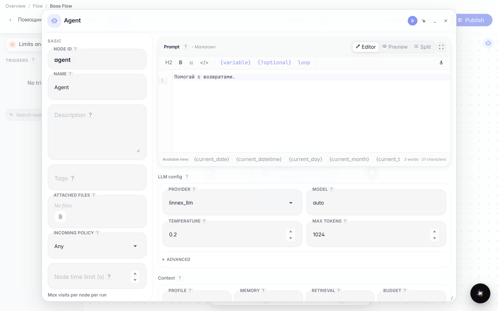
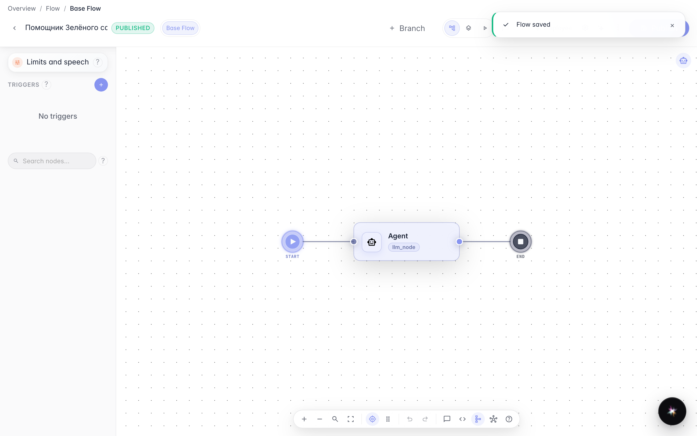
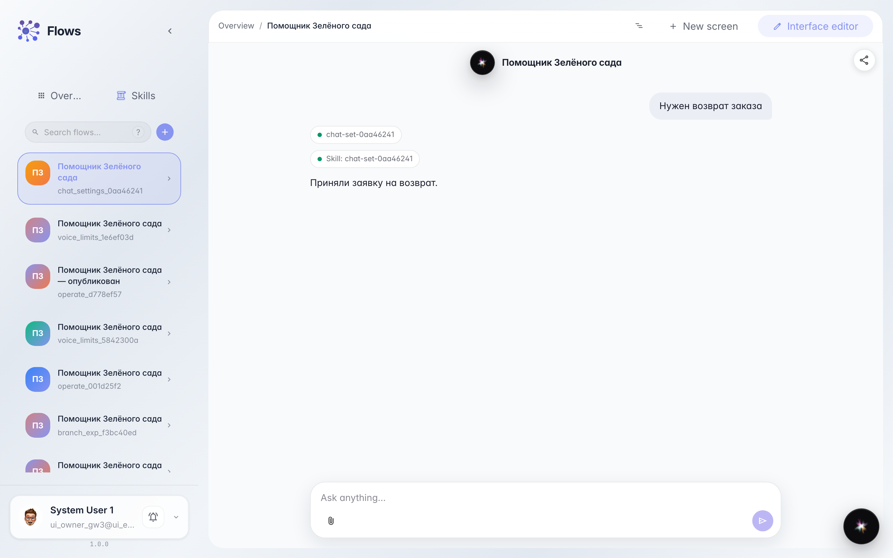

# Настройки чата для покупателей

**Для чего:** эта инструкция поможет управлять тем, видит ли покупатель активации Skills в чате.

**Какие проблемы решает:** чипы процедур отвлекают клиента или, наоборот, нужны для прозрачности — рычаг в настройках чата.

**Результат:** параметр показа активаций Skills переключён и проверен в чате.

## Шаг 1. Включите показ активаций Skills

В настройках агента откройте параметры чата и включите показ активации Skills. Покупатель увидит чипы загруженных процедур.

## Шаг 2. Сохраните и опубликуйте агента

Сохраните карточку и опубликуйте черновик — настройка чата попадёт в рабочую версию.

## Шаг 3. Проверьте чат с видимыми чипами

Задайте вопрос о возврате — в ленте появится чип активации Skill. Так покупатель видит, какая процедура сработала.

