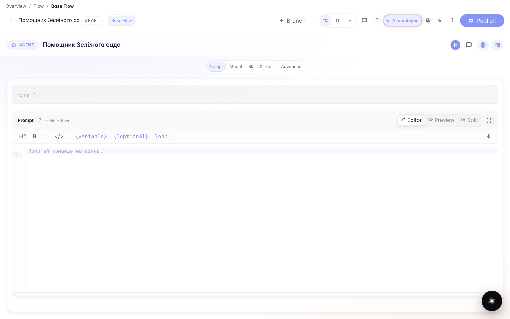
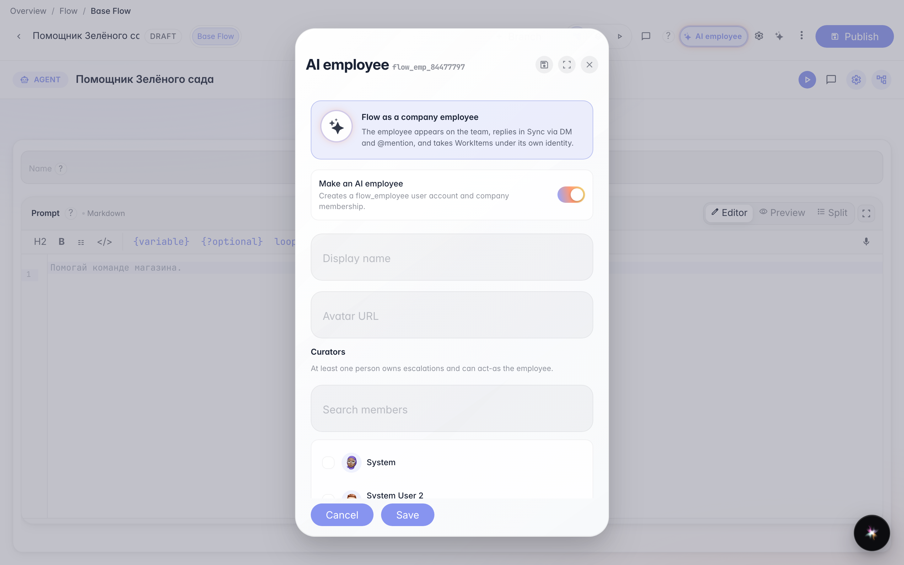
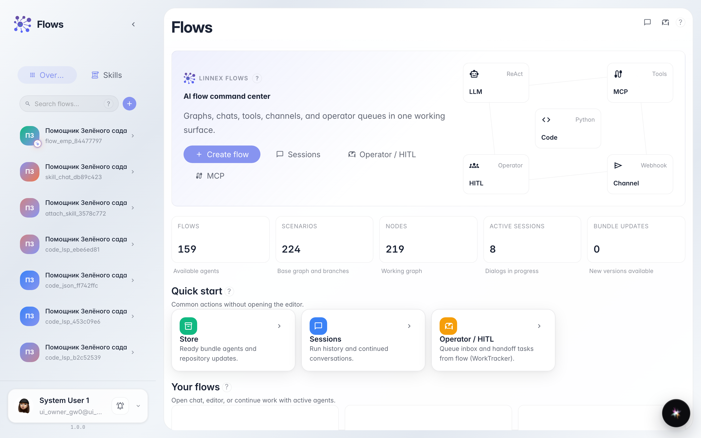
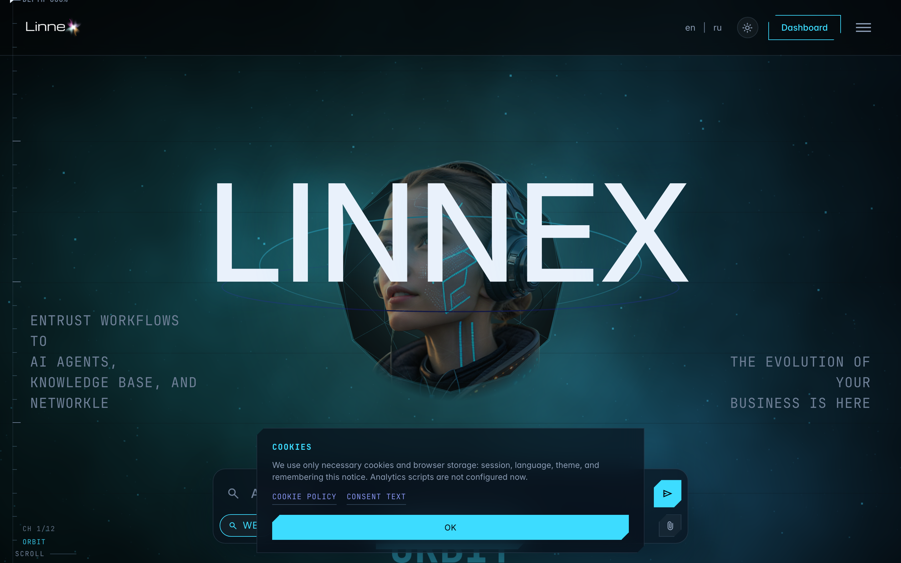
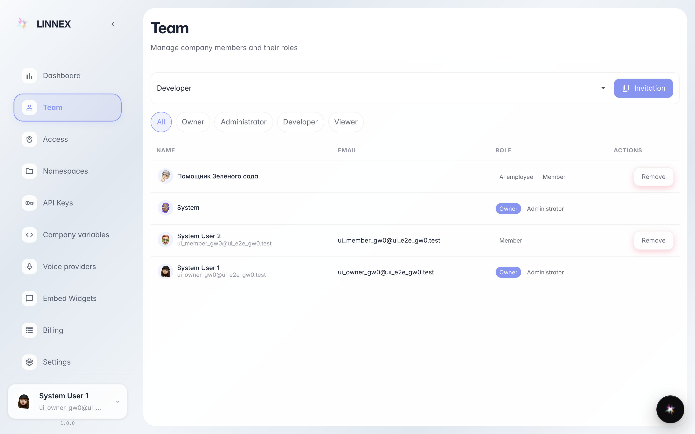

# Enable the agent as an AI employee

**What for:** this guide shows how an agent appears on the company team as an AI employee.

**Problems it solves:** it is unclear where to see that a flow is a team member, not only a chat bot.

**Result:** the team page shows an AI employee badge for the Green Garden assistant.

## Step 1. Open the employee agent in the editor

Open the Green Garden Assistant in the editor. The header shows an AI employee chip when the agent is enabled as a company employee.

## Step 2. Open AI employee settings

Click the header chip. The settings menu opens: enable employee, display name, and human curators.

## Step 3. Confirm the employee badge in the flow list

In the sidebar the agent card shows an AI badge on the avatar — the flow is an employee.

## Step 4. Go to the team section

Open the company team page. People and AI employees are listed here.

## Step 5. Find the AI employee in the list

In the team list find the assistant entry. An AI employee has its own member card.

## Step 6. Confirm the AI employee badge

**Result demonstration.** Next to the member you see the AI employee badge — the agent is on the team.

**Summary.** You understand how an employee agent appears on the team page.

