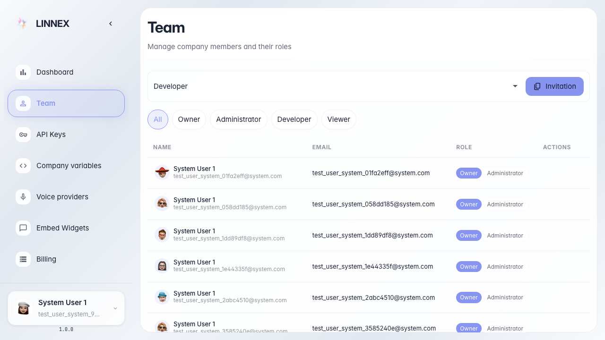

# Включаем агента как AI-сотрудника

**Для чего:** эта инструкция покажет, как агент появляется в команде компании как AI-сотрудник.

**Какие проблемы решает:** непонятно, где увидеть, что flow работает как участник команды, а не только как чат-бот.

**Результат:** на странице команды виден бейдж AI-сотрудника у помощника «Зелёного сада».

## Шаг 1. Откройте опубликованного агента-сотрудника

Откройте «Помощника Зелёного сада» в редакторе. Когда агент включён как сотрудник компании, он получает учётную запись в команде.

## Шаг 2. Перейдите в раздел команды

Откройте страницу команды компании. Здесь перечислены люди и AI-сотрудники.

## Шаг 3. Найдите AI-сотрудника в списке

В списке команды найдите запись помощника. У AI-сотрудника отдельная карточка участника.

## Шаг 4. Убедитесь в бейдже AI-сотрудника

**Демонстрация результата.** Рядом с участником виден бейдж «AI-сотрудник» — агент состоит в команде.

**Итог.** Вы понимаете, как агент-сотрудник отображается на странице команды.

