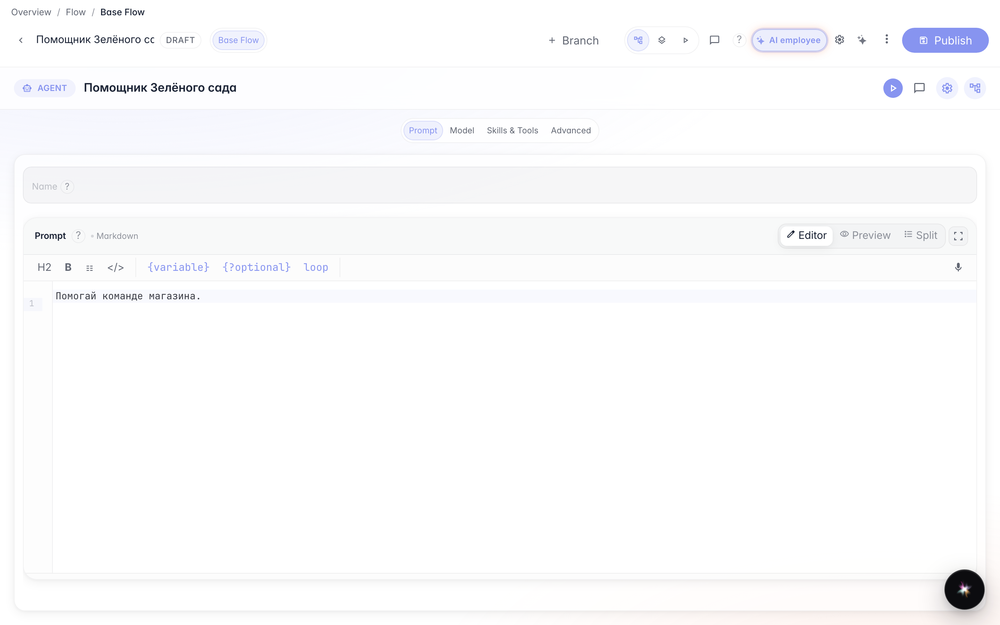
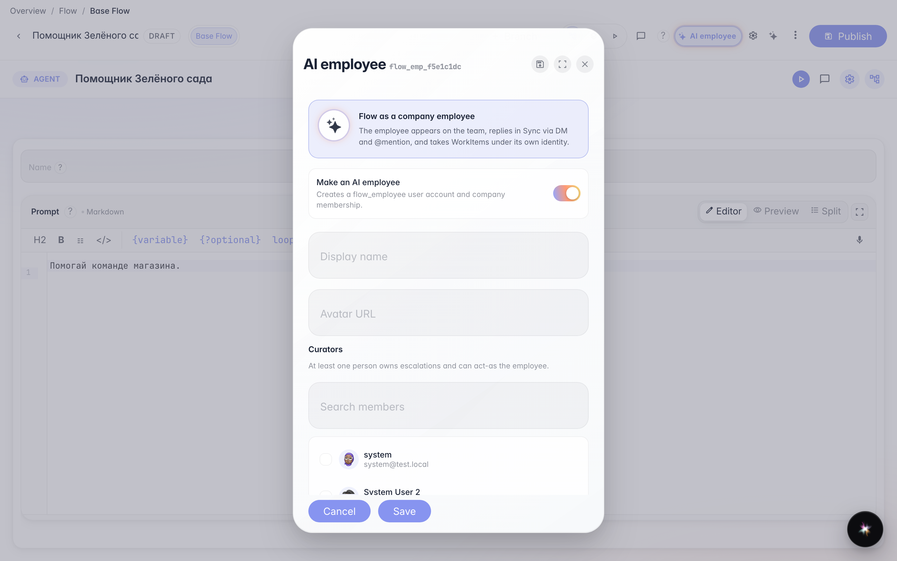

# Включаем агента как AI-сотрудника

**Для чего:** эта инструкция покажет, как агент появляется в команде компании как AI-сотрудник.

**Какие проблемы решает:** непонятно, где увидеть, что flow работает как участник команды, а не только как чат-бот.

**Результат:** на странице команды виден бейдж AI-сотрудника у помощника «Зелёного сада».

## Шаг 1. Откройте опубликованного агента-сотрудника

Откройте «Помощника Зелёного сада» в редакторе. В шапке виден chip «AI-сотрудник» — агент включён как сотрудник компании.

## Шаг 2. Откройте настройки AI-сотрудника

Нажмите chip в шапке. Откроется меню: включение сотрудника, имя и кураторы-люди.

