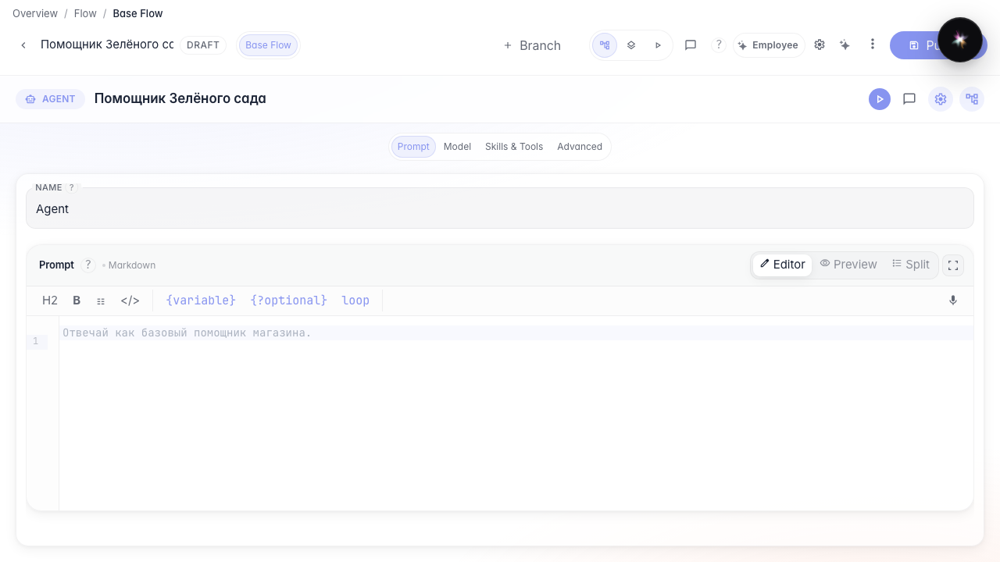
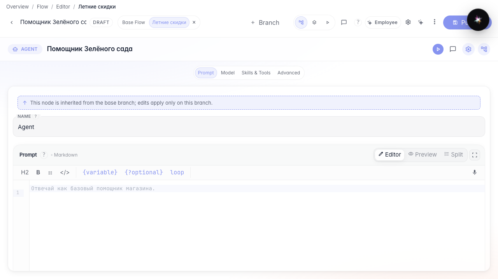
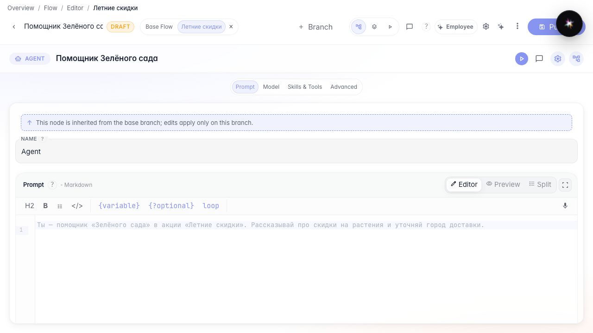

# Experiment in a branch

**What for:** this guide helps you try an idea in a separate branch without changing the main agent version.

**Problems it solves:** you may hesitate to edit a live assistant when testing a promotion or a new instruction.

**Result:** the Summer sale branch keeps its own changes.

## Step 1. Open the agent in the editor

The editor header shows branch tabs. The base branch is the live agent version users get by default.

## Step 2. Create and open the Summer sale branch

Click + next to branch tabs, set an identifier and promotion name. After creation, switch to the new tab — changes stay in this branch only.

## Step 3. Update the instruction for the promotion

Open the answer node and rewrite the instruction for the summer promotion. Some settings inherit from the base branch, while the prompt text can be changed locally.

