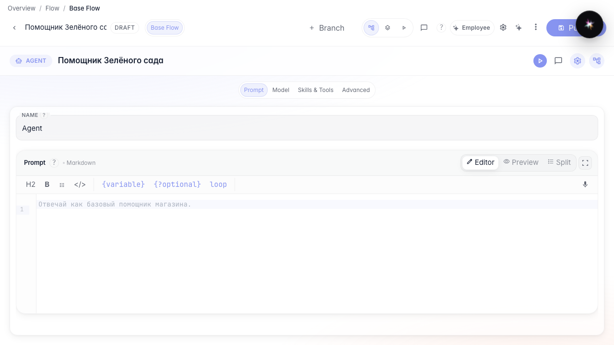
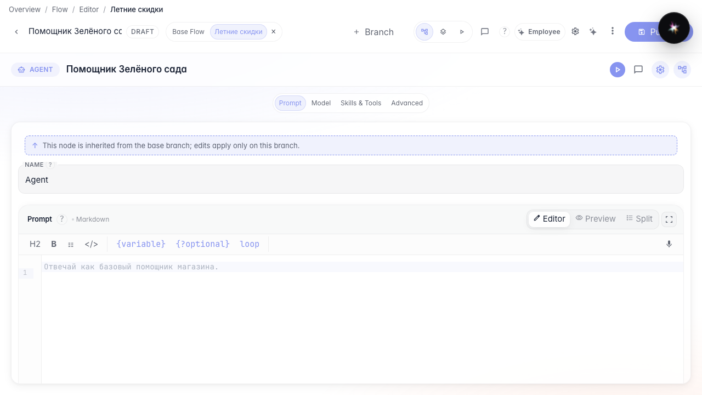
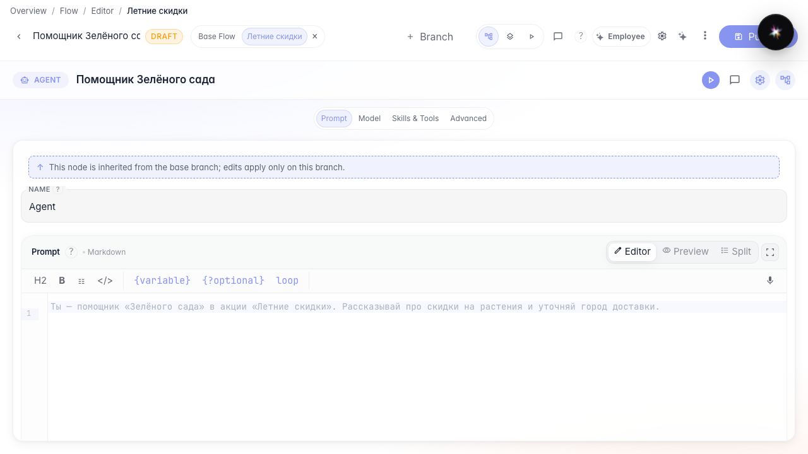

# Экспериментируем в ветке

**Для чего:** эта инструкция поможет проверить идею в отдельной ветке, не меняя основную версию агента.

**Какие проблемы решает:** страшно ломать рабочего помощника, когда нужно протестировать акцию или новый промпт.

**Результат:** в ветке «Летние скидки» сохранены отдельные изменения.

## Шаг 1. Откройте агента в редакторе

В шапке редактора видны вкладки веток. Базовая ветка — это рабочая версия агента, которую видят пользователи по умолчанию.

## Шаг 2. Создайте и откройте ветку «Летние скидки»

Нажмите «+» рядом с вкладками веток, задайте идентификатор и название акции. После создания переключитесь на новую вкладку — изменения будут жить только в этой ветке.

## Шаг 3. Измените инструкцию под акцию

Откройте ноду ответа и перепишите инструкцию под летнюю акцию. Часть настроек наследуется из базовой ветки, а текст промпта можно менять локально.

