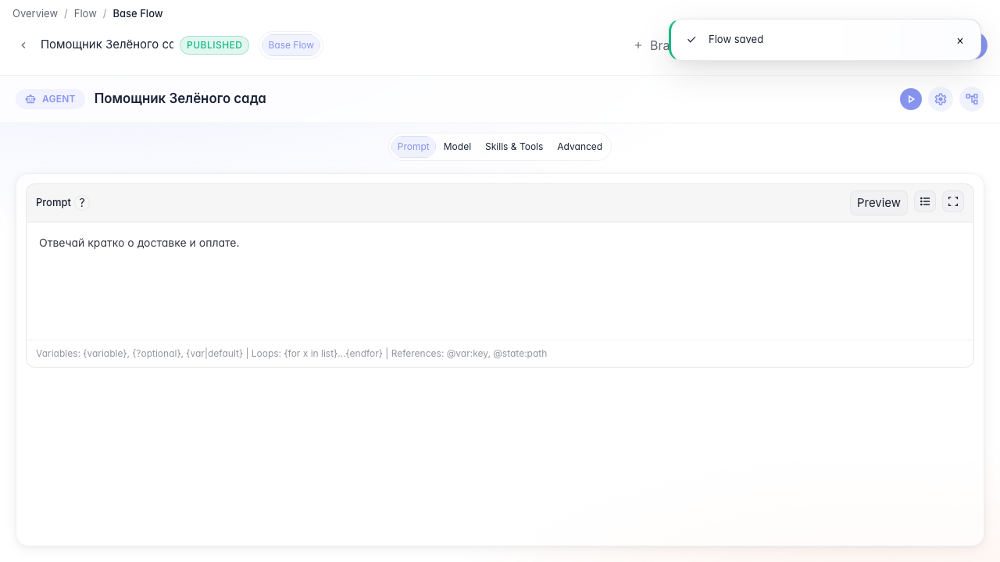
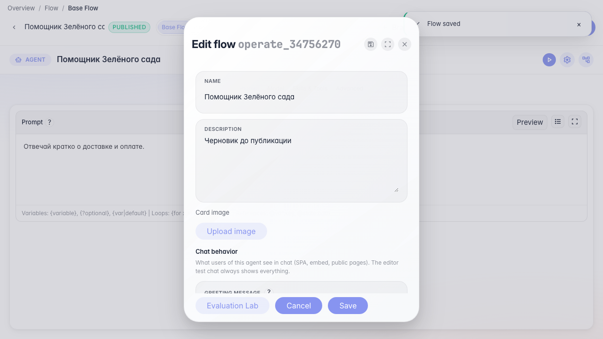
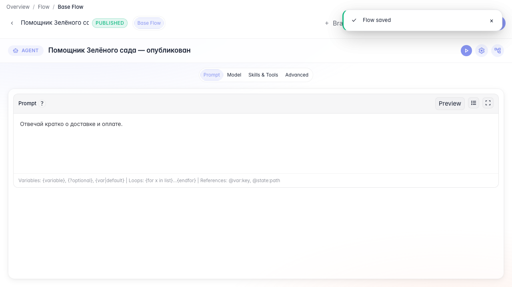
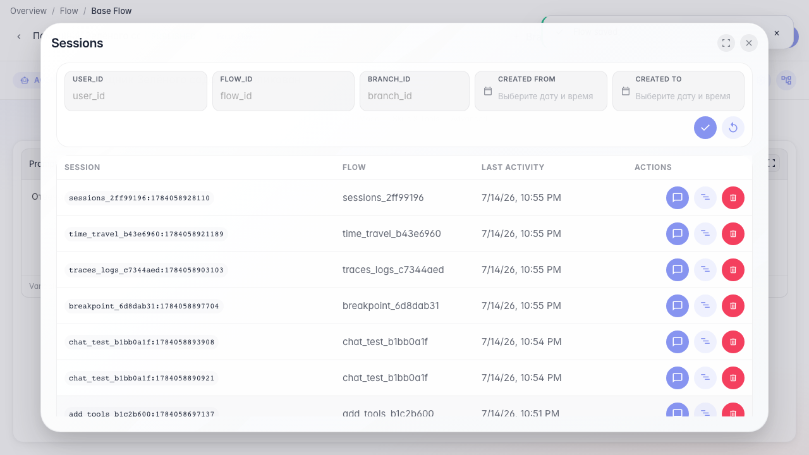
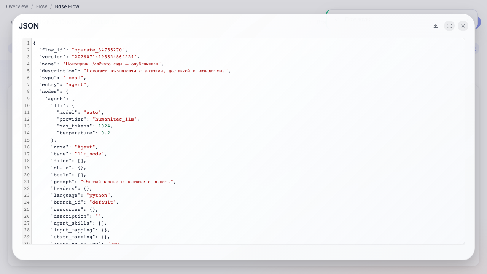

# Publish and operate the agent

**What for:** this guide helps you release an agent and manage its card and sessions.

**Problems it solves:** after editing, it is unclear how to save the live version, update the description, and review conversations.

**Result:** the agent is published, the card is updated, and sessions plus JSON config are available.

## Step 1. Publish the agent

Click Publish in the editor header. After that, user chat, API, and guest links use the saved version.

## Step 2. Enable showing Skill activations in chat

In Agent settings find chat options and enable showing Skill activations. Then the dialog shows chips for loaded procedures. Full chat setup is in a separate guide.

## Step 3. Update the agent card

In the same settings window change the name and description. These fields appear in the catalog and chat.

## Step 4. Open the sessions list

From the editor menu, open Sessions. Here you can find past conversations and return to problematic requests.

## Step 5. Export the JSON configuration

**Result demonstration.** The agent is published, the card is updated, sessions are available, and the JSON config can be saved as a backup.

**Summary.** You can now release an agent, manage its card, and use the editor's operational tools.

