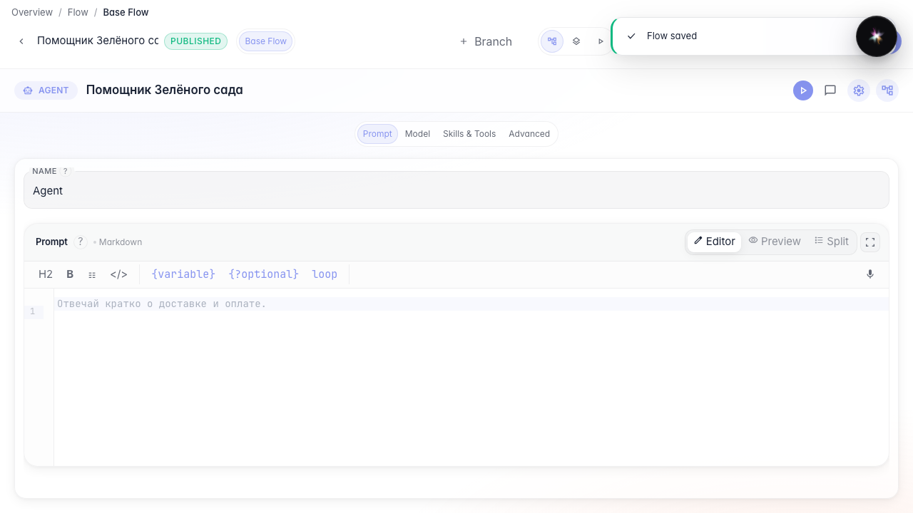
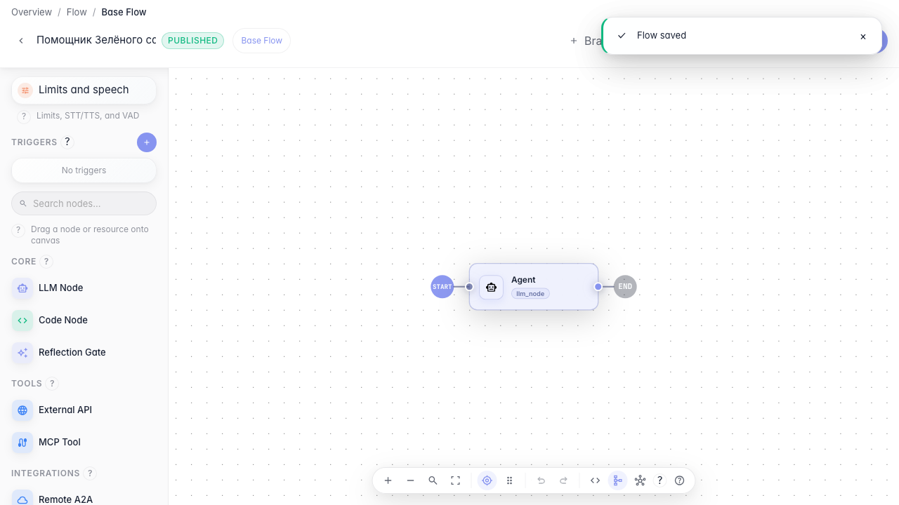
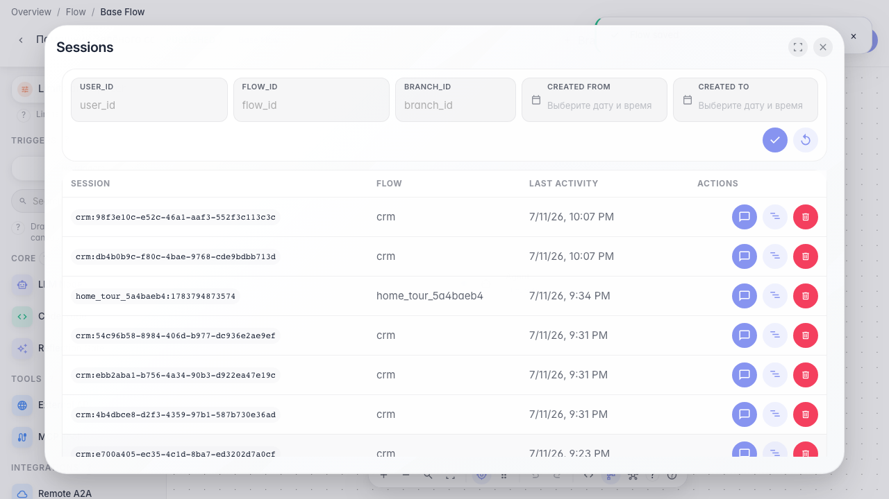
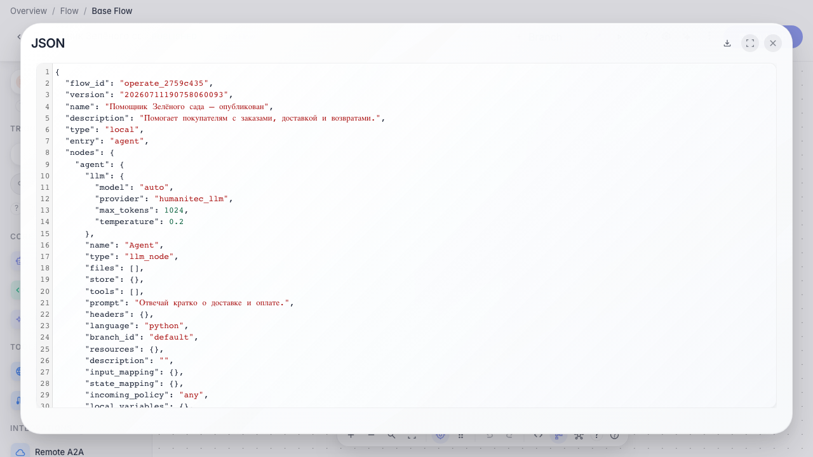

# Публикуем и управляем агентом

**Для чего:** эта инструкция поможет выпустить агента в работу и управлять его карточкой и сессиями.

**Какие проблемы решает:** после редактирования неясно, как сохранить рабочую версию, обновить описание и посмотреть диалоги.

**Результат:** агент опубликован, карточка обновлена, доступны сессии и JSON-конфиг.

## Шаг 1. Опубликуйте агента

Нажмите «Опубликовать» в шапке редактора. После этого пользовательский чат, API и гостевые ссылки используют сохранённую версию.

## Шаг 2. Обновите карточку агента

В меню редактора откройте «Настройки агента» и измените название с описанием. Эти поля видны в каталоге и в чате.

## Шаг 3. Откройте список сессий

Через меню редактора откройте «Сессии». Здесь можно найти прошлые диалоги и вернуться к проблемным обращениям.

## Шаг 4. Выгрузите JSON-конфигурацию

**Демонстрация результата.** Агент опубликован, карточка обновлена, сессии доступны, а JSON-конфиг можно сохранить для резервной копии.

**Итог.** Теперь вы умеете выпускать агента, управлять его карточкой и использовать операционные инструменты редактора.

