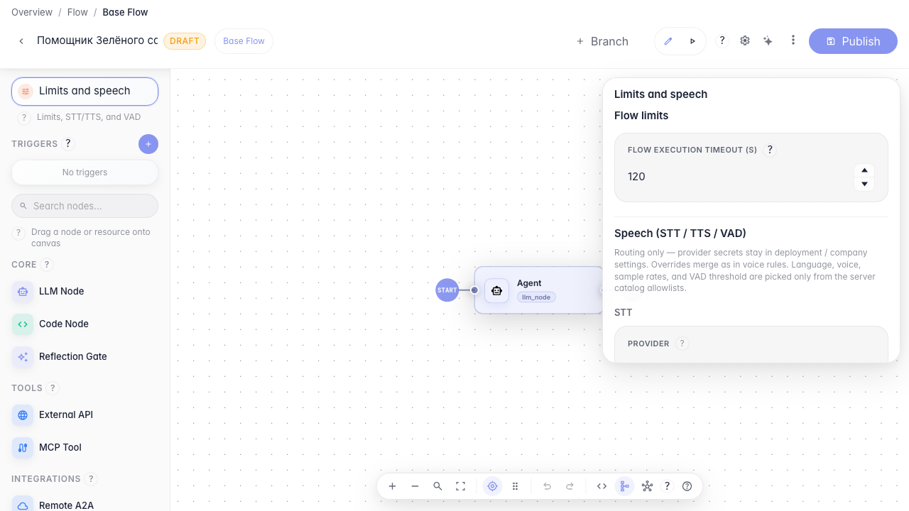
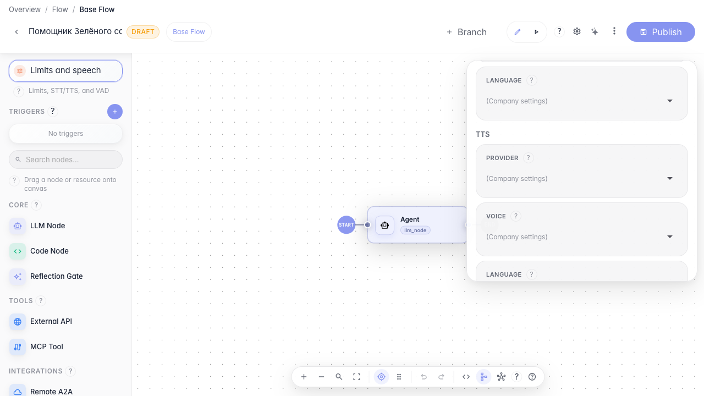

# Configure voice and limits

**What for:** this guide helps you set a time limit and speech profile for the agent.

**Problems it solves:** it is unclear where to enable voice settings and cap long runs without editing the graph.

**Result:** the agent has a timeout and speech options set in the UI.

## Step 1. Open agent limits and speech

In the editor left column, open Limits and speech. Here you set the maximum runtime and STT/TTS/VAD profile.

## Step 2. Review the speech settings block

Scroll the panel to the speech section. Here you choose TTS provider, voice, and language — profile setup only, without a real voice call.

