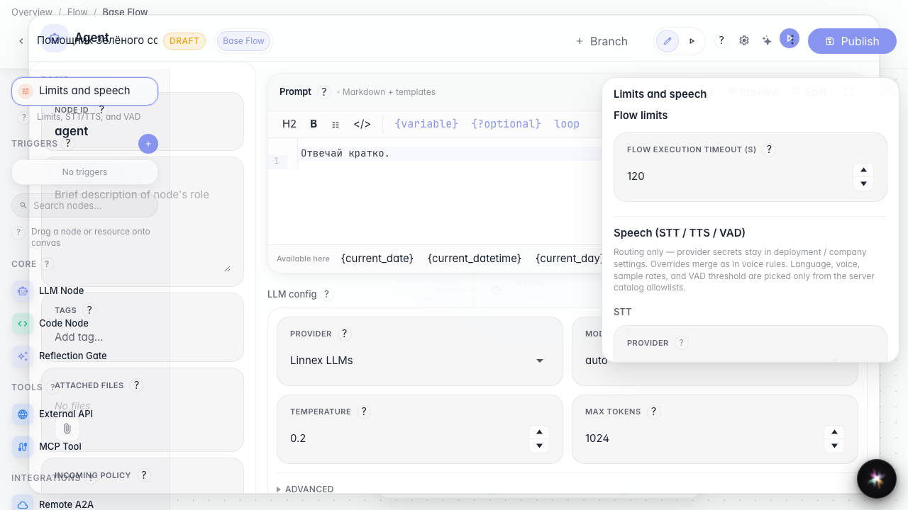
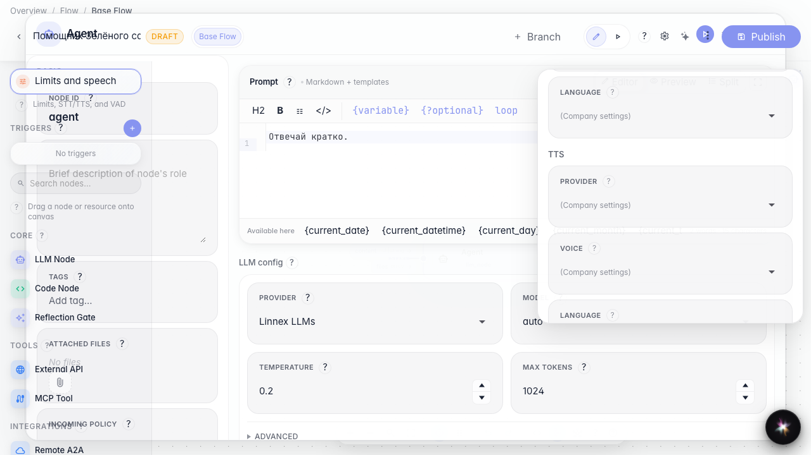
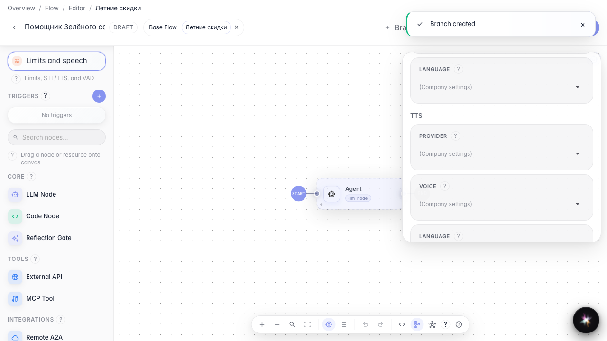

# Настраиваем голос и лимиты

**Для чего:** эта инструкция поможет задать лимит времени и профиль речи агента.

**Какие проблемы решает:** непонятно, где включить голосовой режим и ограничить долгие ответы без правки графа.

**Результат:** у агента задан таймаут и выбраны параметры речи в интерфейсе.

## Шаг 1. Откройте лимиты и речь агента

В левой колонке редактора откройте «Лимиты и речь». Здесь задаётся максимальное время выполнения и профиль STT/TTS/VAD.

## Шаг 2. Проверьте блок настроек речи

Прокрутите панель до раздела речи. Здесь можно выбрать провайдера синтеза, голос и язык — без реального голосового звонка, только настройка профиля.

## Шаг 3. Создайте ветку для отдельных настроек

Добавьте ветку «Летние скидки» и переключитесь на неё. Для разных сценариев можно задавать свои лимиты и профиль речи поверх настроек всего агента.

## Шаг 4. Переопределите речь в ветке

**Демонстрация результата.** В ветке «Летние скидки» виден отдельный блок речи ветки — значит, голос и лимиты можно настраивать точечно.

**Итог.** Теперь вы знаете, где задать таймаут агента и как переопределить профиль речи на уровне ветки.

