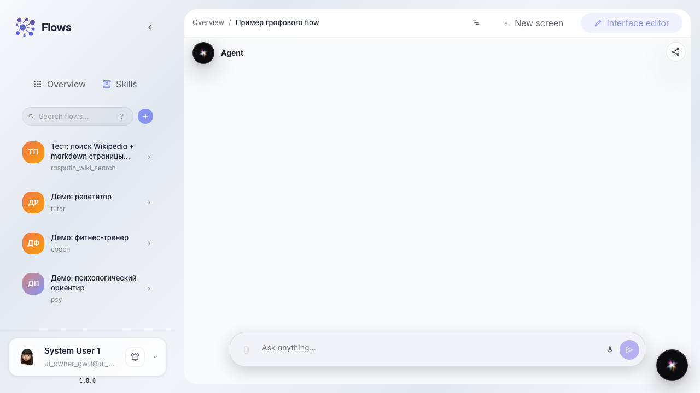
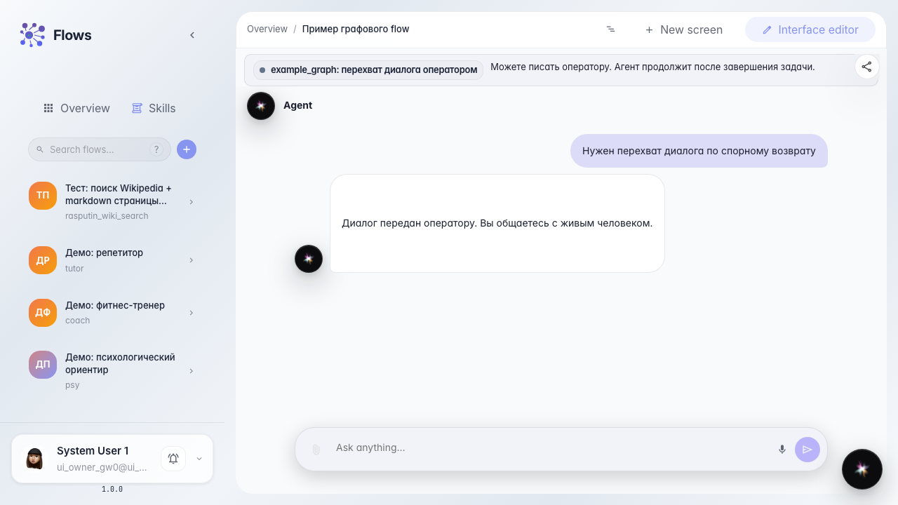
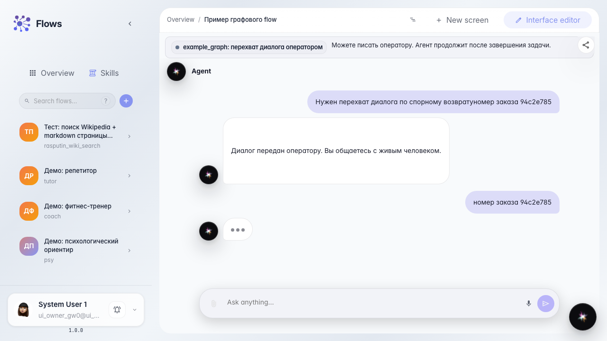

# Customer writes during dialog takeover

**What for:** this guide shows that in dialog takeover the customer can keep writing in the agent chat without waiting for the task to close.

**Problems it solves:** a disputed return needs details from both sides — if the customer input is locked, the operator never gets the order number in time.

**Result:** after handoff the customer sends a message, it appears in the thread, and the task stays open.

## Step 1. Open the agent chat

In Flows open the demo agent chat. This is the same screen the customer uses to write to the store.

## Step 2. Take the dialog to takeover

Write about a disputed return that needs takeover. A waiting banner appears, but the input stays enabled — this is takeover, not single-reply.

## Step 3. Send a follow-up while the task is open

Type the order number and send. The message appears in the chat thread.

## Step 4. Confirm the task is still open

**Result demonstration.** The waiting banner is still there and the operator task is still open: the customer added to the dialog without closing the handoff.

**Summary.** In takeover you can write from the customer chat while the operator handles the case.

